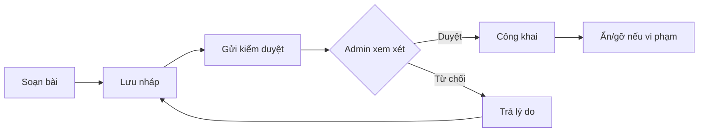
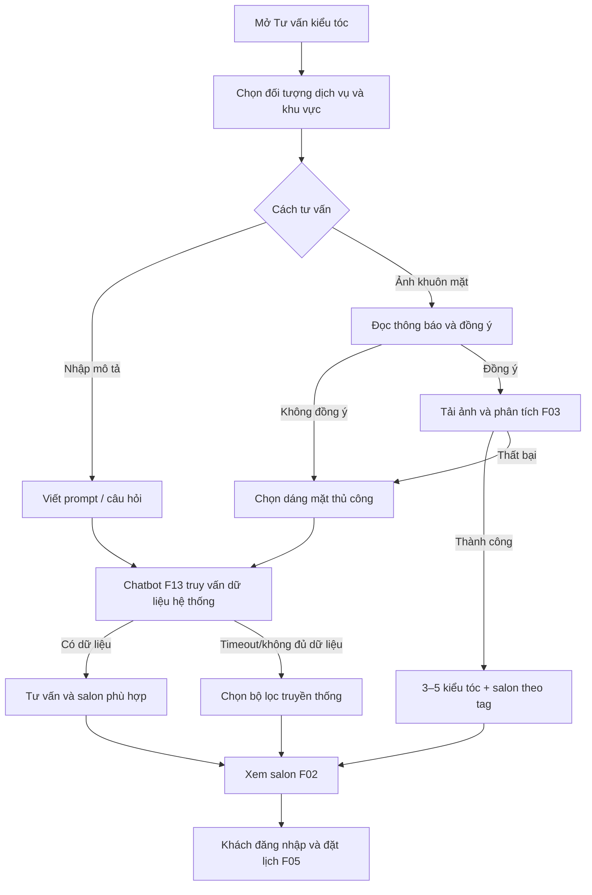

# ĐẶC TẢ GIAO DIỆN UI/UX WEBSITE SALONBOOK – 05 TRANG

**Dự án:** SalonBook – Nền tảng marketplace đặt lịch salon tóc tại TP.HCM  
**Loại tài liệu:** Đặc tả UI/UX chi tiết để thiết kế Figma, xây prototype, bàn giao frontend và lập test case  
**Phạm vi:** (1) Trang chủ, (2) Đặt lịch/Khám phá salon, (3) Blog, (4) Tư vấn kiểu tóc, (5) Về chúng tôi  
**Phiên bản:** 2.0 – mở rộng đặc tả chi tiết, ngày 23/10/2026  
**Nguồn ưu tiên:** `REQUIREMENTS.md` (F01–F13) → `business-workflow(1).md` → `style.css`, HTML hiện có → `README.md`, `AGENTS.md`, `PROJECT_PLAN.md`  
**Tính chất:** Đặc tả **đề xuất**, chưa phải xác nhận các trang đã được lập trình. Các số đo, vị trí và microcopy là quyết định thiết kế gợi ý; phần không có F-code được gắn nhãn chờ duyệt.

**Điểm mở rộng v2.0:** Bổ sung grid theo thiết bị, component IDs, copy mẫu, tương tác map–list, chi tiết wizard booking, phân quyền & duyệt Blog, quy tắc giới tính/vị trí trong tư vấn, cấu trúc prompt AI, ma trận lỗi và test case, danh mục frame Figma, nhật ký quyết định.

> **Nguyên tắc phân biệt phạm vi:** Các nghiệp vụ tìm/lọc salon, xem salon, đặt lịch, đăng nhập, phân tích ảnh khuôn mặt, chatbot, tuyển mẫu, đánh giá và phân quyền **được yêu cầu trong F01–F13**. **Trang Blog đa tác giả**, **Google Maps nhúng/bản đồ tương tác**, quy tắc thu thập **giới tính/vị trí để lọc kết quả tư vấn**, cũng như một số chức năng biên tập nội dung **do yêu cầu thiết kế mới đặt ra và/hoặc đề xuất UX**; cần được BA/leader bổ sung hoặc duyệt trong REQUIREMENTS trước khi được coi là hạng mục bắt buộc nghiệm thu. README/PROJECT_PLAN còn dùng F-code cũ (F01–F10), nên việc đối chiếu nghiệp vụ trong tài liệu này dùng REQUIREMENTS mới nhất làm chuẩn.

---

## 1. Mục tiêu trải nghiệm, đối tượng, cấu trúc website

### 1.1. Mục tiêu trải nghiệm

1. Trong vài thao tác, khách biết có salon nào phù hợp với nhu cầu và khu vực của mình.
2. Mọi thẻ salon chuyển được sang thông tin **đúng `salon_id`**, bảng giá, stylist, lịch còn trống và thao tác đặt lịch.
3. Người chưa đăng nhập được khám phá dịch vụ, bản đồ (nếu tích hợp), tư vấn F03/F13 và xem tin tuyển mẫu; chỉ khách đã đăng nhập được đặt lịch F05, ứng tuyển F04, xem lịch cá nhân F06 và đánh giá khi đủ điều kiện F07.
4. Tư vấn AI là con đường **khám phá/gợi ý**, không tự tạo booking và không tự tuyên bố giờ còn trống; cuối luồng vẫn phải kiểm tra khả dụng ở F05.
5. Đảm bảo khách dùng điện thoại và người không sử dụng được bản đồ/AI vẫn tìm được salon bằng bộ lọc và danh sách thông thường.

### 1.2. Vai trò có liên quan

| Vai trò | Truy cập 5 trang công khai | Ranh giới hành động |
|---|---|---|
| Guest (khách vãng lai) | Trang chủ, Đặt lịch (xem), Blog (đọc – đề xuất), Tư vấn F03/F13, Về chúng tôi | Không xác nhận booking; không ứng tuyển mẫu; không gửi đánh giá. |
| Customer | Các quyền công khai và các tác vụ sau đăng nhập | Đặt/hủy lịch của mình, ứng tuyển F04, đánh giá một lần sau booking Hoàn thành. Quyền tạo bài Blog cần phê duyệt bổ sung. |
| Salon Owner | Xem các trang công khai; vào dashboard quản trị | Quản lý **đúng salon mình**; tạo booking F05 từ hồ sơ mẫu F04 sau khi liên hệ. Quyền viết Blog đối tác cần đặc tả riêng. |
| Platform Admin | Xem các trang công khai; vào dashboard nền tảng | Duyệt/khóa salon, kiểm duyệt tuyển mẫu/đánh giá theo F12. Quyền biên tập/duyệt Blog là **đề xuất mới**, không đồng nghĩa đã có F12. |

### 1.3. Sơ đồ điều hướng đề xuất

```text
SalonBook
├── Trang chủ                      /                 [index.html hiện có]
├── Đặt lịch / Khám phá salon      /dat-lich          [products.html đang là trang danh sách sơ khai]
│   ├── Chi tiết salon            /salon/:salon_id   [product-detail.html sơ khai]
│   ├── Chọn dịch vụ / stylist / giờ
│   ├── Đăng nhập (nếu là Guest)
│   └── Xác nhận + mã booking     [F05; đường dẫn cần thống nhất]
├── Blog                           /blog              [trang mới – đề xuất]
│   └── Bài viết                   /blog/:slug        [trang mới – đề xuất]
├── Tư vấn kiểu tóc                /tu-van-kieu-toc   [trang mới: F03 + F13]
│   └── Kết quả → Chi tiết salon → Đặt lịch
└── Về chúng tôi                  /ve-chung-toi      [about.html hiện có]

Luồng phụ (không phải 5 trang chính): đăng nhập/đăng ký F08;
lịch của tôi F06; tin tuyển mẫu/ứng tuyển F04; dashboard Owner/Admin.
```

**Chú ý:** Các URL bắt đầu bằng `/...` là **quy ước đề xuất** cho thiết kế; những file HTML hiện có là `index.html`, `products.html`, `product-detail.html`, `about.html`. Chưa thay đường dẫn hay tạo code trong đặc tả này.

---

## 2. Hệ thống thiết kế thống nhất (Design System)

### 2.1. Bảng màu – giữ đúng CSS được nhóm chọn

| Token | Mã HEX | Công dụng đề xuất |
|---|---|---|
| `--color-primary` | **#355F3B** | Thanh header/footer, nút chính, tiêu đề nhấn, icon đang chọn. |
| `--color-accent` | **#C2E8F5** | Vùng nhấn nhẹ, chip đang chọn, highlight/hover có chữ tối màu. |
| `--color-background` | **#E8DCC4** | Nền chung trang, khu vực chuyển phần. |
| `--color-surface` | **#FFFDF8** | Nền card, form, modal, ô tìm kiếm, panel. |
| `--color-text` | **#26352B** | Văn bản nội dung, nhãn, tiêu đề trên nền sáng. |
| `--color-border` | **#D4CCBA** | Đường phân cách, viền input, card không kích hoạt. |

**Quy tắc màu:** Nút chính nền `#355F3B`, chữ `#FFFDF8`; chip xanh nhạt dùng chữ `#26352B` (không dùng chữ trắng trên xanh nhạt). Trạng thái lỗi/thành công có thể bổ sung token trạng thái sau khi nhóm thống nhất, không sử dụng màu đơn lẻ làm phương tiện truyền tải lỗi. Ảnh banner phải đủ lớp phủ/độ tương phản để dễ đọc chữ.

### 2.2. Kiểu chữ, tỷ lệ và nhịp khoảng cách

- **Font chuẩn hiện có:** `Arial, sans-serif` theo `style.css`. Không mặc định chuyển sang Poppins hay font khác khi nhóm chưa duyệt.
- Đề xuất desktop: H1 **40px/1.2**, H2 **28px/1.3**, H3 **20px/1.4**, nội dung **16px/1.6**, nhãn **14px/1.4**, chú thích **13px/1.4**.
- Mobile: H1 **28–30px**, H2 **22–24px**, thân bài **16px**; không thu nhỏ chữ input đến mức gây khó đọc.
- Weight: heading **700**, tên salon/CTA **600–700**, nội dung **400**, metadata **400–500**.
- Nhịp khoảng cách: 4, 8, 12, 16, 24, 32, 48, 64px; khoảng cách giữa các section desktop **56–72px**, mobile **32–40px**.
- Container **max-width 1200px**, chừa lề màn hình **16px mobile / 24px tablet / 32px desktop**.
- Card **bo góc 12px**, button **8px** (theo CSS); input/ô tìm kiếm 8px để thống nhất; ảnh card theo tỷ lệ 4:3, ảnh blog 16:9 (đề xuất).
- Vùng chạm nút/icon tối thiểu khoảng **44 × 44px**; có nhãn văn bản đi kèm cho icon chức năng quan trọng.

### 2.3. Header, menu và footer dùng chung

**Header desktop** (một hàng, nền xanh lá):

`[SalonBook]   [Trang chủ] [Đặt lịch] [Blog] [Tư vấn kiểu tóc] [Về chúng tôi]     [Lịch của tôi*] [Đăng nhập/Tài khoản]`

- Logo bên trái, menu giữa, công cụ tài khoản bên phải; mục đang xem có underline hoặc nền nhấn rõ ràng.
- Guest thấy **Đăng nhập/Đăng ký**; Customer thấy tên/avatar, menu **Lịch của tôi**, **Hồ sơ**, **Đăng xuất**; Owner/Admin có thêm lối vào dashboard theo quyền.
- `Lịch của tôi` chỉ hiển thị cho Customer đã đăng nhập; nút **Đặt lịch** ở các trang công khai vẫn cho Guest chuyển đến màn hình chọn salon nhưng yêu cầu đăng nhập **trước bước xác nhận cuối**.
- Chatbot F13 có nút nổi nhỏ góc dưới, không che CTA, có nút đóng; trang tư vấn vẫn có vùng hội thoại chính.

**Header mobile:** logo + icon tài khoản + nút mở menu; menu mở dạng panel có đầy đủ 5 trang, CTA Đặt lịch, đăng nhập; đóng khi chọn link hoặc nhấn Escape. Không ép 5 mục vào một dòng nhỏ.

**Footer:** tên SalonBook + thông điệp ngắn; cụm `Khám phá` (Đặt lịch, Blog, Tư vấn), `Hỗ trợ` (quy định đặt/hủy, liên hệ nếu nhóm cung cấp), `Thông tin` (Về chúng tôi, quyền riêng tư đối với ảnh), nhãn “Dự án học tập” phù hợp source hiện tại. **Không tự tạo** địa chỉ, hotline, email, mạng xã hội, giấy phép hay đối tác giả.

### 2.4. Thành phần giao diện và trạng thái chung

| Component | Quy cách / cách dùng | Trạng thái tối thiểu |
|---|---|---|
| Button Primary | Xanh lá đậm; chữ trắng/kem; nhãn là hành động cụ thể | Default, Hover, Focus, Disabled, Loading |
| Button Secondary | Nền trắng kem, viền xanh lá, chữ xanh lá | Default, Hover, Focus |
| Text input / search | Nền kem, viền trung tính, label luôn có | Empty, Filled, Focus, Error, Disabled |
| Select / chip filter | Vùng chọn rõ, có thao tác xóa/xóa tất cả | All, Selected, Disabled |
| Salon card | Ảnh, tên, vị trí, phân loại, tag, điểm trung bình, giá từ menu nếu có, CTA | Loading, Loaded, Không đủ dữ liệu |
| AI suggestion card | Ảnh/kiểu tóc, lý do phù hợp, salon gợi ý | Loading, Result, No-match, Error |
| Feedback | Inline validation, toast xác nhận, trạng thái rỗng | Không dùng toast thay cho thông báo lỗi chính |
| Modal | Đăng nhập, xác nhận, đồng ý sử dụng ảnh | Có nút đóng; quản lý focus và hỗ trợ bàn phím |
| Skeleton | Khối chờ dữ liệu danh sách/bản đồ/AI | Hiện trong lúc nạp, tránh layout giật |

### 2.5. Tiêu chuẩn responsive và hỗ trợ truy cập

| Kích thước | Tổ chức giao diện đề xuất |
|---|---|
| Desktop ≥ 1200px | Container 1200px; trang Đặt lịch 3 vùng bộ lọc + danh sách + bản đồ; hero hai cột. |
| Tablet 768–1199px | Bộ lọc thu gọn; danh sách + bản đồ chuyển hai vùng hoặc nút đổi chế độ. |
| Mobile < 768px | Một cột; card toàn bề rộng; filter dạng drawer; danh sách/bản đồ chuyển tab; menu hamburger. |

- Điều hướng bằng bàn phím với focus nhìn thấy được; label cho input; `alt` cho ảnh có nội dung; không dùng alt thừa với ảnh trang trí.
- Mọi tương tác bản đồ có phương án **danh sách địa chỉ** tương đương; không bắt buộc cấp quyền vị trí thiết bị.
- Trường nhập liệu dùng thông báo lỗi ngay sát trường; thể hiện cả **vì sao lỗi và cách sửa**.
- Thiết kế ảnh và nội dung thân thiện với kết nối chậm: có ảnh placeholder, bản đồ lỗi thì vẫn hiển thị danh sách salon.

---

### 2.6. Quy chuẩn kích thước và lưới để dựng Figma (đề xuất UI)

Các con số dưới đây là **design decisions đề xuất** để nhóm có thể dựng giao diện nhất quán; không phải yêu cầu kỹ thuật đã có trong `REQUIREMENTS.md`.

| Token/khung | Desktop 1440px | Tablet 834px | Mobile 390px | Mục đích |
|---|---:|---:|---:|---|
| Container | Max 1200px, căn giữa | Margin 24px | Margin 16px | Thống nhất vị trí mọi section |
| Cột lưới | 12 cột, gutter 24px | 8 cột, gutter 16px | 4 cột, gutter 12px | Auto-layout và responsive |
| Chiều cao header | 76px | 68px | 64px | Không che phần nội dung |
| Chiều cao nút chính | 48px | 48px | 48px | Dễ thao tác cảm ứng |
| Chiều cao input/select | 48px | 48px | 48px | Tránh quá nhỏ trên mobile |
| Khoảng cách section | 64px | 48px | 36px | Dễ đọc theo nhịp thị giác |
| Đường bo card | 12px | 12px | 12px | Theo `style.css` |
| Đường bo nút | 8px | 8px | 8px | Theo `style.css` |

**Gợi ý Auto Layout Figma:** Page Frame → Header/Body/Footer; mỗi section đặt trong Container; form và card dùng Auto Layout với `gap=16/24`; tạo variants cho button/input/card; không cố định chiều cao card chứa văn bản; ưu tiên `Hug contents` để tránh tràn khi tiếng Việt dài.

### 2.7. Bộ component dùng chung và giao diện từng trạng thái

| ID | Component | Hình thức chính xác cần thể hiện | Hành vi/khi nào xuất hiện |
|---|---|---|---|
| C-01 | Header/TopNav | Logo trái, menu giữa, tài khoản phải; mục active được gạch dưới | Dùng ở cả 5 trang |
| C-02 | Navigation drawer | Tiêu đề `Menu`, nút X, 5 link, khối tài khoản | Mobile khi nhấn menu; overlay có thể đóng |
| C-03 | Button primary | Nền xanh lá, chữ trắng, có padding ngang 20–24px | Cho một hành động chính mỗi vùng |
| C-04 | Button secondary | Nền kem, viền xanh lá, chữ xanh lá | Chọn phương án thay thế, không cạnh tranh CTA |
| C-05 | Search input | Label ngoài, icon tìm kiếm, placeholder gợi ý | Nhấn Enter tương đương bấm Tìm |
| C-06 | Select/filter chip | Label, icon chevron, trạng thái được chọn | Giữ lại lựa chọn khi chuyển trang nếu phù hợp |
| C-07 | Salon card | Ảnh 4:3, tên, địa chỉ, tag, sao hoặc `Chưa có đánh giá`, CTA | Tất cả dữ liệu thuộc đúng `salon_id` |
| C-08 | Article card | Ảnh 16:9, loại tác giả, ngày, tiêu đề, tóm tắt 2 dòng | Blog công khai nếu được duyệt |
| C-09 | Alert inline | Icon + tiêu đề lỗi + giải pháp khắc phục | Dữ liệu rỗng, AI lỗi, map lỗi, booking conflict |
| C-10 | Confirmation dialog | Tiêu đề, nội dung, hành động chính và Hủy/Đóng | Dùng cho hành động có hậu quả hoặc quyền riêng tư |
| C-11 | Progress stepper | Các bước có số, nhãn ngắn và bước hiện tại | Trong quy trình F05, mobile hiển thị `Bước 2/5` |
| C-12 | Chat bubble | Phân biệt lời người dùng và AI; nguồn dữ liệu gợi ý không bị nhầm | Trang Tư vấn, có vùng cuộn riêng |

**Trạng thái chung mỗi component:** `default`, `hover` (desktop), `focus-visible`, `disabled`, `loading`, `error` (nếu áp dụng), `success` (nếu áp dụng). Mọi thao tác có kết quả phải có xác nhận hiển thị, không chỉ thay đổi màu.

### 2.8. Quy tắc điều hướng, nội dung và khả năng tiếp cận

1. Header phải giữ cùng thứ tự 5 mục trên mọi trang; trạng thái hiện tại có thể nhận diện được cả bằng chữ/gạch chân chứ không chỉ màu sắc.
2. Breadcrumb xuất hiện ở trang kết quả sâu: `Trang chủ / Đặt lịch / Tên salon`, `Blog / Tên bài`; 5 trang cấp một có thể không hiển thị breadcrumb ở phần hero.
3. Chỉ sử dụng **một H1 cho mỗi màn**; các tiêu đề section là H2; card heading là H3. Tiêu đề tối ưu hai dòng, không cắt từ giữa tiếng Việt.
4. Thẻ liên kết dùng để **đi đến trang**; nút dùng để **thực hiện hành động** như lọc, gửi form, chọn ảnh, mở drawer. Không làm thẻ link vô tác dụng.
5. Hỗ trợ tab/Enter/Space và Escape cho drawer, dialog; focus trả về nút đã mở sau khi đóng. Thông báo validation nằm cạnh trường và được gắn với label.
6. Thanh tìm kiếm không cần định vị thiết bị; giá trị vùng có thể chọn thủ công. Nếu tính năng địa lý được duyệt, chỉ yêu cầu quyền vị trí khi có thao tác chủ động.
7. Khi gọi API, tạm khóa nút gửi để hạn chế gửi lặp; khi lỗi mạng, cho phép thử lại và giữ những trường đã nhập **không nhạy cảm**.
8. Không được hiển thị ảnh, địa chỉ, số điện thoại hoặc thống kê của salon giả như thông tin đã hoạt động thật. Trong Figma có thể dùng dữ liệu giả **được ghi rõ là mock data**.
9. Không hiển thị dữ liệu cá nhân trong URL, preview bản đồ, danh sách blog hoặc công khai prompt AI. Dữ liệu salon công khai và dữ liệu khách hàng phải tách nhau.
10. Không đưa cách triển khai chat AI, Google Maps, Blog hay cấu hình API key vào nội dung UI công khai; các giới hạn này thuộc thiết kế kỹ thuật riêng.

---

## 3. TRANG 01 – TRANG CHỦ

**Tên trang/URL đề xuất:** `Trang chủ` / `/` (`index.html` hiện có)  
**Mục tiêu:** Giúp người mới hiểu SalonBook, bắt đầu tìm salon/đặt lịch hoặc khám phá tư vấn/tuyển mẫu.  
**Liên kết yêu cầu:** F01, F02, F03, F04, F05, F07, F08, F13.  
**Đối tượng:** Guest, Customer; nội dung công khai.

### 3.1. Bố cục desktop từ trên xuống

```text
┌─────────────────────────────────────────────────────────────────────────┐
│ HEADER: Logo | Trang chủ | Đặt lịch | Blog | Tư vấn | Về chúng tôi | User │
├─────────────────────────────────────────────────────────────────────────┤
│ HERO: Thông điệp + thanh tìm kiếm nhanh     | Ảnh salon/chăm sóc tóc    │
│      [Khu vực ▼] [Dịch vụ ▼] [Tìm salon →]  |                          │
│      [Tư vấn kiểu tóc cùng AI]              |                          │
├─────────────────────────────────────────────────────────────────────────┤
│ DANH MỤC NHANH: Cắt tóc | Uốn/Nhuộm | Gội dưỡng sinh | Phục hồi tóc     │
├─────────────────────────────────────────────────────────────────────────┤
│ SALON NỔI BẬT  [Card] [Card] [Card]  → [Xem tất cả salon]               │
├─────────────────────────────────────────────────────────────────────────┤
│ HỖ TRỢ TƯ VẤN: Ảnh minh họa | Tải ảnh/chọn dáng mặt | CTA Tư vấn         │
├─────────────────────────────────────────────────────────────────────────┤
│ TUYỂN MẪU TÓC: Card tin đã duyệt | Card tin đã duyệt → Xem tin           │
├─────────────────────────────────────────────────────────────────────────┤
│ QUY TRÌNH: 1 Tìm salon → 2 Chọn lịch → 3 Đến trải nghiệm                │
├─────────────────────────────────────────────────────────────────────────┤
│ GÓC KIẾN THỨC / BLOG: 3 bài viết mới (chỉ sau khi module Blog được duyệt)│
├─────────────────────────────────────────────────────────────────────────┤
│ FOOTER: Khám phá | Hỗ trợ | Thông tin | Dự án học tập                   │
└─────────────────────────────────────────────────────────────────────────┘
```

### 3.2. Đặc tả thành phần

| Khu vực | Thành phần, nội dung | Hành vi/điều hướng | Ghi chú nguồn |
|---|---|---|---|
| 1. Header | Logo và 5 mục menu | Logo → `/`; Đặt lịch → `/dat-lich`; Blog → `/blog`; Tư vấn → `/tu-van-kieu-toc` | Header 5 mục là yêu cầu trang mới; HTML hiện có chỉ có 3 link. |
| 2. Hero | H1 “Tìm salon phù hợp. Đặt lịch thật dễ dàng.”, mô tả ngắn, ảnh ngành tóc (không dùng ảnh giả đánh giá), thanh tìm kiếm | Tìm bằng khu vực + nhóm dịch vụ → `/dat-lich` giữ lại điều kiện đã chọn | F01; câu chữ là đề xuất. |
| 3. Danh mục nhanh | Thẻ Cắt, Uốn/Nhuộm, Gội dưỡng sinh, Phục hồi; icon/ảnh đại diện | Bấm thẻ → danh sách salon đã lọc theo tag tương ứng | F01/F02. |
| 4. Salon nổi bật | 3–4 card với ảnh đại diện, tên, địa chỉ, tag, sao trung bình, CTA **Xem chi tiết/Đặt lịch** | Bấm card → `/salon/:salon_id`; CTA → luồng F05 sau khi chọn dịch vụ | F01/F02/F07; tiêu chí “nổi bật” phải có quy tắc nhóm duyệt, không tự gắn nhãn “hàng đầu”. |
| 5. AI nổi bật | Hình minh họa, mô tả “Khám phá kiểu tóc hợp với bạn” | CTA **Tư vấn kiểu tóc** → `/tu-van-kieu-toc` | F03/F13. |
| 6. Tuyển mẫu | 2–3 tin đang được duyệt/công khai, loại dịch vụ, điều kiện cơ bản, chi phí/ưu đãi do salon cung cấp | CTA **Xem cơ hội làm mẫu** → danh sách F04 (đường dẫn phụ cần định nghĩa); Guest chỉ xem | F04, F12; không viết “miễn phí” với mọi tin. |
| 7. Quy trình 3 bước | Các bước từ khám phá đến xác nhận booking | Link “Đặt lịch ngay” → `/dat-lich` | F01/F02/F05, giải thích phải đăng nhập để xác nhận. |
| 8. Blog xem trước | Bài mới với ảnh, nhãn tác giả (Admin/Khách hàng/Đối tác), tóm tắt | Bấm card → `/blog/:slug` | **Đề xuất mới**, chỉ sử dụng khi Blog được duyệt. |
| 9. Footer | Liên kết thông tin, quyền riêng tư, mô tả học thuật nếu công khai | Điều hướng các trang phù hợp | Chưa có dữ liệu liên hệ chính thức. |

### 3.3. Bảng màu, typography và khoảng cách riêng

- Hero nền `#FFFDF8` hoặc nền be `#E8DCC4`, chữ H1 `#355F3B`; CTA chính xanh lá.
- Thanh tìm kiếm nền trắng kem, cao 48–52px; nhóm điều khiển đều nhau; chỉ đặt icon ở đầu input, không thay label.
- Các thẻ salon nền trắng kem, border `#D4CCBA`, shadow rất nhẹ; ảnh trên đầu card.
- Section AI dùng dải nền xanh lam nhạt `#C2E8F5`, chữ tối `#26352B`.
- Trên mobile, hero thành 1 cột, tìm kiếm xếp `Khu vực → Dịch vụ → Tìm`; salon card cuộn dọc, không ép 4 cột.

### 3.4. Trạng thái và tiêu chí nghiệm thu UI

- Khi không có salon đủ điều kiện hiển thị: hiện “Chưa có salon phù hợp. Hãy thử khu vực hoặc dịch vụ khác”, CTA **Đổi bộ lọc**.
- Không sử dụng số lượng khách/đơn, mức hài lòng, đánh giá, logo đối tác giả khi chưa có dữ liệu.
- Nút “Đặt lịch” của Guest chuyển được đến khám phá, nhưng yêu cầu đăng nhập trước xác nhận F05.
- Trên mobile vẫn thấy rõ CTA tìm salon và CTA tư vấn ngay đầu trang.
- Tin tuyển mẫu chỉ lấy tin F04 **Đã duyệt/Public** và còn được phép công khai.

---

### 3.5. Chi tiết từng khối để bàn giao thiết kế (Desktop → Mobile)

| ID | Vị trí/kích thước đề xuất | Thành phần nội bộ | Bấm/nhập → Phản hồi mong đợi |
|---|---|---|---|
| H-01 | Header cao 76px, full width | Logo 160–180px; menu 5 mục; đăng nhập/tài khoản | Active nav đúng; logo về trang chủ; mobile chuyển drawer |
| H-02 | Hero 2 cột tỷ lệ 55/45, padding dọc 64px | H1 tối đa 2–3 dòng, mô tả, tìm khu vực/dịch vụ, ảnh | `Tìm salon` đưa đến `/dat-lich`, bộ lọc được giữ lại |
| H-03 | Search bar trong hero, cao 52px mỗi ô | Select khu vực, select chuyên môn, nút Tìm | Không chọn khu vực = toàn TP.HCM; không chọn dịch vụ = tất cả |
| H-04 | Danh mục nhanh dạng grid 4 cột | Ảnh/icon + tên dịch vụ + mô tả rất ngắn | Click card mang tag dịch vụ sang trang Đặt lịch |
| H-05 | Khu salon nổi bật, grid 3 card (hoặc 4 khi đủ chỗ) | Tên, ảnh, địa chỉ, tag, sao, CTA | Chỉ salon hoạt động; click CTA đúng salon |
| H-06 | Dải giới thiệu AI, 2 cột | Lý do sử dụng, ảnh minh họa, CTA `Thử tư vấn` | Chuyển đến `/tu-van-kieu-toc`, không upload ảnh ngay |
| H-07 | Tin tuyển mẫu, 2–3 card | Tên tin, salon, khu vực, yêu cầu tóc, hỗ trợ/chi phí | Điều hướng vào trang tin F04; Guest chỉ xem |
| H-08 | Quy trình đặt lịch, 3 bước | Số thứ tự lớn, tên bước, lời mô tả | Là thông tin giới thiệu, không giả lập đã đặt thành công |
| H-09 | Bài Blog, 3 card | Ảnh, nhãn người viết, title, excerpt, ngày đăng | Chỉ xuất hiện khi Blog được duyệt và có bài công khai |
| H-10 | Footer 3–4 nhóm link | Giới thiệu, khám phá, hỗ trợ, chính sách | Link trỏ đúng màn; không đặt địa chỉ giả |

**Bố cục dọc / khoảng cách thực thi:** Header → Hero (48–64px nội bộ) → danh mục (64px) → salon nổi bật (64px) → AI (64px) → tuyển mẫu (64px) → ba bước (64px) → Blog (64px) → Footer. Trên mobile giảm khoảng cách giữa section xuống ~36px; thứ tự giữ nguyên, riêng ảnh hero đặt **sau** H1/tìm kiếm để CTA xuất hiện sớm.

### 3.6. Copywriting mẫu cho bản Figma

| Thành phần | Văn bản hiển thị đề xuất | Quy tắc nội dung |
|---|---|---|
| H1 Hero | **Tìm salon phù hợp với bạn, đặt lịch chỉ trong vài bước.** | Không cam kết dịch vụ hoàn thành tức thì |
| Hero subheading | `Khám phá salon tại TP.HCM theo khu vực, chuyên môn và lịch trống.` | Phù hợp mô hình marketplace |
| Placeholder khu vực | `Chọn quận hoặc khu vực` | Không giả định vị trí người dùng |
| Placeholder chuyên môn | `Bạn muốn làm dịch vụ gì?` | Tương thích các nhóm cắt/uốn/nhuộm... |
| CTA chính | `Tìm salon` | Hành động dễ hiểu hơn `Bắt đầu` |
| CTA AI | `Tư vấn kiểu tóc cùng AI` | Sang trang riêng, không tự phân tích khi chưa đồng ý |
| Salon không có đánh giá | `Chưa có đánh giá` | Không ghi 0 sao hoặc 5 sao giả |
| Chưa có tin tuyển mẫu | `Chưa có cơ hội tuyển mẫu được công khai.` | Có đường chuyển sang Đặt lịch thông thường |

### 3.7. Trạng thái tương tác của Trang chủ

- **Loading salon:** hiển thị 3 skeleton card có chiều cao tương đối ổn định, không nhấp nháy thay toàn trang.
- **Không có salon:** tiêu đề thân thiện, CTA `Khám phá tất cả salon`; section vẫn giữ bố cục, không để một khoảng trắng lớn.
- **Tìm kiếm có kết quả:** mang bộ lọc sang Đặt lịch (query/route-state tùy triển khai); nhấn Back quay về các lựa chọn cũ nếu trình duyệt hỗ trợ.
- **Tìm kiếm không có kết quả:** chuyển sang trang danh sách rỗng kèm nút `Xóa bộ lọc`; không hiển thị lỗi hệ thống khi thực tế là không tìm thấy dữ liệu.
- **Guest chọn Đặt lịch:** có thể chọn salon/dịch vụ/giờ để khảo sát; yêu cầu đăng nhập ở bước xác nhận, sau đăng nhập kiểm tra lại slot.
- **Ảnh không tải được:** dùng placeholder salon/kiểu tóc, tên salon vẫn đọc được, không hiển thị icon lỗi ảnh của trình duyệt.

**Checklist kiểm thử riêng:** H-01 menu chính có 5 link; H-03 truyền điều kiện; H-05 dùng đúng salon; H-07 chỉ tin đã duyệt; H-09 không dùng nội dung chưa duyệt; tại 390px không có cuộn ngang; hai CTA chính xuất hiện trước phần cuộn dài.

---

## 4. TRANG 02 – ĐẶT LỊCH (BỘ LỌC + DANH SÁCH SALON + GOOGLE MAPS)

**Tên trang/URL đề xuất:** `Đặt lịch` / `/dat-lich` (liên kết tới `products.html` trong prototype hiện tại)  
**Mục tiêu:** Tìm salon theo điều kiện, đối chiếu kết quả **danh sách và bản đồ**, mở chi tiết và hoàn thành đặt chỗ.  
**Liên kết yêu cầu:** F01, F02, F05, F06, F08, F09, F10, F11, F12.  
**Mới ngoài REQUIREMENTS:** Google Maps nhúng, tương tác chọn điểm đánh dấu, chia sẻ vị trí/map, tùy chọn sắp xếp hoặc lọc khoảng cách nếu triển khai.

### 4.1. Bố cục desktop đề xuất

```text
┌──────────────────────────────────────────────────────────────────────────────┐
│ HEADER: ...                                                                 │
├──────────────────────────────────────────────────────────────────────────────┤
│ [Trang chủ / Đặt lịch]   H1: Khám phá & đặt lịch salon tại TP.HCM             │
│ [Tìm theo tên salon/dịch vụ________________]  [Khu vực ▼] [Tìm kiếm]          │
├────────────────┬──────────────────────────────────┬─────────────────────────┤
│ BỘ LỌC (230px) │ DANH SÁCH SALON (~440px)         │ GOOGLE MAP (~470px)     │
│ Khu vực        │ [Số kết quả] [Xóa lọc]          │ [Pin theo salon]       │
│ Loại hình      │ ┌──────────────────────────────┐ │                         │
│ Nam/Nữ/Unisex  │ │ Ảnh Tên salon    Điểm ⭐     │ │ Chọn pin → popup      │
│ Dịch vụ        │ │ Địa chỉ, chuyên môn, giá...  │ │ tên/địa chỉ/xem salon │
│ [Áp dụng]      │ │ [Xem chi tiết] [Đặt lịch]    │ │                         │
│ [Xóa tất cả]   │ └──────────────────────────────┘ │ [Mở Google Maps ↗]    │
│                │  ...                             │                         │
└────────────────┴──────────────────────────────────┴─────────────────────────┘
```

**Tỷ lệ gợi ý:** sidebar ~230px, danh sách 430–450px, bản đồ dùng phần bề ngang còn lại; khoảng cách 16px. Vùng kết quả/bản đồ có thể cuộn độc lập trên desktop nếu trải nghiệm không gây khó khi dùng bàn phím.

### 4.2. Bộ lọc, tìm kiếm và quy tắc dữ liệu

| Điều khiển | Giá trị/nguồn dữ liệu | Hành vi UI | Tình trạng |
|---|---|---|---|
| Ô tìm kiếm | Tên salon hoặc nhóm dịch vụ | Nhấn Enter/nút Tìm → lọc danh sách; giữ từ khóa khi xem/đóng map | Phù hợp mục tiêu nghiệp vụ; cần BA chốt phạm vi từ khóa. |
| Khu vực TP.HCM | Danh sách quận/khu vực đã được chuẩn hóa trong CSDL | Chọn một hoặc nhiều nếu dữ liệu hỗ trợ; giá trị mặc định “Toàn TP.HCM” | **F01 bắt buộc**. |
| Loại salon | Salon Nam/Barbershop, Salon Nữ, Salon Unisex | Chọn giá trị; lọc salon đúng tag phân loại | **F01 bắt buộc**. |
| Chuyên môn | Cắt, Uốn/Nhuộm, Gội dưỡng sinh, Phục hồi... | Nhóm danh mục/tags, cho phép chọn phù hợp | **F01 bắt buộc**. |
| Giá tham khảo | Giá từ các menu dịch vụ theo từng salon | Chỉ hiển thị khi định nghĩa cách tính (giá từ/giá dịch vụ) | **Đề xuất**, chưa có quy tắc lọc giá trong F01. |
| Khoảng cách | Tọa độ salon và vị trí khách được tự nguyện cấp, hoặc tâm khu vực chọn | Không bật sẵn định vị; không cam kết độ chính xác khi thiếu tọa độ | **Đề xuất**, cần duyệt thêm. |
| Sắp xếp | Phù hợp, điểm đánh giá, khoảng giá... | Không dùng tiêu chí “gần nhất” nếu không có dữ liệu vị trí đáng tin cậy | **Đề xuất**, cần định nghĩa công thức. |
| Xóa tất cả | Đặt lại điều kiện về mặc định | Đồng bộ danh sách và map về bộ dữ liệu ban đầu | UX cơ bản. |

**Quy tắc đồng bộ bắt buộc khi thiết kế map:** Sau mỗi lần lọc, **danh sách và pin chỉ thể hiện tập salon phù hợp cùng bộ lọc**, đồng thời loại salon đã bị Admin khóa F12. Nếu một salon chưa có tọa độ nhưng có địa chỉ, **giữ salon trong danh sách**, không bịa tọa độ hay loại khỏi kết quả; ghi “Chưa có vị trí trên bản đồ” nếu cần.

### 4.3. Thẻ salon trong danh sách

Mỗi thẻ gồm: (1) ảnh cover/ảnh đại diện salon; (2) tên; (3) nhãn nam/nữ/unisex; (4) quận/khu vực và địa chỉ; (5) tag dịch vụ mạnh; (6) điểm trung bình F07 (chỉ khi có dữ liệu hợp lệ); (7) giá tham khảo có ghi rõ dịch vụ nếu có; (8) **Xem chi tiết**; (9) **Đặt lịch**. Không biểu diễn “còn chỗ” từ dữ liệu bản đồ; thời gian trống thực tế được tính F05 + F10.

**Tương tác:** Rê chuột vào card làm nổi pin tương ứng; chọn pin làm nổi card/tự cuộn đến card; bấm CTA mở đúng `salon_id`. Nếu không có sao thì ghi “Chưa có đánh giá”, không mặc định 5 sao. Ảnh hỏng → ảnh placeholder.

### 4.4. Google Maps – chi tiết tính năng đề xuất

1. **Nguồn dữ liệu:** `salon_id`, `name`, `address`, `latitude`, `longitude`, trạng thái hoạt động. Tọa độ phải được lưu/đối chiếu có căn cứ; khóa API và cấu hình không đưa thẳng lên repository.
2. **Trạng thái ban đầu:** bản đồ hiển thị khu vực TP.HCM và các salon có tọa độ hợp lệ/đang hoạt động trong kết quả; **không** tự định vị địa chỉ cá nhân của người dùng.
3. **Pin:** mỗi salon một marker; nếu các điểm rất gần nhau, có thể dùng gom cụm marker (đề xuất cho dữ liệu nhiều salon).
4. **Click pin:** popup tên salon, ảnh thumbnail nếu có, địa chỉ, điểm trung bình nếu có, nút **Xem salon**; click popup → đúng `/salon/:salon_id`.
5. **Click thẻ salon:** đưa map focus đến pin tương ứng nếu tồn tại; nếu thiếu tọa độ thì không dịch bản đồ.
6. **Đổi bộ lọc:** cập nhật cùng tập kết quả trên list và map; không giữ pin thuộc salon vừa bị loại/khóa.
7. **Mở chỉ đường:** liên kết ngoài **Mở bằng Google Maps** từ địa chỉ/tọa độ đã xác thực; không cần xây chức năng dẫn đường nội bộ.
8. **Không được tải map:** thay bằng thông báo “Bản đồ hiện không khả dụng. Bạn vẫn có thể chọn salon từ danh sách” và địa chỉ có thể copy/mở ngoài.
9. **Quyền riêng tư:** chỉ yêu cầu quyền vị trí khi khách chủ động chọn “Dùng vị trí của tôi” (nếu tính năng này được duyệt); nếu từ chối thì vẫn lọc theo khu vực thủ công.

**Phạm vi kỹ thuật cần chốt:** dùng Google Maps JavaScript API/Embed hay liên kết ngoài, chi phí/billing/quota, dữ liệu tọa độ, quy tắc xếp kết quả. **Đây chưa phải khả năng đã có trong source HTML**; có thể thiết kế vùng map placeholder trước khi tích hợp.

### 4.5. Nhánh đặt lịch sau khi chọn salon (F02 → F05)

| Màn / bước | Giao diện bắt buộc | Kiểm tra / chuyển hướng |
|---|---|---|
| 1. Chi tiết salon | Ảnh, địa chỉ, menu, giá, thời lượng, stylist, đánh giá, CTA Đặt lịch | Thông tin lấy đúng `salon_id` F02/F09. |
| 2. Chọn dịch vụ | Danh mục dịch vụ, tên, giá tại thời điểm hiện tại, thời lượng | Chỉ dịch vụ thuộc salon, có thể đặt. |
| 3. Chọn stylist | Danh sách stylist thuộc salon đã chọn | Không cho chọn người không thuộc salon. |
| 4. Chọn ngày/giờ | Calendar ngày tương lai; slot theo lịch làm và cấu hình F10; slot không khả dụng bị khóa | Xét duration, bước nhảy slot, buffer và ngày nghỉ; không chỉ nhìn giờ bắt đầu. |
| 5. Xác nhận | Tóm tắt salon, dịch vụ, stylist, ngày/giờ, giá chốt, tài khoản | Guest phải đăng nhập F08; giữ lựa chọn khi quay lại sau đăng nhập; backend kiểm tra lần cuối. |
| 6. Kết quả | Mã booking, trạng thái **Chờ xác nhận**, thông tin lịch và link **Lịch của tôi** | Chỉ báo thành công sau khi DB ghi xong; *Chờ xác nhận* không đồng nghĩa salon đã xác nhận. |

**Trạng thái chung:** `Chờ xác nhận → Đã xác nhận → Đang phục vụ → Hoàn thành` hoặc `Hủy/Đã hủy` (cách gọi lưu/hiển thị cần nhóm chốt). Khách được hủy khi cách giờ hẹn **ít nhất 2 giờ**, đúng quyền và trạng thái; không có giao diện “Đổi giờ trực tiếp”: thông báo “Hủy lịch cũ rồi đặt lịch mới”. Giá ghi trong booking không thay đổi khi salon sửa giá sau này.

### 4.6. Mobile, lỗi, nghiệm thu

- Mobile: tiêu đề + ô tìm kiếm → chip bộ lọc tóm tắt → hai tab **Danh sách** | **Bản đồ**. Nút **Bộ lọc** mở drawer; áp dụng thì đóng drawer và làm mới cả hai tab.
- Khi không có kết quả: hiển thị lý do “Không tìm thấy salon phù hợp”, nút **Xóa bộ lọc**, vẫn có đường quay lại tìm kiếm.
- Khi map không có điểm nhưng danh sách có salon: **không** báo không có salon; danh sách tiếp tục sử dụng được.
- Khi slot vừa bị khách khác đặt: xác nhận thất bại, hiện “Giờ này vừa được đặt. Vui lòng chọn khung giờ khác”, cập nhật lại slot, không hiển thị mã booking.
- Khi salon bị khóa F12: không hiển thị ở tìm kiếm, không tiếp nhận booking mới; booking xác nhận trước đó phải dùng cảnh báo vận hành theo workflow.
- Kiểm tra UI ở 375px, 768px, 1280px; nút map/card không che nhau; trên di động có thể chuyển giữa map và danh sách mà không mất bộ lọc.

---

### 4.7. Đặc tả màn kết quả tìm kiếm – phân vùng và quy cách UI (đề xuất)

**Desktop 1440px:** container 1200px, khoảng cách cột 16px; sidebar lọc **240px**, danh sách kết quả **440px**, bản đồ **488px**. Header riêng màn có breadcrumb + H1 + dòng tổng kết + search bar. Phần ba cột có `min-height` khoảng 600px; danh sách dài cuộn theo trang hoặc panel theo phương án đã chọn, **không bắt buộc cả page và panel cùng cuộn**.

| Mã | Thành phần | Nội dung cụ thể | Kích hoạt/hậu quả |
|---|---|---|---|
| B-01 | Search bar | Label `Tìm salon hoặc dịch vụ`, placeholder `Nhập tên salon hoặc dịch vụ…` | Enter/nhấn kính lúp áp dụng từ khóa |
| B-02 | Sidebar filter | Khu vực, loại hình Nam/Nữ/Unisex, chuyên môn; nút Xóa | Thay đổi điều kiện sinh bộ lọc dùng chung list–map |
| B-03 | Applied chips | `Quận 3 ×`, `Nhuộm tóc ×` ... | Nhấn `×` trên chip xóa riêng một điều kiện |
| B-04 | Result summary | `Có N salon phù hợp` (N lấy từ kết quả thực) | Cập nhật sau mỗi lượt tìm và lọc |
| B-05 | Salon card | Ảnh 4:3, tên, địa chỉ, tags, điểm hoặc rỗng, CTA | Click dẫn đúng `/salon/:salon_id` |
| B-06 | Map frame | Bản đồ thật hoặc trạng thái placeholder rõ ràng | Click pin chọn salon; click card đưa pin vào vùng nhìn nếu có |
| B-07 | Map popup | Tên, địa chỉ, điểm, CTA `Xem salon` / `Chỉ đường` | Không chứa dữ liệu khách hàng hoặc popup marketing |
| B-08 | Empty/search error | Icon nhẹ, thông điệp, nút reset và thử lại | Không che bộ lọc hoặc khóa phần điều hướng |
| B-09 | Mobile view switch | Tab `Danh sách` / `Bản đồ` + nút `Bộ lọc` | Chuyển hiển thị không xóa điều kiện |
| B-10 | Floating login guard | Dialog đăng nhập xuất hiện khi xác nhận cuối (Guest) | Đăng nhập xong quay lại bước còn hiệu lực |

**Tương tác bộ lọc:** Khuyến nghị apply tự động sau khi đổi select trên desktop (hiện skeleton ngắn); mobile dùng nút `Áp dụng bộ lọc (N kết quả)` trong drawer để tránh gọi API liên tục. Khi người dùng xóa một chip hoặc bấm `Xóa tất cả`, dùng cùng một nguồn trạng thái lọc thay vì lưu hai bộ lọc khác nhau cho list/map. Nếu backend tải lỗi, giữ dữ liệu kết quả trước đó **chỉ khi gắn nhãn “Kết quả trước đó”**, không giả làm dữ liệu của điều kiện mới.

### 4.8. Quy tắc chi tiết giữa danh sách salon và Google Maps

| Sự kiện | Danh sách | Google Maps | Thông báo/ngoại lệ |
|---|---|---|---|
| Trang mở lần đầu | Nạp salon active phù hợp điều kiện mặc định | Đặt viewport vào TP.HCM hoặc fit các salon có tọa độ | Không hỏi vị trí hiện tại |
| Đổi khu vực/loại dịch vụ | Chỉ còn salon matching; cập nhật N | Chỉ còn marker trong tập đó có tọa độ | Không tô pin của salon đã bị loại |
| Hover một card | Card được nhấn nhẹ | Pin tương ứng nổi bật | Không yêu cầu hover ở mobile |
| Nhấn một card | Có thể mở chi tiết hoặc chọn tùy vùng click | Focus pin nếu sự kiện chọn card | Link `Xem salon` là đường dẫn chính chắc chắn |
| Nhấn pin | Card salon tương ứng nổi bật/cuộn đến gần | Mở popup có tên và địa chỉ | Không tạo popup trùng nhiều salon cùng lúc |
| Ẩn/chuyển tab map | Danh sách/bộ lọc giữ nguyên | Map dừng hiển thị, không mất state | Quay lại tab map vẫn giữ điều kiện |
| Salon thiếu tọa độ | **Vẫn giữ card** | Không render marker cho salon đó | `Chưa có vị trí trên bản đồ` nếu cần |
| Google Maps quota/lỗi mạng | Danh sách hoạt động bình thường | Panel lỗi có nút `Thử tải lại` | Link chỉ đường ngoài nếu có địa chỉ |
| Salon bị khóa F12 | Không xuất hiện | Pin bị loại | Không dẫn sang booking mới của salon khóa |

**Dữ liệu liên kết:** Card và marker dùng `salon_id` chung; map không phải nguồn xác nhận dịch vụ/giá/slot. Nếu map hiển thị địa chỉ khác với dữ liệu salon chính, **dữ liệu salon được backend xác nhận** là nguồn nghiệp vụ; cần chỉnh dữ liệu thay vì im lặng lấy kết quả Google tùy ý. Nếu salon không có dữ liệu tọa độ, không suy luận hoặc bịa khoảng cách km.

**Biên hiển thị mobile:** search và nút lọc vẫn ở phần đầu; tab `Danh sách/Bản đồ` rộng đủ chạm; map có chiều cao khoảng 360–420px; popup không đè lên nút chuyển tab. Bộ lọc mở bottom sheet hoặc drawer toàn màn, các select theo một cột, có `Áp dụng` và `Xóa bộ lọc` ở đáy.

### 4.9. Đặc tả sâu các bước F05 – Đặt lịch

| Bước UI | Form và nguồn dữ liệu | Điều kiện được đi tiếp | Xử lý khi lỗi |
|---|---|---|---|
| **B1 Chọn salon** | `salon_id` từ card/map/AI, kèm tên + địa chỉ | Salon đang hoạt động, không bị F12 khóa | Màn `Salon hiện không nhận đặt lịch` + về kết quả |
| **B2 Chọn dịch vụ** | Danh sách `service_id`, giá hiện tại, thời lượng, mô tả từ F02/F09 | Dịch vụ thuộc `salon_id` và đang hoạt động | Hết/ẩn dịch vụ → bỏ lựa chọn, yêu cầu chọn lại |
| **B3 Chọn stylist** | Ảnh/tên/thông tin thợ được salon công khai từ F02/F10 | Stylist thuộc cùng salon và cung cấp dịch vụ | Stylist không hợp lệ → chọn thợ khác |
| **B4 Chọn ngày + giờ** | Calendar, slot theo F10; hiện rõ giờ bắt đầu và dự kiến kết thúc | Ngày tương lai; toàn khoảng dịch vụ + buffer hợp lệ | Slot trùng/ngoài ca/nghỉ → disabled hoặc thông báo |
| **B5 Kiểm tra thông tin** | Tóm tắt salon, dịch vụ, stylist, ngày, khung giờ, giá thời điểm đặt; tài khoản | Customer đã đăng nhập F08; dữ liệu đầy đủ | Guest → auth; dữ liệu stale → quay bước tương ứng |
| **B6 Đặt lịch** | Nút `Xác nhận đặt lịch`, trạng thái đang xử lý | Backend chấp nhận sau kiểm tra lại & ghi thành công | Double booking → báo giờ vừa hết; không sinh thành công giả |
| **B7 Thành công** | Mã booking, `Chờ xác nhận`, tổng hợp lịch, nút `Lịch của tôi` | Chỉ sau khi DB commit | Không hiển thị số booking nếu response chưa xác thực |

**Phần chọn ngày và giờ:** Hiển thị 7–14 ngày gần nhất trong thanh chọn ngang hoặc calendar (số ngày hiển thị là **quyết định UI**, không mặc định toàn bộ thời hạn đặt lịch). Mỗi slot là nút rõ `09:00`, `09:30`... nhưng **giá trị thực tế phụ thuộc cấu hình step của salon/dịch vụ**, không mặc định 30 phút. Hiển thị bằng định dạng 24h cho khách TP.HCM; thời lượng, giờ dự kiến kết thúc và buffer được tính ở backend. Slot không khả dụng không thể chọn bằng bàn phím hay gọi API vượt quyền.

**Tóm tắt booking sticky trên desktop:** Khối phải hoặc dưới form gồm tên salon, dịch vụ, thợ, ngày, giờ, giá tham khảo/tại thời điểm tạo, chính sách hủy trước **≥ 2 giờ**, nhãn `Chờ xác nhận sau khi gửi` và nút xác nhận. Mobile khối tóm tắt đặt sau form hoặc bottom bar nhỏ, không che nội dung.

**Lưu ý đặt lịch từ hồ sơ tuyển mẫu F04:** Chủ salon có quyền tạo hộ theo F05 sau khi liên hệ. Đây là luồng dashboard của Owner, **không** phải nút `Tự tạo booking từ ứng tuyển` hiển thị cho Guest/Customer; mọi kiểm tra salon, stylist, slot, buffer vẫn chạy như booking thường.

### 4.10. Màn kết quả booking, lịch cá nhân và hủy (điều hướng phụ)

- **Thành công:** `Đã ghi nhận yêu cầu đặt lịch` + `Mã lịch hẹn` + `Trạng thái: Chờ xác nhận`. Không ghi `Salon đã xác nhận` khi chưa có F11.
- **Thất bại do tranh chấp slot:** `Khung giờ này vừa có người đặt. Hãy chọn giờ khác.` + nút `Xem lại giờ trống`; giữ salon/dịch vụ/stylist.
- **Không thể phục vụ vì đổi ca hoặc salon khóa:** Booking cũ hiển thị cảnh báo vận hành và hướng dẫn liên hệ; **không tự tạo một trạng thái enum mới** nếu nhóm chưa chốt schema.
- **Lịch của tôi F06:** danh sách lịch thuộc đúng tài khoản, có mã, salon, thợ, giờ, trạng thái; chỉ hiện nút `Hủy lịch` khi quy tắc thời điểm và trạng thái cho phép.
- **Xác nhận hủy:** dialog nêu ngày giờ, hậu quả mở lại slot và nút `Xác nhận hủy`; hủy xong hiển thị `Đã hủy`. Nếu còn dưới 2 giờ, không gửi hành động hủy và nêu lý do.
- **Muốn đổi giờ:** không có nút sửa giờ trực tiếp; hướng dẫn `Bạn cần hủy lịch cũ (nếu còn đủ thời gian) và đặt lịch mới`.

### 4.11. Kịch bản kiểm thử UI cụ thể cho trang Đặt lịch

| Test ID | Bước thử | Kết quả chấp nhận |
|---|---|---|
| BK-01 | Chọn Quận 3 + Salon Unisex + Nhuộm | List và marker cùng tập kết quả; số lượng card đúng |
| BK-02 | Chọn card salon thiếu tọa độ | Card mở chi tiết; map không nhảy sang vị trí sai |
| BK-03 | Tắt mạng/Maps lỗi | Vẫn lọc được danh sách và mở chi tiết salon |
| BK-04 | Chọn stylist nghỉ ngày đó | Không có slot khả dụng cho ca nghỉ |
| BK-05 | Cố chọn slot có thời lượng chồng lịch | Nút slot không cho đặt; backend cũng từ chối |
| BK-06 | Hai khách xác nhận gần đồng thời | Chỉ một booking được lưu; khách còn lại nhận thông báo |
| BK-07 | Guest xác nhận | Đăng nhập bắt buộc; không tạo booking trước auth |
| BK-08 | Owner đổi giá sau khi khách đã đặt | Màn lịch cũ vẫn hiển thị giá đã chốt |
| BK-09 | Khách muốn hủy còn 1 giờ 59 phút | Bị từ chối theo F06, hiển thị lý do |
| BK-10 | Đổi bộ lọc sau khi xem map trên mobile | Không mất lựa chọn, list/map cập nhật thống nhất |

---

## 5. TRANG 03 – BLOG (ADMIN, KHÁCH HÀNG, ĐỐI TÁC)

**Tên trang/URL đề xuất:** `Blog` / `/blog`  
**Mục tiêu:** Chia sẻ kiến thức tóc, câu chuyện trải nghiệm của khách và chuyên môn của salon; từ đó dẫn người đọc về salon/dịch vụ phù hợp.  
**Trạng thái phạm vi:** **HẠNG MỤC MỚI do yêu cầu hiện tại**, chưa có F-code Blog trong REQUIREMENTS F01–F13. F07 là **đánh giá sau booking**, không phải tính năng tạo Blog; F12 chỉ có quyền kiểm duyệt nội dung cụ thể đã nêu, **không mặc nhiên bao gồm bài Blog**.

### 5.1. Đề xuất cấu trúc blog và nhóm tác giả

| Nhóm bài | Người tạo | Nhãn hiển thị | Ví dụ chủ đề | Quyền công khai – đề xuất cần duyệt |
|---|---|---|---|---|
| Blog nền tảng | Admin | **SalonBook / Ban biên tập** | Xu hướng tóc, cách đặt lịch, hướng dẫn sử dụng, thông báo của nền tảng | Admin đăng / chỉnh sửa / ẩn bài của nền tảng. |
| Góc khách hàng | Customer đã đăng nhập | **Cộng đồng / Khách hàng** | Kinh nghiệm chăm sóc tóc, chia sẻ trải nghiệm không vi phạm quyền riêng tư | Khách gửi bài của chính mình; bài chờ duyệt trước khi công khai. |
| Kiến thức salon | Salon Owner | **Đối tác salon** + tên salon đã xác thực | Kỹ thuật cắt/uốn/nhuộm, hình ảnh dịch vụ được phép sử dụng, thông tin tuyển mẫu phù hợp | Owner gửi bài **gắn đúng `salon_id`**, không đăng dưới danh nghĩa salon khác; chờ duyệt trước công khai. |

**Ranh giới rõ ràng:** Blog mang tính nội dung cộng đồng/biên tập. Đánh giá sao/nhận xét gắn với booking F07 vẫn tuân thủ “Hoàn thành, 1 lần/booking, không chỉnh sửa”, **không chuyển thành Blog để né giới hạn đó**.

### 5.2. Bố cục trang danh sách desktop

```text
┌───────────────────────────────────────────────────────────────────────────┐
│ HEADER                                                                    │
├───────────────────────────────────────────────────────────────────────────┤
│ Breadcrumb   H1: Góc chia sẻ & cảm hứng về tóc                             │
│ Mô tả ngắn   [Tìm bài viết____________]  [Viết bài* (chưa duyệt chức năng)]│
│ TAB: [Tất cả] [Từ SalonBook] [Từ khách hàng] [Từ đối tác salon]           │
├───────────────────────────────────────────────────────────────────────────┤
│ BÀI NỔI BẬT (thẻ ảnh 16:9 lớn)   | Bài nổi bật phụ 1 | Phụ 2             │
├───────────────────────────────────────────────────────────────────────────┤
│ DANH SÁCH BÀI MỚI (grid 3 cột)   | GÓC CHỦ ĐỀ (nếu có dữ liệu)            │
│ [Ảnh – tiêu đề – tác giả – ngày]                                         │
│ [Ảnh – tiêu đề – tác giả – ngày]   [Xem thêm]                              │
├───────────────────────────────────────────────────────────────────────────┤
│ CTA mềm: Khám phá salon / Tư vấn kiểu tóc                                 │
├───────────────────────────────────────────────────────────────────────────┤
│ FOOTER                                                                    │
└───────────────────────────────────────────────────────────────────────────┘
```

### 5.3. Thành phần cụ thể

| Thành phần | Nội dung hiển thị | Tương tác và dữ liệu |
|---|---|---|
| Tiêu đề trang | H1 “Góc chia sẻ & cảm hứng về tóc”; mô tả về nội dung | H1 một lần/trang; không dùng số liệu giả. |
| Thanh tìm bài | Từ khóa tiêu đề/tóm tắt, icon tìm | Lọc trong bài công khai (chỉ khi tính năng tìm Blog được duyệt). |
| Tab nguồn bài | Tất cả / SalonBook / Khách hàng / Đối tác salon | Tab đổi tập bài, nhãn tác giả phải đúng vai trò đã được xác thực. |
| Bài nổi bật | Ảnh, tiêu đề, đoạn dẫn, tác giả, ngày xuất bản | Chỉ lấy bài đã duyệt/công khai; tiêu chí nổi bật cần thống nhất. |
| Bài viết dạng card | Ảnh 16:9, tag chủ đề, tiêu đề 2 dòng, excerpt 2–3 dòng, tên tác giả/loại, ngày | Click toàn card hoặc “Đọc bài” → `/blog/:slug`. |
| Điều hướng phân trang | Tải thêm hoặc phân trang | Không giả định vô hạn dữ liệu; có trạng thái rỗng. |
| CTA từ bài | “Tìm salon phù hợp”, “Tư vấn kiểu tóc” | Dẫn về `/dat-lich` hoặc `/tu-van-kieu-toc`, không tự tạo booking. |
| Nút viết bài | Chỉ hiển thị khi tính năng xuất bản đa vai trò được duyệt | Guest đăng nhập trước; Customer/Owner được mở form theo vai trò. |

### 5.4. Trang chi tiết bài viết (trang con của Blog)

- Breadcrumb `Blog > Nhóm nội dung > Tên bài`.
- Bài: H1; ảnh cover; ngày; tác giả + loại tác giả; nội dung chia đoạn; ảnh có chú thích nếu cần; tag; khung “Bài liên quan” từ **bài công khai**.
- Nếu bài của đối tác: tên salon được liên kết tới `/salon/:salon_id` **đã được duyệt và đang công khai**; nếu salon bị khóa, quy tắc giữ/ẩn bài phải được thống nhất riêng.
- Không tự thêm bình luận công khai, like, share count, lưu bài, hệ thống trả nhuận bút hoặc quảng cáo: chưa được REQUIREMENTS duyệt.
- Nội dung độc giả đóng góp không tự động được xác minh là tư vấn y tế/chăm sóc chuyên môn; có thể hiển thị nhãn “Bài viết do người dùng đóng góp” để phân biệt nguồn nội dung.

### 5.5. Giao diện tạo bài & kiểm duyệt – **đề xuất ngoài scope hiện tại**

| Bước | Tác nhân | Màn hình | Kết quả/trạng thái đề xuất |
|---|---|---|---|
| 1. Mở trình tạo | Customer/Owner đã đăng nhập | Tiêu đề, danh mục, tóm tắt, ảnh cover, nội dung; Owner có salon_id gắn sẵn | Form hợp lệ. |
| 2. Gửi duyệt | Customer/Owner | Nút “Gửi bài để duyệt”; thông tin việc duyệt | Bài ở trạng thái **Chờ duyệt** (đề xuất mới). |
| 3. Xem xét | Admin | Danh sách bài đang chờ, nội dung, tác giả, lý do vi phạm | **Duyệt/Trả về/Từ chối** (tên trạng thái cần chốt). |
| 4. Công khai | Hệ thống | Blog list và chi tiết | Chỉ bài đã được duyệt, không hiển thị bản nháp/chưa duyệt. |

**An toàn nội dung:** Cần kiểm tra định dạng ảnh/HTML, chống XSS khi hiển thị nội dung bài, kiểm soát spam, xử lý thông tin cá nhân không được phép công khai và quyền gỡ bài. Quy tắc sửa/xóa bài sau duyệt, điều kiện đăng bài, ai được chỉnh sửa và lịch sử phiên bản là **các câu hỏi mở phải cập nhật REQUIREMENTS**.

### 5.6. Màu, typography, mobile và nghiệm thu

- Dải tiêu đề nền kem; các thẻ bài nền `#FFFDF8`, border `#D4CCBA`, category chip `#C2E8F5` chữ `#26352B`.
- H1 40px desktop; tiêu đề card 20px bold; excerpt 15–16px; metadata 13–14px.
- Desktop grid 3 bài/hàng, tablet 2, mobile 1; tab nguồn bài cuộn ngang có chỉ báo rõ và vẫn truy cập bằng bàn phím.
- Mọi bài phải có tác giả rõ ràng; khách không nhầm bài chính thức SalonBook với bài tự đăng của khách/đối tác.
- Trạng thái không có bài: “Chưa có bài viết trong mục này” + nút **Xem tất cả**.
- Bài chưa được duyệt không được xuất hiện công khai hoặc bị tìm thấy từ URL người không có quyền.

---

### 5.7. Đặc tả bộ màn Blog (đề xuất phải duyệt phạm vi)

Blog không chỉ có một trang danh sách. Để thực sự hỗ trợ 3 nhóm tác giả **Admin – Customer – Salon Owner**, thiết kế cần tối thiểu: **(i) danh sách công khai, (ii) chi tiết bài, (iii) tạo/chỉnh sửa nháp, (iv) danh sách bài của tôi, (v) duyệt bài ở Admin**. Chúng là màn phụ trong một **module Blog**, không làm tăng số trang điều hướng cấp một từ 5 lên 9.

| Màn | Người thấy | Bố cục và thành phần | Điều kiện/điều hướng |
|---|---|---|---|
| BL-01 Blog công khai | Guest và mọi vai trò | Hero, thanh tìm, tab nguồn, bài nổi bật, lưới card, phân trang | Chỉ hiện `Published` và không bị gỡ |
| BL-02 Chi tiết bài | Mọi vai trò | Breadcrumb, tiêu đề, tên tác giả, ngày, ảnh, thân bài, bài liên quan | Bài nháp/chờ duyệt không mở công khai |
| BL-03 Tạo bài | Customer, Owner, Admin theo quyền nếu duyệt | Form tiêu đề, tóm tắt, chuyên mục, cover, body, preview, nút lưu nháp/gửi duyệt | Guest được yêu cầu đăng nhập; Owner luôn gắn đúng salon |
| BL-04 Bài của tôi | Customer, Owner, Admin nếu có | Tab Nháp/Chờ duyệt/Đã xuất bản/Từ chối; card trạng thái | Chỉ xem bài thuộc tài khoản hoặc salon được phân quyền |
| BL-05 Kiểm duyệt | Admin | Bảng bài chờ duyệt, chi tiết, Duyệt/Từ chối + lý do | Cần phân quyền ở backend, không chỉ ẩn nút UI |

### 5.8. Grid bài viết, vùng hình ảnh và nội dung

- **Thanh lọc đầu trang:** `Tất cả / Từ SalonBook / Từ khách hàng / Từ đối tác`. Tab active nền xanh lam nhạt, chữ tối; nhấn tab giữ giá trị tìm kiếm hoặc cập nhật tập dữ liệu theo quy tắc nhóm chọn.
- **Bài nổi bật:** desktop chiếm khoảng 2/3 container, ảnh tỷ lệ 16:9; các bài phụ có bố cục một cột. Tiêu chí `Nổi bật` **phải được admin lựa chọn hoặc quy định rõ**, không giả định bài có tương tác cao vì chưa có like/view metrics.
- **Card thường:** ảnh 16:9 với alt, badge `SalonBook/Khách hàng/Đối tác`, tiêu đề H3 tối đa 2–3 dòng, trích đoạn tối đa 3 dòng, ngày công khai. Nếu không có ảnh cover thì dùng placeholder chủ đề, không nhân bản ảnh của salon khác.
- **Chi tiết bài:** thân bài rộng 680–760px để dễ đọc; typography nội dung 16–18px/1.7; ảnh, danh sách, các heading H2/H3; sidebar thông tin tác giả chỉ trên desktop. Dưới bài có `Khám phá salon` hoặc `Tư vấn kiểu tóc` nếu nội dung liên quan.
- **Thông tin tác giả:** Admin → `Ban biên tập SalonBook`; Customer → tên hiển thị được phép công khai (hoặc `Thành viên SalonBook` theo chính sách); Owner → tên salon đã xác thực gắn đúng `salon_id`. Không tự công khai SĐT/email của tác giả.
- **Không lẫn với review:** Bài Blog của Customer có thể viết về trải nghiệm chung; hệ thống review F07 được đánh giá một lần/booking và không thể sửa; không tạo nút `Đánh giá 5 sao` trong bài Blog.

### 5.9. Form tạo Blog (đề xuất để BA phê duyệt)

| Trường | Kiểu hiển thị | Kiểm tra UI đề xuất | Ghi chú nghiệp vụ |
|---|---|---|---|
| Tiêu đề | Text input + bộ đếm ký tự | Không trống, giới hạn độ dài do nhóm chốt | Không cho HTML/script làm tiêu đề |
| Chủ đề | Select: Xu hướng, Chăm sóc, Kinh nghiệm, Salon... | Một chủ đề chính | Các danh mục chỉ là mẫu, cần chốt taxonomy |
| Ảnh bìa | File input JPG/PNG/WEBP + preview + Xóa | Kiểm tra loại file, dung lượng theo cấu hình | Không tự áp dụng hạn 24h của ảnh khuôn mặt vào ảnh Blog |
| Tóm tắt | Textarea | Đủ nội dung, giới hạn do nhóm chốt | Dùng trên card / chia sẻ |
| Nội dung chính | Editor văn bản/ảnh hạn chế | Không để rỗng; lọc HTML nguy hiểm | Chỉ cung cấp chức năng editor triển khai được |
| Tác giả/loại tác giả | Chỉ đọc, lấy từ auth | Không được tự chọn `Admin` hoặc salon khác | Backend lấy từ phiên đăng nhập |
| Nút Lưu nháp | Secondary | Lưu vào tài khoản; không công khai | Có thông báo `Đã lưu nháp` |
| Nút Gửi duyệt | Primary | Xác thực các trường bắt buộc | Hiện trạng thái `Chờ duyệt` nếu backend lưu thành công |

**Nội dung bị từ chối:** Hiện rõ `Bị từ chối` + lý do, `Chỉnh sửa và gửi lại` cho tác giả nếu nhóm duyệt quyền này. Xóa bài, khôi phục bài, sửa bài đã đăng, số lần gửi lại và quyền gỡ bài là các điểm **chưa được REQUIREMENTS hiện tại quy định** nên cần chốt trước khi lập trình.

### 5.10. State machine gợi ý và trách nhiệm giao diện Blog



**Chú thích:** Đây là quy trình thiết kế *đề xuất mới*, không phải trạng thái F04 tin tuyển mẫu hay F07 review đã được chốt. Khi chưa có chức năng Blog trong backend, prototype có thể mô phỏng nhưng phải đặt nhãn `Chưa triển khai` hoặc `Dữ liệu mô phỏng` khi demo.

**Trạng thái rỗng:** `Chưa có bài viết được công khai trong chuyên mục này`; khi tìm kiếm rỗng hiển thị `Không tìm thấy bài phù hợp`; khi tạo bài lỗi mạng hiện `Không thể gửi bài, nội dung bạn đang nhập vẫn được giữ lại trong phiên` nếu thực sự có cơ chế giữ dữ liệu. Không hứa tự động lưu khi chưa triển khai autosave.

### 5.11. Test cases tối thiểu cho Blog

| Test ID | Trường hợp | Kết quả UI/điều kiện dữ liệu |
|---|---|---|
| BL-T01 | Guest mở Blog | Đọc bài công khai; không có form gửi bài hoạt động khi chưa auth |
| BL-T02 | Customer gửi bài | Lưu với vai trò Customer, hiển thị `Chờ duyệt`, chưa công khai |
| BL-T03 | Owner gửi bài | Chỉ gắn `salon_id` được quản lý; không chọn salon khác |
| BL-T04 | Admin duyệt | Bài xuất hiện trong tab tác giả tương ứng |
| BL-T05 | Admin từ chối | Bài không công khai; tác giả thấy lý do trong trang cá nhân |
| BL-T06 | Truy cập trực tiếp URL bài chưa duyệt | Backend không công khai nội dung |
| BL-T07 | Customer không có booking hoàn thành nhưng viết blog | Bài blog theo quyền đề xuất có thể gửi; **không** biến thành review F07 |
| BL-T08 | Mobile 390px mở bài dài | Không cuộn ngang; heading, ảnh, nội dung đọc được |

---

## 6. TRANG 04 – TƯ VẤN KIỂU TÓC (GIỚI TÍNH, VỊ TRÍ, PROMPT AI)

**Tên trang/URL đề xuất:** `Tư vấn kiểu tóc` / `/tu-van-kieu-toc`  
**Mục tiêu:** Giúp khách tự mô tả nhu cầu hoặc tải ảnh khuôn mặt, nhận **3–5 kiểu tóc gợi ý** và khám phá salon/stylist phù hợp để đặt lịch.  
**Liên kết yêu cầu:** **F03 (ảnh và gợi ý)**, **F13 (chatbot)**, F01 (lọc salon), F02 (chi tiết), F05 (đặt lịch).  
**Đề xuất UI mới:** Bộ tiêu chí chủ động chọn **giới tính/đối tượng dịch vụ và vị trí** để lọc salon; đây là quy tắc kết hợp F01/F03/F13, chưa phải input bắt buộc được nêu đích danh trong F03/F13.

### 6.1. Bố cục trang desktop

```text
┌────────────────────────────────────────────────────────────────────────────┐
│ HEADER                                                                     │
├────────────────────────────────────────────────────────────────────────────┤
│ H1: Tìm kiểu tóc phù hợp cùng SalonBook AI                                 │
│ Đoạn mô tả + lưu ý “Gợi ý mang tính tham khảo”                              │
│ ┌──────────────────────────────┐ ┌───────────────────────────────────────┐ │
│ │ BỘ TIÊU CHÍ / FORM (40%)     │ │ VÙNG TƯ VẤN & KẾT QUẢ (60%)          │ │
│ │ Đối tượng: Nam/Nữ/Unisex/... │ │ Chatbot / gợi ý hướng dẫn điền prompt │ │
│ │ Khu vực TP.HCM ▼             │ │                                       │ │
│ │ Nhu cầu: cắt/uốn/nhuộm...    │ │ Sau submit: 3–5 kiểu tóc + lý do     │ │
│ │ Mô tả mong muốn (text)       │ │ và salon phù hợp + CTA xem/đặt       │ │
│ │ [Tải ảnh khuôn mặt (tùy chọn)]│ │                                       │ │
│ │ [Tôi đồng ý sử dụng ảnh...] │ │                                       │ │
│ │ [Nhận tư vấn từ AI]          │ │                                       │ │
│ └──────────────────────────────┘ └───────────────────────────────────────┘ │
├────────────────────────────────────────────────────────────────────────────┤
│ Các kiểu tóc gợi ý [Card 1] [Card 2] [Card 3] ...                           │
│ Salon phù hợp theo khu vực & tag: card salon → /salon/:salon_id             │
├────────────────────────────────────────────────────────────────────────────┤
│ Nếu AI bận: [Chọn dáng mặt thủ công] [Đến bộ lọc salon]                    │
│ FOOTER                                                                     │
└────────────────────────────────────────────────────────────────────────────┘
```

### 6.2. Form đầu vào: ý nghĩa & tính bắt buộc

| Trường/điều khiển | Giá trị/thiết kế | Cách xử lý |
|---|---|---|
| **Đối tượng dịch vụ** | `Nam`, `Nữ`, `Unisex/Không phân biệt`, `Không có ưu tiên` | **Người dùng tự chọn**; dùng để đối chiếu phân loại salon F01, không suy đoán giới tính từ khuôn mặt. Khuyến nghị không đặt làm điều kiện chặn tư vấn. |
| **Vị trí ưu tiên** | Chọn quận/khu vực TP.HCM | Dùng lọc salon nằm ở khu vực khách chọn. Nếu không chọn: kết quả trên phạm vi TP.HCM; không tự lấy GPS. |
| **Nhu cầu tóc** | Cắt, Uốn, Nhuộm/Tẩy, Gội dưỡng sinh, Phục hồi hoặc nhiều tag phù hợp | Đối chiếu menu/tag chuyên môn salon trong DB. |
| **Mô tả tự do (prompt)** | Textarea: “Tôi muốn kiểu tóc gọn, dễ chăm sóc, phù hợp môi trường văn phòng…” | Người dùng tự mô tả mục tiêu/độ dài, phong cách, điều cần tránh. Không yêu cầu cung cấp thông tin sức khỏe nhạy cảm. |
| **Chọn dáng mặt thủ công** | Tròn, Vuông, V-line... theo danh sách mà nhóm xây dựng | Dùng khi không muốn tải ảnh hoặc AI nhận diện thất bại; không xác nhận dáng mặt chính xác nếu người dùng chưa chọn. |
| **Tải ảnh khuôn mặt** | Input chọn ảnh, preview, nút xóa ảnh đã chọn | **F03**; trước upload phải có thông báo đồng ý; ảnh chỉ lưu tạm tối đa 24h sau xử lý theo REQUIREMENTS. |
| **Nút tư vấn** | “Gợi ý kiểu tóc cho tôi” | Có thể dùng form văn bản/chat F13; nếu có ảnh và đồng ý thì F03 xử lý ảnh kết hợp tiêu chí tự khai. |

**Lưu ý:** REQUIREMENTS hiện tại không quy định cứng phần mở rộng như độ dài tóc, ngân sách, màu nhuộm ưa thích, kiểu tóc nơi công sở; có thể đặt dưới nhãn “Thông tin bổ sung (không bắt buộc)” nếu nhóm muốn mở rộng UI. Không dùng ảnh để khẳng định giới tính, tuổi hay tình trạng sức khỏe.

### 6.3. Quy tắc ghép gợi ý với salon (business rules + UI)

1. **Bước 1 – xác định sở thích tự khai:** Giới tính/đối tượng dịch vụ là lựa chọn tự nguyện. Nếu `Nam`, ưu tiên salon có phân loại Nam/Unisex; nếu `Nữ`, ưu tiên Nữ/Unisex; nếu `Unisex` hoặc không ưu tiên, không loại salon chỉ dựa vào giới tính. Cách triển khai có thể “ưu tiên” thay vì “chặn tuyệt đối” nhằm tránh thiếu kết quả; nhóm cần chốt.
2. **Bước 2 – vị trí:** Ưu tiên salon thuộc quận/khu vực TP.HCM mà khách chọn; không có lựa chọn thì hiển thị khu vực TP.HCM theo dữ liệu hệ thống. **Không được tự tính km** khi thiếu tọa độ.
3. **Bước 3 – kiểu tóc & tag:** F03/F13 trả về kiểu tóc và tag liên quan; lọc salon có **tag chuyên môn trùng khớp** và có dịch vụ tương ứng.
4. **Bước 4 – nhãn “Hàng đầu”:** Chỉ dùng nếu đáp ứng quy tắc đã có trong REQUIREMENTS: tag phù hợp, **điểm đánh giá trung bình ≥ 4,5** và lượng booking hoàn thành nhiều. REQUIREMENTS chưa chốt **ngưỡng “nhiều”/trọng số**, vì vậy **không tự tạo điểm ranking hay gắn nhãn hàng đầu** khi dữ liệu/thuật toán chưa sẵn sàng.
5. **Bước 5 – lựa chọn salon:** CTA từ gợi ý dẫn đến `/salon/:salon_id` hoặc `/dat-lich` có filter tương ứng; đến F05 mới kiểm tra slot thật. Không tự tạo đặt lịch từ chatbot.
6. **Không có salon khớp:** Giữ phần gợi ý kiểu tóc nếu có, hiển thị “Chưa tìm được salon phù hợp với tất cả tiêu chí” + nút **Mở rộng khu vực/Xem tất cả salon**; không bịa salon.

### 6.4. Luồng 1 – Tư vấn bằng prompt/chatbot F13

| Bước | Người dùng | Hệ thống/UI |
|---|---|---|
| 1 | Mở trang, chọn giới tính/đối tượng phục vụ và khu vực (nếu muốn) | Tạo bộ lọc ngữ cảnh, chưa gọi AI nếu người dùng chưa gửi. |
| 2 | Nhập mong muốn hoặc chọn gợi ý câu hỏi | Hiển thị preview câu hỏi; cho phép sửa trước gửi. |
| 3 | Nhấn **Nhận tư vấn từ AI** | Hiện loading, gửi ngữ cảnh đã xác nhận đến bộ xử lý F13 dùng dữ liệu hệ thống. |
| 4 | Xem phản hồi có cấu trúc | Hiện 3–5 gợi ý nếu dùng quy trình F03; với tư vấn văn bản F13 hiển thị trả lời phù hợp và danh sách salon có căn cứ. Không hứa F13 luôn trả 3–5 kiểu nếu không đi qua F03. |
| 5 | Chọn kiểu tóc/salon | Đến chi tiết salon hoặc danh sách; nếu Guest muốn booking thì đăng nhập trước xác nhận. |

**Prompt hiển thị mẫu cho người dùng (có thể sửa):**

> “Tôi muốn tìm kiểu tóc **[ngắn/dài/dễ chăm sóc…]** phù hợp với phong cách **[mong muốn]**. Tôi muốn tìm salon phục vụ **[Nam/Nữ/Unisex/không ưu tiên]** ở **[khu vực TP.HCM]**, ưu tiên dịch vụ **[cắt/uốn/nhuộm/phục hồi]**. Hãy gợi ý kiểu tóc, giải thích ngắn gọn lý do và đề xuất salon có dịch vụ/tag phù hợp trong SalonBook.”

**Mẫu hướng dẫn AI ở tầng xử lý (đề xuất để dev thiết kế, không công khai thông tin nội bộ trong UI):**

```text
Bạn là trợ lý gợi ý kiểu tóc của SalonBook.
Chỉ dựa trên thông tin do người dùng tự cung cấp và dữ liệu salon,
dịch vụ, tag chuyên môn, bộ sưu tập tóc được hệ thống truy xuất.
Không sáng tác salon, địa chỉ, giá, điểm đánh giá, slot trống hay lịch sử đặt chỗ.
Đầu vào: doi_tuong_phuc_vu, khu_vuc, nhom_dich_vu, mo_ta,
         dang_mat_tu_khai_hoac_ket_qua_F03 (nếu có), ds_salon_hop_le.
Nhiệm vụ: giải thích ngắn các lựa chọn kiểu tóc và liên kết salon
phù hợp dựa trên tag; nếu dữ liệu không đủ, nói rõ và đề nghị dùng bộ lọc.
Không suy đoán giới tính/ngành nghề/tình trạng sức khỏe từ ảnh.
Không tự xác nhận booking hoặc cam kết slot còn trống.
Đầu ra cho giao diện: lời giải thích, kiểu tóc gợi ý, tag liên quan,
                       danh sách salon_id có trong dữ liệu và lý do ghép.
```

### 6.5. Luồng 2 – Phân tích ảnh khuôn mặt F03

1. User chọn **Phân tích bằng ảnh** và đọc thông báo sử dụng dữ liệu hình ảnh.
2. Hiển thị checkbox/hộp thoại đồng ý trước khi upload: “Chúng tôi chỉ sử dụng hình ảnh của bạn cho mục đích phân tích dáng mặt/chất tóc và sẽ tự động xóa sau 24 giờ. Bạn có đồng ý không?” (đúng tinh thần REQUIREMENTS; điều chỉnh văn bản cuối cùng với chính sách áp dụng).
3. Nếu **không đồng ý**, không upload; chuyển sang **Chọn dáng mặt thủ công** hoặc nhập prompt văn bản.
4. Nếu đồng ý, upload ảnh với kiểm tra loại/kích thước tệp theo cấu hình được nhóm duyệt; hiện tiến độ/ảnh xem trước/đổi ảnh. REQUIREMENTS chưa chốt MB và định dạng tại bản đang gửi nên không tự đặt con số.
5. API nhận diện dáng mặt và ghép dữ liệu bộ sưu tập; mục tiêu F03 **dưới 3 giây** khi xử lý thành công; trả **3–5 kiểu tóc** và salon theo tag.
6. Kết quả hiển thị: nhãn dáng mặt khi phân tích thành công, 3–5 card kiểu tóc, mô tả lý do, danh sách salon và CTA; nhãn gợi ý mang tính tham khảo.
7. Nếu AI timeout/lỗi hoặc không thể nhận diện: hiển thị “Hệ thống phân tích tạm bận, vui lòng chọn thủ công”, nút **Chọn dáng mặt**, **Khám phá salon**. Không chặn người dùng.
8. Ảnh xử lý lưu tạm và **xóa vĩnh viễn không quá 24 giờ sau khi phân tích xong** theo REQUIREMENTS; việc tuân thủ là xử lý backend, không chỉ hiển thị câu hứa trong UI.

### 6.6. Thiết kế kết quả tư vấn

| Vùng kết quả | Trường dữ liệu | Tương tác |
|---|---|---|
| Tóm tắt tư vấn | Điều kiện do người dùng chọn + tình trạng đã phân tích hay nhập tay | Nút **Sửa điều kiện** để chạy lại. |
| Kiểu tóc đề xuất | Tên mẫu tóc, ảnh từ bộ sưu tập hợp lệ, phù hợp vì sao, dịch vụ liên quan | Chọn **Tìm salon làm kiểu này**. |
| Salon phù hợp | `salon_id`, tên, địa chỉ/khu vực, tag, đánh giá hợp lệ, stylist nếu có | CTA **Xem salon/Đặt lịch** → luồng F02/F05. |
| Kết quả không đầy đủ | Thông báo chưa đủ dữ liệu hoặc không có salon đủ tiêu chí | Chuyển sang lọc thủ công F01; không bịa gợi ý. |
| Cảnh báo AI | “Gợi ý là tham khảo; kết quả có thể khác tùy chất tóc và tay nghề thực tế” | Không thay cho trao đổi với salon/stylist. |

**Phong cách:** Form trắng kem trên nền be, CTA xanh lá; vùng chat/nhận tư vấn có điểm nhấn xanh lam nhạt nhưng giữ chữ tối. Desktop hai cột 40/60, mobile form phía trên và kết quả phía dưới; CTA chạy AI ở cuối form hiển thị đủ lớn, không che nút tải ảnh hoặc phần đồng ý.

### 6.7. Trạng thái lỗi và nghiệm thu

- Không có ảnh/không đồng ý → vẫn tư vấn qua prompt/chọn dáng mặt thủ công.
- AI thất bại → fallback thủ công có thể truy cập trực tiếp, không mất bộ lọc khu vực đã chọn.
- Dữ liệu salon AI đề xuất phải có `salon_id` hợp lệ và thuộc salon có thể công khai; không đề xuất salon bị khóa.
- Không yêu cầu khách đăng nhập để thử F03/F13; chỉ yêu cầu ở bước booking F05.
- Không hiển thị “Xếp hạng hàng đầu” nếu không đủ dữ liệu ≥4,5 sao và tiêu chí booking hoàn thành đã được định nghĩa.
- Trên mobile nút hành động chính nằm trong tầm nhìn mà không cản form đồng ý tải ảnh.

---

### 6.8. Sơ đồ hành trình tương tác và tách luồng F03/F13



### 6.9. Form chính – thông số chi tiết từng trường

| UI ID | Trường / kiểu | Mặc định | Trạng thái hợp lệ & hành vi | Ghi chú |
|---|---|---|---|---|
| AI-01 | Đối tượng phục vụ, segmented/select | `Không có ưu tiên` | `Nam`, `Nữ`, `Unisex`, `Không có ưu tiên`; cho sửa bất cứ lúc nào | **Sở thích tự khai**, không suy từ ảnh |
| AI-02 | Khu vực, select có tìm | `Toàn TP.HCM` | Quận/khu vực dữ liệu chuẩn, có nút xóa | Không tự xin GPS |
| AI-03 | Nhu cầu dịch vụ, chip | Chưa chọn | Cắt / Uốn / Nhuộm / Gội / Phục hồi... | Khớp tag F01/F09 |
| AI-04 | Prompt, textarea 4–6 dòng | Trống + placeholder | Nhập bằng tiếng Việt; Enter không làm mất xuống dòng; nút gửi riêng | Không cần tối đa ký tự khi chưa được BA chốt |
| AI-05 | Dáng mặt thủ công | Chưa chọn | Lựa chọn từ thư viện dáng mặt được nhóm chuẩn hóa | Có thể dùng thay ảnh |
| AI-06 | Ảnh khuôn mặt | Không ảnh | Chọn tệp, preview, xóa trước gửi; thông báo & đồng ý | Quy tắc ảnh tạm tối đa 24 giờ |
| AI-07 | Consent | Chưa đồng ý | Chỉ kích hoạt upload/xử lý ảnh sau đồng ý | Không bắt buộc consent nếu chỉ chat chữ |
| AI-08 | Nút gửi/Phân tích | Disabled nếu thiếu điều kiện của luồng đang chọn | Khi nhấn: loading, khóa gửi trùng, không mất dữ liệu | Chỉ khẳng định thành công khi có response |
| AI-09 | Danh sách kết quả | Ẩn trước khi chạy | Card kiểu tóc, card salon, lý do ghép, CTA | Không bịa salon/điểm/giá |
| AI-10 | Fallback | Ẩn nếu bình thường | `Chọn dáng mặt`, `Tìm salon theo bộ lọc`, `Thử lại` | Không bắt khách upload lại nếu không muốn |

**Gợi ý bố cục desktop:** Vùng trái rộng 420–460px cho các điều kiện tự khai, vùng phải phần còn lại cho hội thoại. Nút chính đặt cuối form; phần kết quả nằm dưới hai cột trên desktop để đủ chiều ngang cho 3–5 card kiểu tóc. Trên mobile: Tabs `Tư vấn bằng chữ` và `Phân tích ảnh` (nếu nhóm thích), điều kiện → input → nút gửi → kết quả; chatbot dạng panel không bắt user cuộn đồng thời hai lớp.

### 6.10. Chi tiết quy tắc giới tính/vị trí (đề xuất để BA quyết định)

| Tình huống | Hệ thống nên làm | Không nên làm |
|---|---|---|
| Người dùng chọn `Nam` | Ưu tiên salon tag `Nam`, `Unisex` và dịch vụ phù hợp | Khẳng định giới tính thật từ lựa chọn hoặc ảnh |
| Chọn `Nữ` | Ưu tiên `Nữ`, `Unisex` | Xóa hoàn toàn salon Unisex |
| Chọn `Unisex`/không ưu tiên | Không áp giới hạn từ trường giới tính | Tự mặc định nam/nữ từ khuôn mặt |
| Chọn Quận 3, có salon matching | Ưu tiên nhóm ở Quận 3, hiển thị nhãn khu vực | Gán khoảng cách km nếu thiếu tọa độ |
| Chọn Quận 3, không có salon matching | Hiện trạng thái không khớp, cho phép `Mở rộng toàn TP.HCM` | Tự nới rộng mà không nói cho người dùng |
| AI hiểu nhu cầu tóc không rõ | Hỏi lại 1 câu ngắn hoặc đưa lựa chọn chip dịch vụ | Tự bịa thuộc tính tóc không được cung cấp |
| Người dùng đã chọn tag chuyên môn | Chỉ đối chiếu salon active và dữ liệu tag đã duyệt | Nhận toàn bộ câu trả lời AI là dữ liệu thật của salon |

**Nguyên tắc phân biệt bộ lọc cứng và ưu tiên:** Với trường vị trí, `Ưu tiên khu vực` có thể cho mở rộng khi không khớp; với đối tượng dịch vụ, dùng tag salon là **độ phù hợp**, không dùng để xác định danh tính hay loại trừ người dùng. Nếu nhóm muốn thiết kế điều kiện *bắt buộc*, cần chốt rõ trong REQUIREMENTS và hiển thị nhãn `Chỉ trong khu vực đã chọn` để người dùng hiểu lý do ít kết quả.

### 6.11. Bố cục thẻ gợi ý & thông tin thật từ hệ thống

Mỗi **kiểu tóc được gợi ý** có: ảnh minh họa từ bộ sưu tập (hoặc placeholder), tên kiểu, tag dịch vụ, 2–3 câu lý do gợi ý gắn với dữ liệu người dùng cung cấp, CTA `Tìm salon làm kiểu này`. Tránh câu khẳng định y khoa/ngoại hình như “mặt bạn chắc chắn...” hoặc “bảo đảm hợp 100%”.

Mỗi **salon gợi ý** có: tên, khu vực, tag chuyên môn khớp, lý do khớp (`Có dịch vụ nhuộm`/`Tag salon phục vụ...`), điểm trung bình nếu có; nút `Xem salon` và `Đặt lịch`. Để đảm bảo độ tin cậy, dữ liệu tên, địa chỉ, điểm, giá được lấy từ DB theo `salon_id` thay vì đưa trực tiếp văn bản không kiểm chứng của chatbot lên card. Danh sách salon bị khóa phải bị loại trước khi hiển thị.

**Phân biệt kết quả F03 và F13:** F03 nhận ảnh và yêu cầu **3–5 kiểu tóc**; F13 là chatbot hỏi đáp nên câu trả lời có thể là tư vấn văn bản ngắn hoặc salon gợi ý, không ép mọi câu hỏi thành 5 kiểu tóc. Hai khu có thể chia sẻ kết quả salon nhưng trạng thái tiến trình phải độc lập.

### 6.12. Mẫu prompt hướng dẫn AI theo trường dữ liệu (đề xuất kỹ thuật)

```text
Vai trò: Trợ lý tư vấn kiểu tóc của SalonBook.

Đầu vào có kiểm soát:
- Đối tượng salon khách tự chọn: {audiencePreference}
- Khu vực khách tự chọn: {districtPreference}
- Dịch vụ quan tâm: {serviceTags}
- Nội dung mô tả: {userPrompt}
- Dáng mặt người dùng chọn hoặc F03 nhận diện: {faceShapeOrNull}
- Bộ sưu tập kiểu tóc nội bộ: {approvedHairstyles}
- Các salon công khai, tag dịch vụ và liên kết theo salon_id: {salonMatches}

Nhiệm vụ:
1. Tóm tắt nhu cầu, không tạo thông tin người dùng chưa cung cấp.
2. Gợi ý kiểu tóc hoặc cách chọn dịch vụ phù hợp theo dữ liệu đã có.
3. Nếu là quy trình F03, đưa ra 3–5 gợi ý có lý do ngắn.
4. Chỉ trả salon_id của salon tồn tại trong salonMatches.
5. Nếu dữ liệu salon không có, giải thích và đề nghị dùng trang bộ lọc.
6. Không xác nhận lịch, không tự nhận có slot còn trống.
7. Không suy đoán giới tính, sức khỏe, tuổi hay đặc điểm nhạy cảm từ ảnh.
8. Phân biệt kết quả tư vấn AI là tham khảo, cần xác nhận với salon thực tế.

Định dạng kết quả cho giao diện:
- introduction: string
- suggested_styles: [{name, approved_style_id, rationale, service_tags}]
- salons: [{salon_id, match_reason}]
- follow_up_question: string | null
- warnings: string[]
```

**Chú ý:** Prompt chỉ là đề xuất triển khai. Các biến, API, kiểu dữ liệu và thuật toán F03/F13 cần được Technical Lead xác nhận, không copy raw prompt và bí mật cấu hình lên trình duyệt. Server phải lọc dữ liệu và xác thực `salon_id` trước khi trả kết quả.

### 6.13. Trạng thái và test cases AI

| Tình huống | Copy/thành phần giao diện | Hành động tiếp theo |
|---|---|---|
| Chưa chọn ảnh nhưng muốn tư vấn | `Bạn có thể mô tả bằng chữ hoặc chọn dáng mặt thủ công.` | Sử dụng F13, không buộc upload |
| Chưa đồng ý quyền xử lý ảnh | `Vui lòng xác nhận đồng ý trước khi tải ảnh.` | Có thể đóng dialog, chuyển tư vấn văn bản |
| Upload sai loại/giới hạn | Lỗi ngay dưới input, hiển thị định dạng/giới hạn thật trong cấu hình | Chọn tệp khác; không gửi backend |
| AI đang xử lý | `Đang phân tích...` + spinner/skeleton | Nút gửi disabled chống lặp |
| AI timeout | `Hệ thống phân tích tạm bận, vui lòng chọn thủ công.` | Chọn dáng mặt / lọc salon |
| Không có salon phù hợp | `Đã có gợi ý kiểu tóc nhưng chưa có salon phù hợp khu vực bạn chọn.` | `Mở rộng khu vực` / `Xem tất cả salon` |
| Có 3–5 kiểu tóc | Card kiểu tóc có ảnh, tên, lý do, CTA | Chọn salon phù hợp; F05 kiểm tra slot lại |
| Có kết quả nhưng chưa đủ dữ liệu đánh giá | Card salon hiện `Chưa có đánh giá`; không gắn `Hàng đầu` | Tiếp tục xem chi tiết |

**Tiêu chí test:** AI-01 Guest dùng được F03/F13; AI-02 không gửi ảnh nếu chưa consent; AI-03 có 3–5 kiểu trong response F03 thành công; AI-04 ảnh tạm bị xóa theo quy tắc backend, không chỉ ẩn khỏi UI; AI-05 khi API lỗi có đường dùng F01; AI-06 mọi salon do AI chọn tồn tại, active, đúng tag; AI-07 mobile không che CTA; AI-08 không tự booking.

---

## 7. TRANG 05 – VỀ CHÚNG TÔI

**Tên trang/URL đề xuất:** `Về chúng tôi` / `/ve-chung-toi` (`about.html` hiện có)  
**Mục tiêu:** Giải thích SalonBook là ai, giá trị cho khách và đối tác, quy trình hoạt động, quyền riêng tư, phạm vi nền tảng và những cách khám phá tiếp theo.  
**Nguồn:** README mục 1–2, REQUIREMENTS mục 1–3, phần giới thiệu sơ khai trong `about.html`.

### 7.1. Bố cục desktop

```text
┌──────────────────────────────────────────────────────────────────────────┐
│ HEADER                                                                   │
├──────────────────────────────────────────────────────────────────────────┤
│ HERO: “SalonBook – Kết nối bạn với salon phù hợp”                         │
│       Mô tả marketplace tại TP.HCM | Ảnh minh họa                          │
├──────────────────────────────────────────────────────────────────────────┤
│ CHÚNG TÔI LÀ AI: Mô hình trung gian kết nối nhiều salon độc lập            │
├──────────────────────────────────────────────────────────────────────────┤
│ GIÁ TRỊ: [Dành cho khách hàng] [Dành cho đối tác salon]                   │
├──────────────────────────────────────────────────────────────────────────┤
│ CÁCH HOẠT ĐỘNG: 1 Khám phá  2 Đặt lịch  3 Trải nghiệm & đánh giá          │
├──────────────────────────────────────────────────────────────────────────┤
│ CÁC DỊCH VỤ & TIỆN ÍCH: Tìm salon | Tư vấn AI | Tuyển mẫu tóc              │
├──────────────────────────────────────────────────────────────────────────┤
│ CAM KẾT NGUYÊN TẮC: Phân quyền dữ liệu, chống trùng lịch, bảo vệ ảnh       │
├──────────────────────────────────────────────────────────────────────────┤
│ VỀ DỰ ÁN HỌC TẬP: Đồ án UEH; giới hạn phạm vi; không nhận thanh toán      │
├──────────────────────────────────────────────────────────────────────────┤
│ [Khám phá salon] [Thử tư vấn kiểu tóc]    FOOTER                           │
└──────────────────────────────────────────────────────────────────────────┘
```

### 7.2. Thành phần và nội dung khuyến nghị

| Khu vực | Nội dung | Hành vi/điều hướng |
|---|---|---|
| Hero | H1 giới thiệu SalonBook, ảnh mang tính minh họa phù hợp ngành tóc | CTA **Khám phá salon** → `/dat-lich`. |
| Giới thiệu mô hình | “SalonBook là nền tảng kết nối khách hàng với nhiều salon và barbershop độc lập tại TP.HCM.” | Không mô tả là chuỗi salon do SalonBook trực tiếp sở hữu. |
| Giá trị khách hàng | Tìm theo khu vực/chuyên môn, xem giá/stylist, xem lịch trống, đặt lịch trực tuyến | Link **Đặt lịch** / **Tư vấn kiểu tóc**. |
| Giá trị salon | Công cụ quản lý dịch vụ, nhân sự, lịch làm, tiếp nhận khách và tuyển mẫu | Link hướng dẫn liên hệ/hợp tác **chỉ khi nhóm cung cấp kênh thực**. |
| Cách hoạt động | Ba bước và mô tả ngắn, nhấn mạnh đặt lịch cần đăng nhập và salon xác nhận | Không nói booking thành công đồng nghĩa đã phục vụ hay đã được xác nhận. |
| Tiện ích chính | Gợi ý kiểu tóc từ ảnh, tư vấn Chatbot AI, tin tuyển mẫu đã duyệt | Dẫn tới trang tư vấn; phần tuyển mẫu dẫn vào luồng F04. |
| Nguyên tắc vận hành | Kiểm tra slot, giá được chốt khi booking tạo thành công, hủy trước ít nhất 2h; dữ liệu ảnh xử lý tạm | Liên kết đến chính sách chi tiết khi được công khai. |
| Thông tin dự án | Đồ án phát triển ứng dụng WEB/TMĐT – UEH; phạm vi thử nghiệm TP.HCM | **Không** dùng thành tựu, số lượng đối tác hoặc công nhận giả. |
| Nhóm thực hiện | Nếu được leader duyệt, ghi vai trò nhóm sinh viên theo PROJECT_PLAN (hoặc lời giới thiệu chung) | Không tự đăng ảnh/thông tin cá nhân thành viên. |
| CTA cuối | “Bắt đầu khám phá” và “Nhận tư vấn kiểu tóc” | Chuyển đúng đến trang mục tiêu. |

### 7.3. Văn bản mẫu ngắn trên trang

> **SalonBook – Đặt lịch chăm sóc tóc thuận tiện hơn.**  
> SalonBook là nền tảng kết nối khách hàng với nhiều salon và barbershop tại TP.HCM. Chúng tôi giúp bạn tìm kiếm theo khu vực và chuyên môn, tham khảo dịch vụ, lựa chọn stylist và khung giờ phù hợp trước khi đặt lịch.  
> Với các đối tác salon, SalonBook hỗ trợ quản lý dịch vụ, lịch làm việc và tiếp nhận lịch hẹn trên cùng một nền tảng. Đây là dự án học tập đang được xây dựng và hoàn thiện theo phạm vi đồ án.

### 7.4. Màu, typography, mobile và nghiệm thu

- Hero trắng kem/be, H1 xanh lá; ảnh minh họa tỷ lệ khoảng 4:3; các section giá trị dùng hai card song song desktop và xếp dọc mobile.
- Có thể dùng icon line đơn giản, hạn chế quá nhiều ảnh stock; không dùng ảnh chụp salon cụ thể khi chưa có quyền sử dụng.
- Không tạo số liệu giả (“500 salon”, “99% khách hài lòng”), giải thưởng, địa chỉ văn phòng hay hotline nếu chưa được xác nhận.
- Trang có ít nhất một CTA đến Đặt lịch; menu vẫn có Blog và Tư vấn theo sitemap.
- Câu chữ phân biệt SalonBook là **nền tảng trung gian** chứ không trực tiếp cung cấp dịch vụ tóc.

---

### 7.5. Chi tiết bố cục và mẫu nội dung từng section

| Mã | Section/vị trí | Nội dung có thể dựng trực tiếp | Mục tiêu UX |
|---|---|---|---|
| A-01 | Hero, hai cột 55/45 | H1 `SalonBook – Kết nối bạn với salon phù hợp`; 2 câu giới thiệu; CTA `Khám phá salon`; ảnh minh họa | Truyền đạt nền tảng **marketplace**, không phải chuỗi salon |
| A-02 | Định nghĩa nền tảng | H2 `SalonBook là gì?`; đoạn 80–120 từ, làm rõ TP.HCM và tính trung gian | Người mới phân biệt với website một salon |
| A-03 | Giá trị khách hàng | Card: Tìm theo khu vực; So sánh bảng giá/thợ; Chủ động đặt lịch; Gợi ý kiểu tóc | Liên kết lợi ích tới tính năng thật F01–F05/F13 |
| A-04 | Giá trị đối tác | Card: Tiếp cận khách; Quản lý ca làm và lịch; Đăng tin tuyển mẫu; Nhận phản hồi | Hướng tới Salon Owner, không hứa công cụ chưa làm |
| A-05 | Cách hoạt động | 3 bước có icon: Tìm salon → Đặt lịch → Đến salon trải nghiệm | Giải thích khách cần đăng nhập và chờ salon xác nhận |
| A-06 | Cam kết vận hành | Thẻ thông tin: Chống trùng lịch; Xác thực/phân quyền; Ảnh xử lý tạm; Không thu tiền qua web | Tăng tính minh bạch; wording bám REQUIREMENTS |
| A-07 | Giới thiệu dự án | Nhãn `Đồ án học tập – UEH`, mô tả mục tiêu dự án nhóm | Không tự dựng lịch sử thành lập hay công ty pháp nhân |
| A-08 | FAQ 3–5 câu | Vì sao đăng nhập? Làm sao hủy lịch? Có thanh toán trên web không? Salon có xác nhận không? | Trả lời quy tắc F05/F06 rõ ràng |
| A-09 | CTA cuối | `Tìm salon ngay` / `Nhận tư vấn kiểu tóc` | Đường đi tiếp theo rõ ràng |

**Ảnh:** Sử dụng hình ảnh minh họa không gán sai đối tác; nếu dùng ảnh salon thực tế cần nguồn hợp pháp hoặc sự cho phép. **Nhóm tác giả:** có thể hiện tên 7 thành viên từ `PROJECT_PLAN.md` chỉ sau khi nhóm đồng ý công khai; mặc định mô tả chung để không tiết lộ dữ liệu cá nhân.

### 7.6. Mẫu microcopy cho FAQ và các CTA

| Nội dung | Câu chữ đề xuất |
|---|---|
| Câu hỏi 1 | **Tôi có phải đăng nhập trước khi đặt lịch không?** – Có. Bạn có thể xem salon và khung giờ khi chưa đăng nhập, nhưng cần tài khoản để xác nhận lịch hẹn. |
| Câu hỏi 2 | **Tôi có thể đổi giờ đã đặt không?** – Hiện SalonBook chưa hỗ trợ sửa trực tiếp. Bạn cần hủy lịch cũ đúng điều kiện rồi đặt lịch mới. |
| Câu hỏi 3 | **Thời hạn hủy lịch là bao lâu?** – Bạn có thể hủy lịch hợp lệ khi còn ít nhất hai giờ trước thời điểm hẹn. |
| Câu hỏi 4 | **SalonBook có thu tiền trực tuyến không?** – Không. Website không xử lý thanh toán; chi phí dịch vụ được khách và salon tự thỏa thuận, thanh toán trực tiếp. |
| Câu hỏi 5 | **Tư vấn AI có đặt lịch giúp tôi không?** – Không. AI giúp khám phá kiểu tóc/salon; việc đặt lịch vẫn cần bạn chọn khung giờ và xác nhận. |
| CTA giữa trang | `Khám phá các salon tại TP.HCM` |
| CTA cuối trang | `Bắt đầu tìm salon` và `Thử tư vấn kiểu tóc` |

### 7.7. Định dạng mobile và trạng thái tương tác

- Mobile: Hero văn bản trước, ảnh sau; hai nhóm lợi ích đặt thành các card xếp dọc; quy trình ba bước theo trục dọc, đường nối nhẹ hoặc số thứ tự; FAQ dạng accordion có vùng chạm lớn.
- Mỗi thẻ FAQ mở/đóng độc lập; hỗ trợ bàn phím, trạng thái mở rõ ràng; không cần lưu lịch sử xem FAQ.
- Footer ở 390px xếp một cột/accordion tùy phương án; không tạo liên kết chính sách chưa có trang đích thực.
- Nếu chưa có ảnh/giấy phép sử dụng hoặc thông tin công khai nhóm, dùng ảnh minh họa và mô tả trung tính, không lắp giả dữ liệu.
- Test: A-01 ghi rõ marketplace TP.HCM; A-02 giải thích login; A-03 nêu hủy ≥2h; A-04 không quảng bá thanh toán online; A-05 hai CTA hoạt động; A-06 responsive không cuộn ngang.

---

## 8. Điều hướng liên trang & hành trình tiêu biểu

### 8.1. Ma trận điều hướng

| Từ trang | Nút/link | Đích | Lưu dữ liệu/ngữ cảnh |
|---|---|---|---|
| Trang chủ | Tìm salon | Đặt lịch | Khu vực và nhóm dịch vụ đã chọn. |
| Trang chủ | Salon card | Chi tiết salon | `salon_id`. |
| Trang chủ | Tư vấn AI | Tư vấn kiểu tóc | Không bắt buộc đăng nhập. |
| Trang chủ | Bài Blog | Chi tiết Blog | `slug` của bài công khai, nếu module Blog được duyệt. |
| Đặt lịch | Chọn card hoặc pin | Chi tiết salon | `salon_id`, filter giữ trong trạng thái điều hướng nếu quay lại. |
| Chi tiết salon | Đặt lịch | Form F05 | `salon_id`, `service_id` nếu người dùng đã chọn. |
| Form F05 | Xác nhận (Guest) | Đăng nhập F08 → trở lại form | Giữ lựa chọn hợp lệ, **kiểm tra lại slot sau đăng nhập**. |
| Form F05 | Đặt lịch thành công | Màn kết quả → Lịch của tôi F06 | Mã booking; trạng thái Chờ xác nhận. |
| Blog | Xem salon của đối tác | Chi tiết salon | `salon_id` đã xác thực (đề xuất Blog). |
| Blog | Tư vấn theo bài viết | Tư vấn kiểu tóc | Có thể điền sẵn tag dịch vụ, không gửi prompt tự động. |
| Tư vấn | Salon được gợi ý | Chi tiết salon | `salon_id`, tag gợi ý. |
| Về chúng tôi | Khám phá salon | Đặt lịch | Không cần đăng nhập để xem. |

### 8.2. Hành trình khách chính

**Hành trình A – Tìm và đặt lịch:** `Trang chủ → Đặt lịch → Lọc / Xem map → Chi tiết salon → Chọn dịch vụ/stylist/ngày giờ → (Đăng nhập) → Xác nhận → Mã booking → Lịch của tôi`. Không bỏ qua backend kiểm tra lại xung đột F05.

**Hành trình B – AI đến salon:** `Trang chủ/Tư vấn → Chọn đối tượng + khu vực + nhập prompt hoặc tải ảnh có đồng ý → Xem kết quả → Salon phù hợp → Chi tiết → Đặt lịch`. Nếu AI lỗi đi qua bộ lọc F01.

**Hành trình C – Đọc Blog:** `Blog → Tab Admin/Khách hàng/Đối tác → Chi tiết bài → Đặt lịch/Tư vấn`. Chỉ triển khai chức năng tác giả, gửi duyệt và biên tập sau khi cập nhật phạm vi.

**Hành trình D – Tìm hiểu nền tảng:** `Về chúng tôi → Hiểu giá trị và cách vận hành → Khám phá salon/Tư vấn`.

---

## 9. Nội dung dữ liệu, trạng thái UI và phân quyền

| Đối tượng dữ liệu | Trường tối thiểu ảnh hưởng UI | Quy tắc chất lượng |
|---|---|---|
| Salon | `salon_id`, tên, địa chỉ/khu vực, loại hình, tags, ảnh, trạng thái hoạt động | Tất cả link thẻ/pin/AI tới đúng salon; salon khóa không nằm trong kết quả công khai F01. |
| Map marker (**đề xuất**) | `salon_id`, tọa độ đã kiểm chứng, label, address | Thiếu tọa độ thì không tạo pin giả; salon vẫn hiện trong danh sách. |
| Dịch vụ | `service_id`, `salon_id`, tên, giá, thời lượng, khả dụng | Dùng giá/thời lượng backend; dịch vụ phải thuộc salon. |
| Stylist | `stylist_id`, `salon_id`, tên/thông tin công khai, ca làm | Không hiển thị slot ngày nghỉ; tôn trọng cấu hình buffer F10. |
| Booking | `booking_id`, customer, salon, service, stylist, giờ, giá chốt, trạng thái | Không báo thành công khi backend chưa lưu; bảo đảm chống double booking. |
| Gợi ý AI | Kiểu tóc, tag chuyên môn, salon hợp lệ, lý do ghép | Không bịa rating/giá/slot; nếu AI bận có đường fallback thủ công. |
| Blog (**đề xuất**) | `post_id`, slug, title, summary, content, author_role, author_id, salon_id? , visibility/status, published_at | Bảo vệ nội dung chưa duyệt; gắn loại tác giả rõ. Schema cuối cùng do nhóm duyệt. |
| Ảnh mặt/ảnh tóc | Đồng ý, thời điểm upload/xử lý, thời hạn xóa, trạng thái xóa | Dữ liệu nhạy cảm theo REQUIREMENTS; tự động xóa ảnh tạm trong tối đa 24 giờ theo mốc quy định. |

**Các trạng thái luôn cần thiết kế trên 5 trang:** `Loading`, `Empty`, `Error`, `Success`, `Unauthorized`, `No matching salons`, `AI timeout`, `Map unavailable`, `Booking conflict`. Trạng thái “cảnh báo” khi salon bị khóa/Owner đổi ca phải hiển thị cho booking đã xác nhận theo workflow, nhưng nhãn enum/cờ dữ liệu cần chốt riêng.

---

## 10. Bảng đối chiếu với F-code và đánh dấu phạm vi mới

| Trang | F-code/nguồn được hỗ trợ | Phần đề xuất thêm cần thống nhất |
|---|---|---|
| **Trang chủ** | F01/F02/F03/F04/F05/F07/F08/F13; README | Tiêu chí salon nổi bật, module xem trước Blog, chiến dịch/banner nội dung. |
| **Đặt lịch** | F01/F02/F05/F06/F08/F09/F10/F11/F12 | Google Maps, dữ liệu tọa độ, pin–list sync, sort/khoảng cách/bộ lọc giá nếu có. |
| **Blog** | Chưa có F-code riêng; chỉ có ngữ cảnh nội dung salon/đánh giá F07, kiểm duyệt nội dung khác F12 | Toàn bộ CRUD bài, phân quyền admin/khách/đối tác, quy trình duyệt, danh mục, trang chi tiết, dữ liệu và test cases. |
| **Tư vấn kiểu tóc** | F03, F13; kết nối F01/F02/F05 | Form tự chọn đối tượng/giới tính, khu vực trong luồng AI; ưu tiên so với lọc cứng; chi tiết template prompt. |
| **Về chúng tôi** | Mục tiêu, vai trò và phạm vi từ README/REQUIREMENTS; `about.html` | Bố cục nội dung, CTA, chính sách công khai, nếu có phần nhóm tác giả. |

### 10.1. Những điểm cần BA/nhóm phê duyệt trước khi đưa lên GitHub như requirement chính thức

1. **Blog:** có nằm trong MVP không? Ai có quyền viết/sửa/xóa/gửi duyệt? Admin duyệt bài cộng đồng/đối tác theo trạng thái gì? Có cho người dùng tự gỡ bài không? Có cần chống spam, báo cáo bài vi phạm?
2. **Google Maps:** nhúng bản đồ tương tác hay mở ngoài? Nguồn tọa độ, chi phí API, phạm vi dữ liệu và chính sách định vị khách; có cần bộ lọc khoảng cách hay không?
3. **Quy tắc giới tính & vị trí cho AI:** bắt buộc hay tùy chọn, ưu tiên hay loại cứng? Có hỗ trợ “Không có ưu tiên” và “Tất cả TP.HCM” hay không?
4. **Nhãn “salon hàng đầu”:** cách kết hợp tag, mức sao **≥ 4,5**, ngưỡng booking hoàn thành và thứ tự kết quả; trường hợp salon mới chưa có đánh giá.
5. **Ảnh AI:** giới hạn kích thước/định dạng upload, trạng thái đồng ý, cách xóa ảnh tạm thật sự sau **24 giờ** và khả năng không gửi ảnh.
6. **Tên/địa chỉ route:** thống nhất route thân thiện người dùng với các file `.html` mẫu đang có; giao diện `product-detail.html` là trang chi tiết salon chứ không phải trang bán hàng.
7. **Tài liệu chưa đồng bộ:** `README.md` và `PROJECT_PLAN.md` đang có mã F01–F10 cũ, trong khi `REQUIREMENTS.md` đã F01–F13; `AGENTS.md` nêu stack HTML/CSS/JS + Bootstrap/Node/Express/MySQL, còn README ghi ASP.NET Core MVC/EF Core/SQL Server/SQLite. Không chọn lại stack trong bản UI này; Technical Lead và leader chốt trước phát triển.
8. **Hiện trạng CSS:** HTML đang tham chiếu `css/style.css`, file CSS được cung cấp có tên `style.css` tại thư mục nguồn được đính kèm. Cần kiểm tra cấu trúc đường dẫn trên repo thực tế trước khi chạy giao diện; không suy luận đây chắc chắn là lỗi khi chưa xem cây thư mục triển khai.

---

## 11. Danh sách đầu ra thiết kế và tiêu chí bàn giao

### 11.1. Figma nên có

- 05 frame desktop tương ứng 05 trang ở độ rộng tham chiếu 1440px, vùng nội dung tối đa 1200px.
- 05 frame mobile tương ứng tại độ rộng tham chiếu 390px.
- Bộ components: header/footer, buttons, input, filter chips, salon card, blog card, AI suggestion card, dialog consent, map panel placeholder, status notification.
- Biến thể states: hover/focus/disabled/error/loading/empty; ít nhất 01 giao diện không tìm thấy salon, 01 AI lỗi và 01 booking slot vừa hết.
- Prototype liên kết `Trang chủ → Đặt lịch → Chi tiết salon → Chọn slot → Đăng nhập → Xác nhận`; `Trang chủ → Tư vấn → Kết quả → Chi tiết salon`; `Blog → Chi tiết bài` (đề xuất); `Về chúng tôi → Đặt lịch`.

### 11.2. Checklist nghiệm thu UI/UX

| Mã kiểm tra | Điều kiện đạt |
|---|---|
| UI-01 | 5 mục menu chính hoạt động đúng; header/footer nhất quán giữa các trang. |
| UI-02 | Sử dụng màu chuẩn `#355F3B`, `#C2E8F5`, `#E8DCC4`, `#FFFDF8`, `#26352B`, `#D4CCBA`; font hiện hành Arial. |
| UI-03 | Desktop và mobile hiển thị đúng, không tràn ngang; nút, input, modal dùng được bằng bàn phím. |
| UI-04 | Danh sách salon F01 lọc theo khu vực, phân loại, chuyên môn và chỉ hiện salon đủ điều kiện. |
| UI-05 | Card salon và pin (nếu Maps được duyệt) cùng dẫn đúng `salon_id`; map lỗi không làm mất list. |
| UI-06 | Guest xem salon/AI nhưng không xác nhận booking; hệ thống yêu cầu đăng nhập F08 trước ghi lịch. |
| UI-07 | F05 có đủ service/stylist/ngày/giờ; slot không khả dụng khóa, kiểm tra server lần cuối; trả mã sau lưu. |
| UI-08 | F03 có đồng ý ảnh, 3–5 kiểu tóc khi thành công, fallback chọn dáng mặt khi lỗi; quy định xóa ảnh tạm được thực thi. |
| UI-09 | F13 tư vấn theo dữ liệu hệ thống, không tự ghi booking; kết quả có liên kết về salon/bộ lọc. |
| UI-10 | Blog (nếu duyệt) phân biệt đúng bài Admin, Customer, Owner; bài chưa duyệt không hiển thị công khai. |
| UI-11 | Về chúng tôi mô tả marketplace TP.HCM và không dùng thông tin thành tích, đối tác, liên hệ chưa xác thực. |
| UI-12 | Thông tin riêng của Customer/Owner không lộ qua link/URL; Admin/Owner chỉ có UI và API theo quyền. |

---

## 12. Tài liệu nguồn đã sử dụng

- `REQUIREMENTS.md`: yêu cầu chức năng **F01–F13**, vai trò, tiêu chí nghiệm thu, điều kiện AI, thời hạn xóa ảnh, trạng thái và phi chức năng. **Nguồn quy tắc chính.**
- `business-workflow(1).md`: luồng đặt lịch, chọn salon–dịch vụ–stylist, cách tính slot/buffer, hủy/đánh giá, nhánh từ tuyển mẫu, ngoại lệ AI và cảnh báo vận hành.
- `style.css`: **bảng màu và font hiện có** (`Arial`), container 1200px, card 12px, button 8px và header/footer.
- `index.html`, `products.html`, `product-detail.html`, `about.html`: hiện trạng giao diện **khung cơ bản**, chưa có 5 trang hoàn chỉnh.
- `README.md`, `AGENTS.md`, `PROJECT_PLAN.md`: mô tả bối cảnh dự án, nhân lực, nguyên tắc không tự thêm chức năng và các điểm còn chưa đồng bộ với REQUIREMENTS mới.

> **Kết luận phạm vi:** 5 trang trong tài liệu này là **đặc tả để thiết kế**, không phải mô tả tính năng đã chạy. Các phần không có F-code đã được đánh dấu để nhóm quyết định trước khi chuyển từ prototype sang phát triển/kiểm thử.

---

## 13. Đặc tả điều hướng và xử lý phiên đăng nhập (độ chi tiết cho Figma prototype)

### 13.1. Bảng click-path ở mức màn hình

| Luồng | Sự kiện khởi động | Đích tiếp theo | Dữ liệu giữ lại | Trường hợp đặc biệt |
|---|---|---|---|---|
| Trang chủ → Đặt lịch | Click `Tìm salon` | Danh sách `/dat-lich` | Khu vực, dịch vụ, từ khóa | Không có kết quả → empty state |
| Trang chủ → Salon | Click salon card | Chi tiết salon | `salon_id` | Salon bị khóa → thông báo không khả dụng |
| Đặt lịch → Map | Chọn tab map mobile | Cùng trang, map panel | Filter, salon đang chọn | Map lỗi → vẫn dùng list |
| Đặt lịch → Xác nhận | Click `Xác nhận đặt lịch` | Kết quả booking | Các ID, thời gian, giá server | Guest → đăng nhập; slot trùng → chọn lại |
| Blog → Bài chi tiết | Click bài đã duyệt | `/blog/:slug` | Post slug / id | Bài bị gỡ → trạng thái không còn công khai |
| Blog → Viết bài | Click `Viết bài` (đề xuất) | Form Blog riêng | Vai trò tài khoản | Guest → đăng nhập; quyền cần BA duyệt |
| Blog → Salon đối tác | Click tên salon trong bài | Chi tiết salon | `salon_id` | Salon khóa → thông báo thay vì booking |
| Tư vấn → Salon gợi ý | Click `Xem salon` | Chi tiết salon | `salon_id`, tag gợi ý | Không tiết lộ prompt riêng tư trên URL |
| Tư vấn → Lọc thủ công | Click fallback AI lỗi | `/dat-lich` | Khu vực, nhóm chuyên môn phù hợp | Không bắt buộc ảnh |
| Về chúng tôi → Tìm salon | Click CTA | `/dat-lich` | Không cần | Khách vẫn khám phá được |

### 13.2. Modal đăng nhập trong hành trình Booking

1. Khi Guest đến bước xác nhận cuối, mở dialog/route đăng nhập F08 với tiêu đề `Đăng nhập để hoàn tất đặt lịch`.
2. Lựa chọn salon, dịch vụ, stylist, ngày/giờ giữ trong phiên điều hướng ở mức phù hợp; **không ghi booking trước khi xác thực**.
3. Khi đăng nhập thành công, backend kiểm tra lại salon/dịch vụ/slot/giá. Nếu giờ đã bị đặt, báo rõ và yêu cầu chọn giờ khác.
4. Đăng nhập thất bại giữ người dùng ở màn xác thực, không lộ lý do nhạy cảm; có đường quay lại Đặt lịch.
5. Thông tin người dùng và token không đưa vào query string hoặc local state được chia sẻ công khai.

### 13.3. Quy chuẩn thông báo

| Loại | Mẫu thông điệp | Hành động đi kèm |
|---|---|---|
| Kết quả rỗng | `Không tìm thấy salon phù hợp với bộ lọc hiện tại.` | `Xóa bộ lọc` |
| Lỗi mạng | `Không thể tải dữ liệu lúc này.` | `Thử lại` |
| Google Maps lỗi | `Bản đồ hiện không khả dụng. Danh sách salon vẫn sử dụng được.` | `Xem danh sách` |
| AI lỗi | `Hệ thống phân tích tạm bận, vui lòng chọn thủ công.` | `Chọn dáng mặt` |
| Booking trùng | `Khung giờ này vừa có người đặt. Vui lòng chọn thời gian khác.` | `Xem giờ trống` |
| Đặt lịch thành công | `Đã ghi nhận yêu cầu đặt lịch. Hãy theo dõi trạng thái xác nhận.` | `Lịch của tôi` |
| Hủy đúng hạn | `Lịch hẹn đã được hủy.` | `Tìm salon khác` |
| Hủy muộn | `Không thể hủy trực tuyến khi còn dưới 2 giờ trước lịch hẹn.` | `Xem chi tiết lịch` |
| Blog chờ duyệt | `Bài viết đã được gửi và đang chờ kiểm duyệt.` | `Bài của tôi` |

## 14. Ma trận trạng thái màn hình cần có trong Figma

| Trang | Default | Loading | Empty | Error | Success/Completed | Unauthorized |
|---|---|---|---|---|---|---|
| Trang chủ | Hero, salon nổi bật | Skeleton salon | Không có salon/tin | API danh sách lỗi | Điều hướng lọc | Guest chưa booking |
| Đặt lịch | List + Filter + Map | Skeleton list/map | Không có salon/slot | Map lỗi, double-book | Booking có mã | Guest chưa đăng nhập |
| Blog | Bài đã xuất bản | Skeleton bài | Không có bài theo tab | Không tải bài | Đã gửi bài chờ duyệt | Chưa được viết/duyệt |
| Tư vấn | Form/chat rỗng | AI spinner | Không có salon khớp | AI timeout/ảnh lỗi | Gợi ý F03/F13 | Booking phải đăng nhập |
| Về chúng tôi | Nội dung giới thiệu | Chủ yếu tĩnh | Không áp dụng | Ảnh không tải được | CTA điều hướng | Không áp dụng |

*Không được chỉ vẽ màn hình đẹp ở trạng thái mặc định.* Các state trên cần ít nhất một frame mẫu/annotation cho developer và QA. Phần Blog là scope mới nên nếu chưa được duyệt, chỉ cần prototype kèm nhãn `Đề xuất`.

## 15. Tiêu chí nghiệm thu chi tiết theo 5 trang

| ID | Màn/tiêu chí | Điều kiện đạt |
|---|---|---|
| AC-01 | Đồng bộ header/footer | 5 trang có cùng menu 5 mục, token màu, focus/hover, bản mobile |
| AC-02 | Điều hướng | Tất cả nút/link đã có đường đi rõ, không click chết |
| AC-03 | Trang chủ tìm nhanh | Chuyển được điều kiện F01 sang kết quả salon |
| AC-04 | Trang chủ dữ liệu salon | Không hiển thị salon khóa, không dùng điểm giả |
| AC-05 | Đặt lịch bộ lọc | Kết hợp được khu vực/loại salon/chuyên môn theo F01 |
| AC-06 | Google Maps đề xuất | Pin và card liên kết bằng `salon_id`; map lỗi không làm hỏng list |
| AC-07 | Đặt lịch đúng salon | Booking F05 chỉ chứa service/stylist thuộc salon đã chọn |
| AC-08 | Đặt lịch chống trùng | Không thể xác nhận hai lịch giao nhau cùng stylist sau kiểm tra backend |
| AC-09 | Giá booking | Giá chốt hiển thị đúng khi xem lại lịch cũ |
| AC-10 | Đăng nhập | Guest không xác nhận booking; giữ lựa chọn và kiểm tra lại sau login |
| AC-11 | Blog ba vai trò | Nội dung công khai có nhãn Admin/Customer/Owner; quyền viết/duyệt phân biệt khi được duyệt |
| AC-12 | Blog chưa duyệt | Không rò rỉ bài qua đường dẫn trực tiếp |
| AC-13 | Tư vấn AI | Phân biệt F03 và F13, có fallback, không xác nhận booking |
| AC-14 | Riêng tư ảnh | Consent trước xử lý, hạn xóa ảnh theo REQUIREMENTS và thực thi backend |
| AC-15 | Quy tắc giới tính/vị trí | Chỉ dùng thông tin tự khai; mở rộng khu vực có thông báo |
| AC-16 | Về chúng tôi | Mô tả marketplace đúng, không bịa đối tác/số liệu, CTA hoạt động |
| AC-17 | Responsive | Kiểm thử 390px/834px/1440px, không cuộn ngang, nút đủ vùng chạm |
| AC-18 | Accessibility | Tab/Enter/Escape hoạt động cho menu/modal; nhãn và lỗi form đọc được |

## 16. Danh mục frame Figma, component variants và file bàn giao

### 16.1. Tên frame đề xuất (dễ quản lý trong Figma)

```text
00 – Design System
  DS-Colors / DS-Typography / DS-Spacing
  C-Header[Desktop/Mobile], C-Button[Primary/Secondary/Disabled/Loading]
  C-SalonCard[Loaded/Skeleton/NoRating], C-Input[Default/Focus/Error]
01 – Homepage
  HOME-Desktop-1440 / HOME-Tablet-834 / HOME-Mobile-390
  HOME-EmptySalon / HOME-MobileMenu
02 – Booking
  BOOK-Search-Desktop / BOOK-List-Mobile / BOOK-Map-Mobile
  BOOK-Empty / BOOK-MapError / BOOK-Step1-5 / BOOK-Conflict / BOOK-Success
03 – Blog [PROPOSAL]
  BLOG-Index / BLOG-Article / BLOG-NewPost / BLOG-MyPosts / BLOG-AdminModeration
  BLOG-Empty / BLOG-Pending / BLOG-Rejected
04 – AI Consultation
  AI-Form / AI-ImageConsent / AI-Analyzing / AI-Results
  AI-Chat / AI-Timeout / AI-Fallback / AI-Mobile
05 – About
  ABOUT-Desktop / ABOUT-Mobile / ABOUT-FAQExpanded
99 – Flows
  FLOW-SearchToBook / FLOW-AIToSalon / FLOW-BlogRoles
```

### 16.2. Handoff từ Figma sang frontend

- Với mỗi frame: gắn **tên route đề xuất, vai trò, F-code (hoặc nhãn `New proposal`)**, kích thước khung, auto-layout, component variants, icon/ảnh sử dụng có nguồn.
- Với mỗi CTA: annotation `click → destination/action`; với mỗi input: label, placeholder, required/optional, validation, backend field tương ứng nếu đã có.
- Với trang Đặt lịch: annotation riêng công thức hiển thị giờ khả dụng dùng time slots/service duration/buffer từ cấu hình; không dùng mock slot làm thuật toán thật.
- Với Blog: mock authors/covers được ghi `DỮ LIỆU MINH HỌA`, không ngụ ý tài khoản người dùng có thật.
- Với AI: note `F03` vs `F13`, dữ liệu salon grounded, consent, lưu ảnh ≤24h theo rule, fallback thủ công và điều hướng đặt lịch.
- Bàn giao tối thiểu gồm: link Figma có quyền xem, sơ đồ user flow, bảng component, asset hợp lệ, danh sách test case và điểm chưa chốt cần BA xác nhận.

## 17. Các quyết định cần xác nhận trước khi code (Decision Log)

| Mã | Vấn đề | Phương án UI đề xuất | Tình trạng theo nguồn |
|---|---|---|---|
| DEC-01 | Blog có trong MVP? | Thiết kế đầy đủ, nhưng giữ nhãn `Proposed` đến khi BA cập nhật F-code | **Chưa có** trong REQUIREMENTS F01–F13 |
| DEC-02 | Quyền sửa/xóa Blog | Customer/Owner quản lý bài mình, Admin duyệt; trạng thái như mục 5.10 | **Chưa xác nhận** |
| DEC-03 | Google Maps | Panel bản đồ tương tác đồng bộ card + link chỉ đường ngoài | **Đề xuất mới**, cần API/billing/tọa độ |
| DEC-04 | Trường giới tính/vị trí | Trường tự chọn, ưu tiên gợi ý; có `Không ưu tiên`/`Toàn TP.HCM` | **Quy tắc UI mới**, cần nhóm chốt cứng/mềm |
| DEC-05 | Tính ưu tiên/hàng đầu | Dùng tag + sao ≥4,5 + booking hoàn thành theo yêu cầu | **Thiếu ngưỡng/trọng số booking**, không tự invent |
| DEC-06 | Dung lượng/định dạng ảnh F03 | UI báo đúng cấu hình, chưa chốt con số tại tài liệu này | **Chưa đủ thông số** |
| DEC-07 | Mốc xóa ảnh ứng tuyển F04 | Gắn consent và expiry theo quy tắc chung; backend thống nhất thời điểm bắt đầu | **Cần BA làm rõ mốc xử lý ảnh tuyển mẫu** |
| DEC-08 | Trạng thái `Cảnh báo` khi salon bị khóa | Badge tình trạng vận hành trên đơn đã xác nhận, không tự tạo enum | **Cần BA chốt dữ liệu** |
| DEC-09 | Header route hiện tại vs mới | Thiết kế `/dat-lich`, `/blog`, `/tu-van-kieu-toc`, `/ve-chung-toi`, mapping về HTML sơ khai | **Cần Technical Lead chốt routing** |
| DEC-10 | Tech stack README/AGENTS/REQUIREMENTS | UI specification chỉ dùng HTML/CSS/JS, không quyết định thay framework/backend | **Tài liệu nguồn chưa đồng nhất**, nhóm xác nhận |

