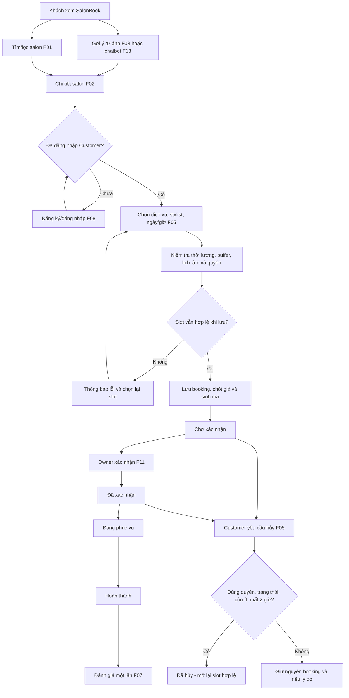

# QUY TRÌNH NGHIỆP VỤ SALONBOOK (BUSINESS WORKFLOW)

## 1. Mục tiêu, phạm vi và căn cứ nghiệp vụ

### 1.1. Bối cảnh

SalonBook là nền tảng trung gian **nhiều salon**, không phải website đặt chỗ của một tiệm duy nhất. Nền tảng giúp khách tìm salon phù hợp theo khu vực tại TP.HCM, loại hình và nhóm chuyên môn; xem thông tin, giá, stylist, lịch trống; đặt lịch làm dịch vụ và quản lý lịch cá nhân. Chủ salon quản lý dữ liệu vận hành của **salon mình**, còn quản trị viên nền tảng quản lý đối tác và kiểm duyệt nội dung toàn sàn.

Ba hành trình hỗ trợ trong MVP kết nối với luồng đặt lịch nhưng không thay thế bước xác nhận booking:

- **F03 – Phân tích khuôn mặt:** Người dùng tải ảnh, hệ thống gợi ý **3–5 kiểu tóc** và salon/stylist có chuyên môn phù hợp.
- **F04 – Tuyển mẫu tóc:** Chủ salon đăng tin, Admin duyệt, Customer ứng tuyển; sau khi liên hệ thành công, **chủ salon có thể tạo booking F05 từ hồ sơ ứng viên**, vẫn phải kiểm tra khả dụng slot.
- **F13 – Chatbot AI:** Guest/Customer hỏi thông tin dịch vụ, kiểu tóc và salon; chatbot điều hướng đến trang salon hoặc luồng đặt lịch, không tự xác nhận booking.

### 1.2. Phạm vi MVP theo REQUIREMENTS mới

| F-code | Chức năng | Đầu ra nghiệp vụ cần đạt |
|---|---|---|
| **F01** | Tìm kiếm và lọc salon đa tiêu chí | Kết quả theo khu vực, Nam/Nữ/Unisex, chuyên môn; có tên, địa chỉ, ảnh, tag và điểm trung bình. |
| **F02** | Xem thông tin salon, menu và stylist | Thông tin dịch vụ, giá, stylist, ảnh không gian đúng `salon_id`. |
| **F03** | Phân tích ảnh khuôn mặt, gợi ý tóc/salon | Nhận ảnh hợp lệ, gợi ý **3–5 kiểu tóc**, ghép salon/stylist theo tag chuyên môn; có dự phòng khi AI lỗi. |
| **F04** | Đăng tin và ứng tuyển mẫu tóc | Tin phải được Admin duyệt; Guest chỉ xem; Customer gửi tối đa **1 hồ sơ/tin đang mở**; Owner xem hồ sơ salon mình. |
| **F05** | Đặt lịch dịch vụ | Booking đúng salon, dịch vụ, stylist, giờ, giá tại thời điểm tạo; chống trùng cho cả Customer và Owner tạo từ hồ sơ mẫu. |
| **F06** | Lịch sử và hủy lịch cá nhân | Customer chỉ xem booking của mình, hủy khi còn **ít nhất 2 giờ**; slot hợp lệ được mở lại. |
| **F07** | Đánh giá salon | Chỉ booking **Hoàn thành**, mỗi booking **1 đánh giá không chỉnh sửa**, sao 1–5, tính lại điểm trung bình sau khi Admin gỡ. |
| **F08** | Đăng ký/đăng nhập | Phân quyền Guest, Customer, Salon Owner, Platform Admin; bảo vệ URL/API quản trị. |
| **F09** | Quản lý thông tin và dịch vụ salon | Owner sửa thông tin, tag, dịch vụ, giá/ẩn dịch vụ trong đúng `salon_id`. |
| **F10** | Quản lý stylist, ca trực, ngày nghỉ | Owner cấu hình lịch làm, bước nhảy slot, thời lượng, thời gian đệm; không cho đặt vào ca nghỉ/ngoài giờ. |
| **F11** | Điều phối trạng thái lịch hẹn | Owner theo dõi ngày/trạng thái và xử lý các trạng thái booking thuộc salon mình. |
| **F12** | Quản trị đối tác/kiểm duyệt | Admin duyệt/khóa salon, kiểm duyệt tin tuyển mẫu, gỡ đánh giá vi phạm và quản lý tài khoản. |
| **F13** | Chatbot AI tư vấn | Guest/Customer hỏi đáp và nhận gợi ý phù hợp từ dữ liệu hệ thống; có dự phòng khi AI lỗi. |

**Ngoài phạm vi:** SalonBook **không tích hợp hay quản lý thanh toán/giao dịch tiền tệ** giữa khách và salon, kể cả chi phí tuyển mẫu. Không có vận chuyển/giao hàng. Tích điểm đổi voucher liên kết đa hệ thống thuộc giai đoạn sau.

### 1.3. Các quy tắc nền tảng

1. Mỗi salon, dịch vụ, stylist, tin tuyển mẫu và booking được đối chiếu đúng `salon_id`; backend phải chống truy cập chéo và lỗi IDOR.
2. **Guest** có thể lọc/xem salon, xem lịch trống/đánh giá, xem tin tuyển mẫu, phân tích khuôn mặt và trò chuyện chatbot; **không được đặt lịch, ứng tuyển, gửi đánh giá hay xem lịch sử cá nhân**.
3. **Customer đã đăng nhập** được tạo booking, xem/hủy booking của mình, gửi hồ sơ tuyển mẫu và đánh giá khi đủ điều kiện.
4. **Salon Owner** quản lý đúng salon được cấp quyền, gồm thông tin, dịch vụ, lịch thợ, tin tuyển mẫu, ứng viên và booking; không can thiệp dữ liệu salon khác.
5. **Platform Admin** duyệt/khóa salon, kiểm duyệt tin/đánh giá và quản trị tài khoản; không vận hành ca làm hàng ngày thay Owner.
6. Slot phải tính bằng cấu hình salon/dịch vụ, lịch làm/ngày nghỉ, thời lượng và **thời gian đệm**. Backend kiểm tra lại **khi ghi lịch**, dùng transaction/locking để tránh double booking.
7. Giá dịch vụ của booking được **chốt tại thời điểm đặt thành công**; việc Owner đổi giá sau đó không làm thay đổi giá booking cũ.
8. F06 không hỗ trợ đổi trực tiếp lịch hẹn: muốn đổi, Customer **hủy lịch cũ hợp lệ rồi đặt booking mới**.
9. Ảnh mặt và ảnh tình trạng tóc cần thông báo/đồng ý trước tải lên; sử dụng lưu tạm và cơ chế tự xóa theo yêu cầu **tối đa 24 giờ**. Quy tắc kích hoạt mốc 24 giờ với ảnh ứng tuyển được ghi ở mục 8 để làm rõ.
10. Dữ liệu gợi ý AI lấy từ **danh mục dịch vụ, tag salon và bộ sưu tập kiểu tóc** của hệ thống. AI hỗ trợ quyết định; không thay thế kiểm tra quyền, giá, slot hoặc ghi booking.

## 2. Tác nhân và phạm vi trách nhiệm

| Tác nhân | Hành động trong workflow | Giới hạn |
|---|---|---|
| **Guest (khách vãng lai)** | F01/F02: tìm, xem salon/dịch vụ/đánh giá; F03: nhận gợi ý từ ảnh; F04: **chỉ xem** tin; F13: sử dụng chatbot. | Không tạo booking, ứng tuyển, đánh giá hoặc tra cứu lịch cá nhân. |
| **Customer (đã đăng nhập)** | Thực hiện hành động công khai; đặt lịch F05; xem/hủy F06; gửi **1 hồ sơ/tin** F04; xem trạng thái ứng tuyển; đánh giá F07 nếu đủ điều kiện. | Chỉ dữ liệu chính mình; không sửa booking trực tiếp hoặc chỉnh sửa đánh giá đã gửi. |
| **Salon Owner / Manager** | Quản lý thông tin/giá F09, ca/ngày nghỉ F10, lịch hẹn F11; đăng tin tuyển mẫu F04, xem ứng viên và **tạo booking F05 từ hồ sơ** sau liên hệ. | Chỉ trong `salon_id` được cấp; không tự công khai tin chưa duyệt hay tự gỡ đánh giá người khác. |
| **Platform Admin** | Duyệt/khóa salon, kiểm duyệt tin/đánh giá, quản lý tài khoản F12. | Không quản lý ca trực chi tiết thay salon. |
| **Stylist** | Là nguồn lực được gắn với dịch vụ, lịch làm và booking; thực hiện dịch vụ tại salon. | REQUIREMENTS chưa cấp vai trò đăng nhập/F-code độc lập cho stylist; **Owner** là người cập nhật trạng thái F11. |
| **Frontend** | Giao diện tìm kiếm, tải ảnh có xác nhận đồng ý, chatbot, biểu mẫu ứng tuyển, lịch trống, đặt/hủy và thông báo. | Không tự quyết định cuối về quyền, trạng thái, tồn tại slot hay kết quả lưu dữ liệu. |
| **Backend & Database** | Xác thực/phân quyền, kiểm tra dữ liệu, xử lý ảnh an toàn, quản lý trạng thái, khóa/tranh chấp lịch, lưu/đọc và xóa dữ liệu theo chính sách. | Không trả thành công khi chưa ghi an toàn; bảo vệ dữ liệu khách và ứng viên. |
| **Mô-đun AI (F03, F13)** | Nhận ảnh/câu hỏi, xử lý từ nguồn dữ liệu được quy định, trả gợi ý có thể dẫn sang F01/F02/F05. | Khi timeout/lỗi phải dự phòng; không được tự tạo hay hủy booking. |

## 3. 04.1 – Quy trình đặt lịch chính (F01, F02, F05, F08–F12)

### 3.1. Điều kiện trước khi đặt lịch

- Salon đã được Admin phê duyệt, có trạng thái hoạt động hợp lệ (F12).
- Chủ salon đã tạo menu, giá, stylist (F09), ca làm/ngày nghỉ và cấu hình slot/thời lượng/đệm (F10, mục 5 REQUIREMENTS).
- Customer phải đăng nhập qua F08 trước khi gửi booking F05. Guest vẫn có thể xem salon/slot.
- Dịch vụ và stylist phải thuộc salon đã chọn, có thể đặt tại thời điểm đó; ngày giờ thuộc tương lai.
- Các yêu cầu đến từ F03, F13 hay hồ sơ ứng tuyển F04 đều đi qua **cùng bộ kiểm tra lịch F05**.

### 3.2. Luồng tổng quát

**Khách đặt trực tiếp:** Truy cập → lọc salon F01 (hoặc được gợi ý từ F03/F13) → xem F02 → đăng nhập F08 → chọn salon/dịch vụ/stylist/ngày–giờ F05 → backend xác minh slot và dữ liệu → ghi booking, chốt giá, trả mã → Owner tiếp nhận F11 → khách theo dõi/hủy F06 → nếu Hoàn thành thì có thể đánh giá F07.

**Chủ salon đặt từ ứng tuyển:** Owner xem ứng viên F04 → liên hệ, thống nhất nhu cầu với ứng viên → chọn dịch vụ, stylist, ngày/giờ → gọi nghiệp vụ **F05 tạo booking từ hồ sơ ứng viên** → kiểm tra xung đột như booking thường → tạo booking liên kết đúng salon/ứng viên → Owner xử lý F11. **Việc nộp form F04 tự nó không giữ chỗ.**

*Sơ đồ mô tả luồng chính; sự cố salon bị khóa, stylist nghỉ đột xuất và booking bị cảnh báo được xử lý ở mục 6. Các trạng thái “Hủy” / “Đã hủy” chưa đồng nhất trong REQUIREMENTS, xem mục 7.*

### 3.3. Các bước chi tiết

| Bước | Người thực hiện | Đầu vào / hành động | Xử lý hệ thống | Đầu ra / căn cứ |
|---|---|---|---|---|
| **1. Kích hoạt đối tác** | Admin | Duyệt hoặc quản lý salon. | Kiểm tra quyền, công khai salon đủ điều kiện; ẩn salon bị khóa. | Danh sách salon có thể tìm – **F12**. |
| **2. Cấu hình vận hành** | Owner | Cập nhật menu, giá, stylist, lịch làm, ngày nghỉ; bước nhảy slot/đệm. | Gắn cấu hình đúng `salon_id`; lấy từ `SalonSettings`/`ServiceConfigurations`. | Dữ liệu hợp lệ – **F09, F10**. |
| **3. Khám phá salon** | Guest/Customer | Chọn quận, Nam/Nữ/Unisex, chuyên môn. | Kết hợp bộ lọc, loại salon không hoạt động; hiển thị tên/địa chỉ/ảnh/tag/điểm trung bình. | Danh sách phù hợp – **F01**. |
| **4. Xem salon** | Guest/Customer | Mở salon cụ thể hoặc theo đề xuất AI. | Hiển thị menu, giá, stylist, không gian và đánh giá thuộc đúng salon. | Trang chi tiết – **F02**. |
| **5. Xác thực** | Khách | Nhấn đặt lịch. | Nếu chưa có phiên Customer thì yêu cầu đăng nhập/đăng ký; backend đối chiếu vai trò. | Customer có quyền – **F08**. |
| **6. Chọn dịch vụ và stylist** | Customer | Chọn `salon_id`, `service_id`, `stylist_id`. | Kiểm tra các mã thuộc cùng salon; dịch vụ đang cho phép đặt; lấy giá và thời lượng từ CSDL. | Lựa chọn hợp lệ – **F05/F09**. |
| **7. Chọn lịch** | Customer | Chọn ngày/giờ tương lai. | Tính slot bằng bước nhảy cấu hình, ca làm/ngày nghỉ, thời lượng và buffer; loại khoảng giao nhau. | Các slot khả dụng dự kiến – **F05/F10**. |
| **8. Kiểm tra đơn** | Customer | Xem lại salon, dịch vụ, stylist, giá, ngày/giờ và liên hệ; nhấn xác nhận. | Kiểm tra trường bắt buộc và dữ liệu đầu vào. | Yêu cầu booking gửi đến backend. |
| **9. Xác minh cuối** | Backend | Customer + các mã + giờ bắt đầu. | Kiểm tra quyền, salon còn hoạt động, lịch làm, cấu hình mới nhất, khoảng phục vụ/đệm và booking đang chiếm slot. | Cho lưu hoặc yêu cầu chọn lại – **F05**. |
| **10. Ghi nhận an toàn** | Backend/DB | Yêu cầu vượt kiểm tra. | Transaction/locking chống race condition; lưu giá tại thời điểm tạo, các liên kết và trạng thái ban đầu. | Booking duy nhất, mã booking, **Chờ xác nhận** – **F05**. |
| **11. Hiển thị kết quả** | Website | Phản hồi backend. | Chỉ báo thành công nếu đã ghi thành công; hiển thị mã, giá đã chốt và trạng thái. | Xác nhận đã ghi nhận lịch, **chưa đồng nghĩa Owner đã duyệt**. |
| **12. Tiếp nhận lịch** | Owner | Xem lịch của salon theo ngày/trạng thái. | Giới hạn phạm vi `salon_id`, kiểm tra điều kiện chuyển trạng thái. | **Chờ xác nhận → Đã xác nhận** – **F11**. |
| **13. Thực hiện dịch vụ** | Salon/Stylist; Owner cập nhật | Đón khách và phục vụ theo lịch. | Owner ghi **Đang phục vụ → Hoàn thành** nếu phù hợp. | Lịch hoàn tất – **F11**. |
| **14. Theo dõi/hủy** | Customer | Mở lịch sử cá nhân, chọn lịch để hủy nếu cần. | Xác minh sở hữu + còn ≥ 2 giờ + trạng thái hợp lệ; giải phóng slot nếu hủy thành công. | Lịch sử cập nhật – **F06**. |
| **15. Đánh giá** | Customer | Chọn booking Hoàn thành, nhập 1–5 sao và nhận xét. | Kiểm tra chưa đánh giá booking này; lưu 1 lần và cập nhật điểm trung bình. | Đánh giá công khai hợp lệ – **F07**. |

### 3.4. Dữ liệu đầu vào và đầu ra

| Nhóm dữ liệu | Đầu vào | Quy tắc / đầu ra |
|---|---|---|
| **Salon** | `salon_id` | Tồn tại, được phép hoạt động; đúng salon dịch vụ/stylist/Owner. |
| **Dịch vụ** | `service_id` | Thuộc salon, có thể đặt; đọc **thời lượng và giá từ backend**. |
| **Stylist** | `stylist_id` | Thuộc salon, không nghỉ/ngoài giờ, không trùng booking đang chiếm chỗ. |
| **Cấu hình slot** | Bước nhảy, buffer, giờ làm chuẩn, thời lượng trong `SalonSettings` / `ServiceConfigurations` | Dữ liệu được áp dụng theo cấu hình hiện hành; không tin giá trị client tự gửi. |
| **Ngày/giờ** | Ngày, giờ bắt đầu | Tương lai; kiểm tra **dịch vụ + buffer** trong ca làm và với các booking khác. |
| **Customer** | Phiên đăng nhập; thông tin liên hệ theo form | Booking gắn đúng tài khoản; kiểm tra định dạng SĐT theo quy tắc nhóm phê duyệt (REQUIREMENTS chưa chốt số chữ số). |
| **Booking** | Customer, salon, dịch vụ, stylist, thời gian | Mã booking, thời điểm tạo, giá **đã chốt**, thời gian phục vụ và trạng thái. |
| **Tác động từ hồ sơ mẫu** | Hồ sơ F04 của ứng viên, Owner liên hệ thành công | Owner được tạo booking F05 liên kết đúng ứng viên, nhưng **không bỏ qua kiểm tra slot**. |
| **Thông báo/cảnh báo** | Hủy/thay ca/khóa salon | Kết quả hoặc cảnh báo cho khách theo quy tắc ở mục 6, không thay booking im lặng. |

### 3.5. Tính thời gian trống và chống đặt trùng

- **Bước nhảy slot**, **thời lượng** từng `service_id`, **buffer giữa hai ca** và **giờ làm chuẩn** được cấu hình trong cơ sở dữ liệu (`SalonSettings` / `ServiceConfigurations`) bởi Owner. REQUIREMENTS đưa ví dụ bước nhảy **30 hoặc 60 phút**, buffer **10–15 phút**; đây là **giá trị tùy cấu hình**, không phải quy định một giá trị chung cho mọi dịch vụ.
- Thời điểm kết thúc dịch vụ: `end_time = start_time + service_duration`. Backend phải tính cả buffer khi kiểm tra tính khả dụng và không làm các khoảng phục vụ/đệm giao nhau.
- Với hai khoảng phục vụ của cùng stylist, điều kiện giao nhau là:  
  `new_start < existing_end AND new_end > existing_start`  
  Khi có buffer, kiểm tra trên **khoảng chiếm dụng hiệu lực** đã bao gồm buffer được cấu hình (quy tắc đặt buffer trước/sau dịch vụ cần được nhóm thể hiện thống nhất trong cấu hình).
- Kiểm tra ca làm, ngày nghỉ, các lịch chưa hủy đang chiếm chỗ và quan hệ salon–dịch vụ–stylist. **Một stylist không thể nhận hai booking có khoảng chiếm dụng giao nhau**, dù hai yêu cầu đến gần đồng thời.
- Backend **kiểm tra lại trong transaction/locking lúc ghi** và chỉ tạo một booking; mọi yêu cầu còn lại nhận thông báo slot không khả dụng.
- Booking đã hủy chỉ giải phóng khung giờ **nếu** giờ đó vẫn phù hợp ca trực và không xung đột với booking/cấu hình khác.
- Salon bị khóa, dịch vụ ẩn hoặc stylist nghỉ không tạo ra slot mới có thể đặt; booking **đã xác nhận trước đó** chịu chính sách cảnh báo/xử lý tại mục 6.

### 3.6. Nhánh Owner tạo booking từ ứng tuyển (F04 → F05)

| Bước | Owner / hệ thống | Kết quả |
|---|---|---|
| 1 | Owner vào danh sách ứng viên thuộc tin tuyển mẫu của salon mình sau khi liên hệ thành công. | Xác định hồ sơ mẫu và salon tương ứng. |
| 2 | Owner chọn dịch vụ, stylist, ngày/giờ đã thỏa thuận; sử dụng chức năng tạo booking F05. | Yêu cầu tạo lịch **khác với hồ sơ ứng tuyển**. |
| 3 | Backend kiểm tra quyền Owner, `salon_id`, `service_id`, `stylist_id`, lịch làm, duration/buffer, giá và xung đột. | Lịch hợp lệ hoặc báo giờ hết chỗ. |
| 4 | Lưu booking và liên kết với ứng viên/Customer phù hợp; xử lý trạng thái theo F11. | Booking xuất hiện trong lịch salon; việc liên kết vào lịch sử của Customer cần đúng danh tính tài khoản. |

**Lưu ý:** Việc Owner tạo booking từ hồ sơ ứng tuyển là quyền **đã có trong REQUIREMENTS**. Nguồn xác nhận đồng ý đặt lịch là quá trình Owner **liên hệ thành công**, nhưng hình thức lưu chứng cứ/đồng ý và trạng thái ban đầu của lịch Owner tạo cần thống nhất khi thiết kế. Không tự coi mọi đơn ứng tuyển là lịch đã đặt.

## 4. Các workflow bổ trợ trong MVP

### 4.1. Phân tích khuôn mặt và gợi ý kiểu tóc/salon (F03)

| Bước | Tác nhân | Hành động / xử lý | Kết quả |
|---|---|---|---|
| 1 | Guest/Customer | Mở công cụ gợi ý, xem thông báo mục đích dùng ảnh và thời hạn xóa. | Hộp thoại đồng ý trước khi tải ảnh. |
| 2 | Người dùng | **Đồng ý** rồi chọn ảnh chân dung/khuôn mặt. | Yêu cầu tải ảnh gửi lên; không đồng ý thì không tải. |
| 3 | Backend | Kiểm tra tệp ảnh hợp lệ, an toàn và giới hạn định dạng/dung lượng theo cấu hình được nhóm thống nhất (REQUIREMENTS hiện tại chưa định nghĩa mức MB cụ thể). | Ảnh hợp lệ hoặc lỗi cụ thể. |
| 4 | AI / hệ thống | Nhận diện dáng mặt, khớp bộ sưu tập kiểu tóc của hệ thống. | **3–5 kiểu tóc** gợi ý; mục tiêu xử lý thành công **< 3 giây**. |
| 5 | Hệ thống | Ghép kiểu tóc với salon/stylist theo **tag chuyên môn**, điểm trung bình **≥ 4,5** và số booking hoàn thành. | Danh sách salon/stylist đáp ứng điều kiện gợi ý/xếp hạng. |
| 6 | Guest/Customer | Mở salon từ kết quả, xem F02; nếu muốn đặt thì phải xác thực Customer và dùng F05. | Chuyển ngữ cảnh đến salon, **không tự tạo booking**. |
| 7 | Hệ thống | Lưu ảnh tạm và tự động xóa theo chính sách **tối đa 24 giờ kể từ khi phân tích xong**. | Giảm thời gian lưu ảnh cá nhân. |

**Dự phòng:** Nếu ảnh sai định dạng/dung lượng, không nhận diện được, API timeout hoặc không trả kết quả, hiển thị *“Hệ thống phân tích tạm bận, vui lòng chọn thủ công”* và cung cấp lựa chọn **chọn dáng mặt bằng tay** hoặc bộ lọc F01. Không phát sinh kết quả AI giả hoặc booking khi phân tích thất bại.

**Tiêu chí xếp hạng:** `tag chuyên môn phù hợp` + `điểm trung bình ≥ 4,5 sao` + `booking Hoàn thành nhiều`. REQUIREMENTS chưa nêu ngưỡng số booking hay trọng số xếp hạng; không tự khẳng định đã có công thức chính thức.

### 4.2. Đăng tin tuyển mẫu và ứng tuyển (F04, F08, F12)

#### A. Owner tạo và Admin kiểm duyệt tin

| Bước | Tác nhân | Dữ liệu / xử lý | Kết quả |
|---|---|---|---|
| 1 | Owner | Đăng nhập, chọn salon thuộc quyền; khai báo loại tuyển (cắt/uốn/nhuộm...), yêu cầu tóc, chi phí hỗ trợ hoặc miễn phí, thông tin tin. | Bản nháp/tin gửi lên để xử lý. |
| 2 | Backend | Kiểm tra quyền `salon_id`, các trường và dữ liệu an toàn. | Tạo tin **Chờ duyệt (Pending)**. |
| 3 | Admin | Xem tin chờ duyệt và đánh giá nội dung. | **Đã duyệt (Public)** hoặc **Bị từ chối** kèm lý do. |
| 4 | Hệ thống | Chỉ hiển thị tin **Đã duyệt**, còn hiệu lực, không bị gỡ cho Guest/Customer. | Tin hợp lệ ở danh sách công khai. |
| 5 | Owner | Nếu bị từ chối, chỉnh sửa và **gửi duyệt lại**. | Tin quay về luồng kiểm duyệt; không tự công khai. |
| 6 | Admin / hệ thống | Ẩn/gỡ tin **hết hạn, vi phạm thuần phong mỹ tục hoặc lừa đảo**. | Tin không còn xuất hiện công khai. |

#### B. Customer ứng tuyển và Owner tiếp nhận

| Bước | Tác nhân | Dữ liệu / xử lý | Kết quả |
|---|---|---|---|
| 1 | Guest/Customer | Xem danh sách tin tuyển mẫu đã được duyệt. | Guest **chỉ xem**; Customer có thể chọn ứng tuyển. |
| 2 | Customer | Đăng nhập F08, chọn tin đang mở; xem thông báo dùng/xóa ảnh và đồng ý trước tải lên. | Form ứng tuyển có quyền gửi. |
| 3 | Customer | Điền **họ tên, SĐT, email, ảnh chụp tình trạng tóc hiện tại**. | Dữ liệu được gửi kiểm tra. |
| 4 | Backend | Kiểm tra định dạng SĐT/email, tính hợp lệ ảnh, đồng ý xử lý ảnh, trạng thái tin và giới hạn **1 Customer / 1 tin đang mở**. | Form hợp lệ hoặc thông báo lỗi/trùng đơn. |
| 5 | Backend/DB | Lưu hồ sơ gắn `customer_id`, `post_id`, `salon_id`; ngăn 2 yêu cầu gửi cùng lúc tạo trùng. | Một hồ sơ được ghi nhận. |
| 6 | Customer | Xem thông tin/trạng thái hồ sơ của mình theo vai trò Customer. | Không thấy hồ sơ người khác. |
| 7 | Owner | Xem hồ sơ ứng viên **thuộc salon mình**, liên hệ trực tiếp để thỏa thuận. | Quyết định phối hợp ngoài nền tảng. |
| 8 | Owner (nếu phù hợp) | Sau khi liên hệ thành công, tạo booking F05 từ hồ sơ theo mục 3.6. | Chỉ tạo lịch nếu **slot hợp lệ**; ứng tuyển tự nó không chiếm slot. |

**Nguyên tắc chống gửi trùng:** Tối đa **1 hồ sơ của cùng Customer cho mỗi tin tuyển mẫu đang mở**; kiểm tra ở backend và có ràng buộc chống gửi song song trong dữ liệu. Không chuyển hồ sơ lần hai thành hồ sơ cập nhật vì yêu cầu không quy định cơ chế sửa ứng tuyển.

**Quy tắc ảnh chất tóc:** Bắt buộc thông báo và đồng ý trước khi tải; áp dụng chính sách lưu tạm và tự xóa ảnh **tối đa 24 giờ**. REQUIREMENTS mô tả mốc “kể từ thời điểm phân tích xong” nhưng luồng ứng tuyển **không có bước phân tích ảnh chất tóc**; thời điểm bắt đầu đếm 24 giờ cần chốt ở mục 8. Việc xóa ảnh không đồng nghĩa xóa thông tin liên hệ/form nếu yêu cầu lưu hồ sơ chưa quy định như vậy.

### 4.3. Chatbot AI tư vấn và điều hướng (F13)

| Bước | Tác nhân | Hành động / xử lý | Kết quả |
|---|---|---|---|
| 1 | Guest/Customer | Mở chatbot và nhập câu hỏi về salon, dịch vụ, kiểu/màu tóc. | Yêu cầu tư vấn. |
| 2 | Backend/AI | Xử lý trên nguồn dữ liệu hệ thống: **menu dịch vụ, tag chuyên môn salon và bộ sưu tập kiểu tóc**. | Phản hồi theo truy vấn; mục tiêu **< 3 giây**. |
| 3 | Hệ thống | Gợi ý salon/dịch vụ/kiểu tóc và dẫn tới F01/F02/F03 khi có dữ liệu tương ứng. | Người dùng có thể tự so sánh và chọn salon. |
| 4 | Customer | Nếu muốn đặt lịch, phải dùng F05 và hoàn tất xác thực F08. | Không có booking nếu chưa đi qua backend F05. |
| 5 | Hệ thống (khi AI lỗi) | Timeout/không có câu trả lời đáng tin cậy. | Hiển thị *“Hệ thống phân tích tạm bận, vui lòng chọn thủ công”*; chuyển về lọc F01/danh mục dịch vụ. |

**Phân biệt:** Chatbot không được tự cam kết slot còn trống, giá đã chốt hay tình trạng booking chỉ bằng lời đáp; các nội dung giao dịch phải lấy từ nguồn dữ liệu và quy trình F05. Lịch sử hội thoại thuộc phạm vi bảo vệ dữ liệu cá nhân nêu tại mục 5 REQUIREMENTS.

### 4.4. Đăng ký/đăng nhập và phân quyền (F08)

1. Guest có quyền công khai F01/F02/F03/F13 và xem tin F04 nhưng không được thao tác dành cho Customer.
2. Khi Guest yêu cầu đặt lịch F05, ứng tuyển F04, xem/hủy F06 hoặc đánh giá F07, hệ thống bắt buộc xác thực Customer.
3. Owner/Admin đăng nhập và được phân quyền trên server đối với từng URL/API; ẩn nút giao diện không thay thế kiểm tra backend.
4. Mật khẩu phải được **băm an toàn** và thông tin truyền qua HTTPS. Không lưu mật khẩu thô.
5. Dùng `salon_id`, `customer_id` và quyền vai trò để chống IDOR trong booking, tin tuyển mẫu, hồ sơ ứng viên, lịch thợ và đánh giá.

### 4.5. Xem lịch sử, hủy và đổi lịch (F06)

| Bước | Tác nhân | Xử lý | Đầu ra |
|---|---|---|---|
| 1 | Customer | Mở lịch sử; hệ thống truy vấn theo tài khoản đã xác thực. | Chỉ các booking của Customer đó. |
| 2 | Customer | Chọn lịch cần hủy hoặc cần đổi thời gian. | Mã booking và thông tin hiện tại. |
| 3 | Backend | Kiểm tra quyền sở hữu, trạng thái cho phép hủy và còn **≥ 2 giờ** trước giờ bắt đầu. | Cho phép hoặc từ chối kèm lý do. |
| 4 | Backend | Nếu hợp lệ, cập nhật lịch sang nhãn hủy (F06 ghi **“Đã hủy”**) và giải phóng slot sau kiểm tra lịch khả dụng. | Lịch sử và slot cập nhật nhất quán. |
| 5 | Customer | Nếu muốn đổi lịch, **tạo booking F05 mới**; không sửa trực tiếp đơn đã hủy. | Booking mới có mã/giá/slot riêng. |

**Biên 2 giờ:** đúng **2 giờ** trước giờ hẹn vẫn đủ điều kiện; **dưới 2 giờ** không đủ. Sau khi hủy lịch cũ, hệ thống **không bảo đảm** lịch mới còn chỗ và không tự khôi phục lịch cũ. Không cho Customer tự hủy lịch đã hoàn thành, đã hủy hoặc đang phục vụ.

### 4.6. Đánh giá, tính điểm và kiểm duyệt (F07, F12)

1. Customer đăng nhập và chọn booking của mình đã ở trạng thái **Hoàn thành**.
2. Backend đối chiếu chủ booking và chỉ cho gửi **đúng một đánh giá** cho `booking_id` đó. Điểm sao thuộc **1–5**, nội dung được kiểm tra hợp lệ.
3. Sau khi gửi thành công, đánh giá **không thể chỉnh sửa**; thao tác gửi lần hai, kể cả từ phiên/song song, phải bị từ chối.
4. Điểm trung bình salon = **tổng điểm các đánh giá hợp lệ còn hiển thị / số đánh giá hợp lệ còn hiển thị**. Kết quả cập nhật ngay ở F01/F02 sau khi có đánh giá mới.
5. Admin gỡ nhận xét vi phạm theo F12; hệ thống **loại điểm của đánh giá bị gỡ** khỏi phép tính, tính lại và cập nhật điểm trung bình ngay. Khi không còn đánh giá hợp lệ, hiển thị trạng thái **chưa có đánh giá** thay vì tự tạo điểm trung bình giả.
6. Owner có thể xem phản hồi salon mình nhưng không được tùy ý sửa/xóa bình luận; Guest chỉ được đọc đánh giá công khai.

### 4.7. Quản lý salon, dịch vụ, stylist và lịch làm (F09, F10)

1. Owner đăng nhập và chỉ chọn salon thuộc `salon_id` được cấp.
2. Qua F09, Owner cập nhật mô tả, ảnh/tag phân loại salon, dịch vụ và giá; ẩn dịch vụ không còn cung cấp. Các thay đổi hợp lệ phản ánh ra F01/F02.
3. Qua F10, Owner phân stylist, ca trực, ngày nghỉ và cấu hình `SalonSettings` / `ServiceConfigurations`: bước nhảy, thời lượng, buffer, giờ hoạt động.
4. Khi F10 thay đổi, hệ thống tính lại slot hiển thị ở F05. **Không được tự xóa/sửa giờ các booking đã xác nhận**.
5. Nếu thay đổi ca/ngày nghỉ **giao với booking Đã xác nhận**, hệ thống **từ chối thay đổi hoặc cảnh báo bắt buộc liên hệ khách trước khi cho phép khóa ca**, theo quy tắc REQUIREMENTS.
6. Nếu có sự cố phải đóng ca/khóa salon ảnh hưởng đến booking đã xác nhận, kích hoạt quy trình cảnh báo và liên hệ ở mục 6.
7. Nếu Owner đổi giá dịch vụ, giá trên danh mục thay đổi cho **booking mới**, nhưng **giá của booking đã tạo thành công không thay đổi**.

### 4.8. Tiếp nhận lịch và quản trị sàn (F11, F12)

1. Owner lọc booking theo ngày/trạng thái và xử lý luồng thông thường: **Chờ xác nhận → Đã xác nhận → Đang phục vụ → Hoàn thành** hoặc **Hủy** nếu nghiệp vụ cho phép.
2. Owner không được cập nhật booking của salon khác. Thao tác chuyển trạng thái phải kiểm tra quyền và trạng thái ngay ở backend.
3. Theo giả định REQUIREMENTS: khách nên đến **trước giờ hẹn ≥ 10 phút**; nếu **muộn quá 15 phút không liên hệ**, salon có quyền từ chối hoặc chuyển sang nhãn hủy. Việc xử lý thuộc Owner, không phải hành động hủy tự phục vụ của Customer theo giới hạn 2 giờ.
4. Admin duyệt/khóa salon, duyệt tin tuyển mẫu, gỡ tin/nhận xét vi phạm, quản lý tài khoản. Salon bị khóa **không xuất hiện trên F01**.
5. Nếu khóa salon ảnh hưởng booking đã xác nhận, phải theo luồng cảnh báo ở mục 6; **không âm thầm hủy, xóa hoặc đổi giá booking**.

## 5. 04.2 – Ngoại lệ và các quy tắc nghiệp vụ

| Tình huống | Điều kiện phát sinh | Cách hệ thống xử lý | Kết quả / căn cứ |
|---|---|---|---|
| Bộ lọc không có kết quả | Không salon khớp tiêu chí. | Hiển thị thông báo và cho phép đổi bộ lọc. | Không tạo booking – F01. |
| Salon chưa duyệt / bị khóa | Salon không được phép công khai. | Ẩn khỏi F01; chặn yêu cầu booking mới ở backend. | F05/F12. |
| Mã liên kết sai salon | `service_id`, `stylist_id` hoặc `post_id` không thuộc `salon_id`. | Từ chối thao tác và không lộ dữ liệu salon khác. | F02/F04/F05/F09. |
| Guest thao tác hạn chế | Chưa đăng nhập khi muốn đặt, ứng tuyển, đánh giá, tra cứu lịch. | Điều hướng F08, backend từ chối thao tác thiếu quyền. | F04–F08. |
| Ngày/slot không hợp lệ | Quá khứ, ngoài ca, nghỉ ngày, không đủ thời lượng/buffer. | Không hiển thị/khóa slot và yêu cầu chọn khác. | F05/F10. |
| Hai yêu cầu đồng thời | Cùng stylist, khoảng chiếm dụng giao nhau. | Kiểm tra và ghi bằng transaction/locking; chỉ một thành công. | Chống double booking – F05. |
| Giá thay đổi | Owner đổi giá sau khi lịch đã tạo. | Giữ **giá đã chốt** ở booking cũ; giá mới cho booking sau. | NFR mục 5. |
| Thay đổi ca trùng booking xác nhận | Owner muốn khóa ca cho giờ có booking. | Từ chối hoặc cảnh báo phải liên hệ khách trước khi sửa; không ghi âm thầm. | F10 + NFR. |
| Salon bị khóa/ca nghỉ đột xuất | Ảnh hưởng booking đã xác nhận. | Gắn cảnh báo, thông báo khẩn qua hệ thống/SĐT; Owner liên hệ khách để giải quyết. | NFR; **mục 6**. |
| Customer hủy đúng hạn | Chủ lịch, trạng thái hợp lệ, còn ≥ 2 giờ. | Chuyển nhãn hủy, giải phóng slot nếu đủ điều kiện. | F06. |
| Customer hủy muộn/không hợp lệ | Còn < 2 giờ, sai chủ hoặc lịch kết thúc. | Từ chối, giữ booking hiện tại. | F06. |
| Customer yêu cầu đổi trực tiếp | Muốn sửa giờ/dịch vụ/thợ của booking đã đặt. | Hướng dẫn hủy hợp lệ rồi tạo booking mới. | F05/F06. |
| Ảnh chưa được đồng ý | Người dùng chưa chấp thuận thông báo xử lý ảnh. | Không nhận tải ảnh khuôn mặt hoặc chất tóc. | NFR xử lý ảnh. |
| Ảnh không hợp lệ | Tệp lỗi, không phải ảnh hoặc không đáp ứng định dạng/dung lượng được nhóm cấu hình. | Từ chối, hiển thị điều kiện tệp. | F03/F04 + NFR; loại tệp và mức MB cần chốt. |
| AI không nhận diện hoặc timeout | F03/F13 lỗi, phản hồi chậm hoặc không thể phân tích. | Thông báo dự phòng đúng nội dung yêu cầu, cho chọn dáng mặt/dịch vụ thủ công hoặc F01. | F03/F13 + NFR. |
| Không đủ dữ liệu để xếp “hàng đầu” | Salon không đáp ứng tag, đánh giá ≥ 4,5 hoặc dữ liệu booking hoàn thành. | Không gắn nhãn “hàng đầu” một cách không có căn cứ; vẫn có thể dẫn người dùng đến F01/F02. | NFR xếp hạng. |
| Tin tuyển mẫu chưa duyệt | Tin ở **Chờ duyệt** hoặc **Bị từ chối**. | Không hiển thị công khai; cho Owner sửa/gửi duyệt lại tin bị từ chối. | F04/F12. |
| Tin mẫu hết hạn/vi phạm | Tin hết hạn, nội dung lừa đảo hoặc vi phạm. | Ẩn/gỡ khỏi công khai theo quyền Admin. | F04/F12. |
| Guest gửi ứng tuyển | Guest chỉ có quyền xem. | Yêu cầu đăng nhập F08, không lưu hồ sơ. | F04. |
| Hồ sơ ứng tuyển trùng | Customer đã ứng tuyển cùng tin đang mở hoặc gửi gần đồng thời. | Từ chối gửi lần hai theo `customer_id + post_id`. | **1 hồ sơ/tin** – F04. |
| Form ứng tuyển sai | Thiếu họ tên, SĐT, email, ảnh tóc hoặc dữ liệu sai định dạng/thiếu consent. | Hiển thị lỗi và không lưu thành công. | F04 + NFR. |
| Owner cố xem ứng viên salon khác | Owner không có quyền `salon_id` của tin. | Backend từ chối truy cập và không lộ thông tin cá nhân. | F04/F08. |
| Owner tạo booking từ mẫu nhưng slot hết | Ứng viên đồng ý, Owner chọn giờ đã có lịch. | Chặn booking, yêu cầu tìm giờ khác; hồ sơ mẫu vẫn riêng biệt. | F04 → F05. |
| Booking chưa hoàn thành mà đánh giá | Không đạt trạng thái hoặc không đúng Customer. | Không hiện quyền đánh giá/không ghi đánh giá. | F07. |
| Gửi hoặc sửa đánh giá lần hai | Booking đã có review hợp lệ hoặc Customer muốn sửa sau gửi. | Từ chối vì **1 booking/1 đánh giá, không sửa**. | F07. |
| Admin gỡ review | Nội dung vi phạm quy tắc cộng đồng. | Ẩn/gỡ và **tính lại ngay** điểm trung bình, loại điểm đã gỡ. | F07/F12. |
| Owner cập nhật sai trạng thái | Sai quyền hoặc chuyển trạng thái không phù hợp. | Từ chối, giữ trạng thái hiện tại. | F11. |
| Khách đến trễ > 15 phút không báo | Điều kiện giả định tại mục 6 REQUIREMENTS. | Owner quyết định từ chối/đánh dấu hủy theo quyền; ghi nhận lý do nếu có quy định. | F11, giả định dự án. |
| Ảnh tạm quá hạn | Đạt giới hạn **tối đa 24 giờ** từ mốc xử lý tương ứng. | Tự động xóa ảnh theo chính sách; không lưu vô thời hạn. | NFR dữ liệu ảnh. |
| Lỗi ghi DB/khóa tài nguyên | Không thể hoàn tất giao dịch. | Rollback/không xác nhận thành công; tránh bản ghi một phần. | Bảo toàn dữ liệu. |

## 6. Biến động vận hành, thông báo khẩn và giá đã chốt

### 6.1. Owner đổi ca, stylist nghỉ đột xuất

| Bước | Xử lý nghiệp vụ | Hệ quả |
|---|---|---|
| 1 | Owner thay ca, ngày nghỉ hoặc giờ hoạt động của stylist tại F10. | Backend xác định các booking **Đã xác nhận** bị giao với thay đổi. |
| 2 | Nếu có xung đột, hệ thống **từ chối cập nhật hoặc hiển thị cảnh báo bắt buộc Owner liên hệ khách** trước khi thực hiện khóa ca/đổi giờ. | Không thay đổi lịch đã xác nhận một cách im lặng. |
| 3 | Trong trường hợp ca đã bị hủy đột xuất/biến động thực tế ảnh hưởng booking, hệ thống **đánh dấu tình huống cảnh báo**, gửi thông báo khẩn bằng kênh hệ thống/SĐT theo yêu cầu. | Customer được biết vấn đề; Owner có trách nhiệm gọi liên hệ trực tiếp. |
| 4 | Owner thống nhất phương án với khách và thực hiện thao tác hợp lệ (ví dụ hủy lịch cũ/đặt lại). | Booking chỉ được đổi/hủy theo quyền và quy tắc đã chốt; không tự chuyển thợ/giờ ngầm. |

### 6.2. Admin khóa salon

- Salon bị khóa **không xuất hiện trên F01** và không cho phát sinh booking mới khi không đủ điều kiện.
- Các booking **Đã xác nhận** trước đó được đưa vào quy trình **cảnh báo khẩn**, gửi thông báo khách và Owner liên hệ để xử lý; không tự xóa dữ liệu booking.
- REQUIREMENTS có cụm **“chuyển tự động sang trạng thái cảnh báo”** nhưng F11 chỉ định nghĩa các trạng thái chu trình đặt lịch. Cách biểu diễn **cảnh báo vận hành** (trạng thái riêng hay cờ bổ sung) **cần nhóm thống nhất**, không tự coi nó là trạng thái booking thứ sáu.

### 6.3. Thay đổi giá

Giá được lấy từ dịch vụ tại thời điểm **booking tạo thành công** và ghi cố định vào bản ghi booking; mọi thay đổi giá F09 về sau không tác động đến lịch đã chốt. SalonBook không xử lý thanh toán; thông tin giá phục vụ minh bạch khi khách và salon sử dụng dịch vụ.

### 6.4. Chính sách thông báo

Thông báo khẩn khi ca bị hủy đột xuất hoặc salon bị khóa được yêu cầu qua **hệ thống/SĐT**. REQUIREMENTS chưa quy định nhà cung cấp SMS, hình thức thông báo “trong hệ thống”, thời điểm gửi lại, cơ chế người dùng xác nhận đã nhận. Những chi tiết này cần được xác định trong thiết kế kỹ thuật và kiểm thử, không tự gán vào F-code mới.

## 7. Trạng thái và vòng đời dữ liệu

### 7.1. Trạng thái booking (F05, F06, F11)

| Nhãn trong yêu cầu | Ý nghĩa | Chuyển tiếp thông thường |
|---|---|---|
| **Chờ xác nhận** | Booking F05 đã ghi nhận, chờ Owner tiếp nhận. | → **Đã xác nhận** hoặc hủy hợp lệ. |
| **Đã xác nhận** | Owner chấp nhận lịch; slot được giữ. | → **Đang phục vụ** hoặc hủy hợp lệ; có thể phát sinh cảnh báo vận hành. |
| **Đang phục vụ** | Dịch vụ đang được thực hiện. | → **Hoàn thành**. |
| **Hoàn thành** | Đã thực hiện xong dịch vụ. | Kết thúc; Customer được đánh giá **1 lần**. |
| **Hủy / Đã hủy** | Booking không tiếp tục thực hiện. | Kết thúc, slot có thể mở lại nếu vẫn hợp lệ. |

**Điểm chưa thống nhất trong chính REQUIREMENTS:** F11 ghi nhãn **“Hủy”**, F06 ghi **“Đã hủy”**; phần giả định mục 6 cũng dùng **“Đã hủy”**. Workflow trình bày hai cách gọi cho cùng ý nghĩa nghiệp vụ nhưng **không tự chọn enum chính thức**. Nhóm cần chọn một giá trị lưu trong DB và một nhãn hiển thị chuẩn để tránh báo cáo/truy vấn sai.

**Cảnh báo vận hành:** yêu cầu phi chức năng mô tả booking xác nhận “chuyển sang trạng thái cảnh báo” khi salon bị khóa/hủy ca đột xuất. **Chưa xác định đó là nhãn booking hay thuộc tính cảnh báo riêng**; cần chốt để không phá vỡ chu trình F11.

### 7.2. Trạng thái tin tuyển mẫu (F04, F12)

| Trạng thái | Ý nghĩa | Hành động tiếp theo |
|---|---|---|
| **Chờ duyệt (Pending)** | Tin mới tạo hoặc gửi lại chờ Admin. | Admin duyệt hoặc từ chối. |
| **Đã duyệt (Public)** | Tin hợp lệ được công khai. | Guest/Customer xem; Customer đủ quyền được ứng tuyển nếu tin đang mở. |
| **Bị từ chối** | Nội dung không được duyệt; có lý do. | Owner sửa và gửi duyệt lại. |
| **Hết hạn/đã gỡ** | Không còn đủ điều kiện công khai. | Ẩn khỏi danh sách; không cho hồ sơ mới khi tin không còn mở. |

**Lưu ý:** “Hết hạn/đã gỡ” là **điều kiện không hiển thị**, chưa được khai báo rõ là trạng thái enum trong bảng F04. Workflow không tự coi đây là trạng thái lưu chính thức.

### 7.3. Trạng thái hồ sơ ứng tuyển

REQUIREMENTS cho Customer **xem trạng thái hồ sơ ứng tuyển**, nhưng chưa quy định tên các trạng thái vòng đời hoặc quyền rút/hủy ứng tuyển. Workflow chỉ yêu cầu Customer thấy **hồ sơ của chính mình** và Owner thấy hồ sơ thuộc tin của salon mình; **không tự đặt enum** như “Trúng tuyển”, “Từ chối”, “Đã đặt lịch”.

### 7.4. Vòng đời ảnh và nội dung AI

- Trước khi tải **ảnh mặt/ảnh chất tóc**, hiển thị hộp thoại thông báo mục đích phân tích và xóa trong **24 giờ**, người dùng phải đồng ý.
- Ảnh xử lý tạm trên lưu trữ đám mây, được xóa tự động **không muộn hơn 24 giờ** từ mốc tính đã thống nhất; không lưu vô thời hạn. Với ảnh mặt, mốc là **sau khi phân tích xong** theo REQUIREMENTS.
- Với ảnh chất tóc đính kèm form ứng tuyển, REQUIREMENTS **chưa nêu bước phân tích**, nên mốc bắt đầu xóa cần chốt để vừa tuân thủ giới hạn lưu trữ vừa phục vụ Owner xem ảnh. Không diễn giải mặc nhiên là ảnh có thể giữ đến lúc Owner xem xong.
- Thông tin liên hệ, booking, hồ sơ ứng tuyển và lịch sử chatbot phải được bảo vệ theo yêu cầu HTTPS, mã hóa CSDL, phân quyền truy cập và chính sách quản lý dữ liệu; không đồng nhất việc xóa ảnh với việc xóa toàn bộ hồ sơ.

## 8. 04.3 – Đối chiếu workflow với REQUIREMENTS.md cập nhật

| F-code | Tiêu chí/điểm mới cần kiểm tra | Vị trí workflow | Tình trạng |
|---|---|---|---|
| **F01** | Bộ lọc đa tiêu chí và thông tin ảnh/tag/điểm; salon khóa bị loại. | 1, 3.3, 5 | **Đã thể hiện**. |
| **F02** | Menu/giá/stylist/không gian đúng `salon_id`. | 2, 3.3, 3.4 | **Đã thể hiện**. |
| **F03** | 3–5 gợi ý; **< 3 giây**, tag, điểm ≥ 4,5 và booking hoàn thành; chọn thủ công khi lỗi; xóa ảnh 24h. | 4.1, 5, 7.4 | **Đã thể hiện**; thiếu công thức xếp hạng chi tiết từ nguồn. |
| **F04** | Pending → Public/Bị từ chối; Guest chỉ xem; form có ảnh tóc, **1 Customer/tin**; Owner xem ứng viên. | 3.6, 4.2, 5, 7.2–7.4 | **Đã thể hiện**; mốc xóa ảnh tóc/trạng thái hồ sơ cần chốt. |
| **F05** | Booking Customer hoặc Owner tạo từ hồ sơ mẫu; đúng mã salon–dịch vụ–stylist; chống trùng; chốt giá. | 3.1–3.6, 5, 6 | **Đã thể hiện**. |
| **F06** | Chỉ booking của mình, hủy **≥ 2 giờ**, mở slot; đổi bằng hủy + đặt mới. | 3, 4.5, 5, 7 | **Đã thể hiện**; nhãn hủy F06/F11 khác nhau. |
| **F07** | Booking Hoàn thành, **1 review/booking**, không sửa, tính trung bình và tính lại khi Admin gỡ. | 3.3, 4.6, 5 | **Đã thể hiện**. |
| **F08** | Xác thực, bảo vệ URL/API theo vai trò. | 2, 4.4, 5 | **Đã thể hiện**. |
| **F09** | Owner quản lý thông tin, tag, menu/giá, ẩn dịch vụ; giữ giá cũ đã chốt. | 3, 4.7, 6.3 | **Đã thể hiện**. |
| **F10** | Ca/ngày nghỉ, cấu hình slot/buffer, cảnh báo nếu giao booking đã xác nhận. | 3.5, 4.7, 6.1 | **Đã thể hiện**; cách gán buffer cần xác nhận. |
| **F11** | Owner điều phối các trạng thái, chỉ booking salon mình; xử lý khách đến trễ. | 3, 4.8, 6, 7.1 | **Đã thể hiện**; xung đột nhãn “Hủy/Đã hủy” và “cảnh báo” cần chốt. |
| **F12** | Admin duyệt/khóa salon, duyệt/ẩn tin, gỡ review và cập nhật điểm. | 3, 4.2, 4.6, 4.8, 6.2 | **Đã thể hiện**. |
| **F13** | Chatbot AI cho Guest/Customer; **< 3 giây**, dữ liệu hệ thống, dự phòng về lọc truyền thống. | 4.3, 5, 7.4 | **Đã thể hiện**; **F13 đã có trong REQUIREMENTS**, không còn thiếu F-code. |

### 8.1. Các điểm cần thống nhất trước khi phát triển/kiểm thử

| Điểm cần thống nhất | REQUIREMENTS đang quy định | Vấn đề còn mở / tác động |
|---|---|---|
| **Nhãn hủy booking** | F06 “Đã hủy”; F11 “Hủy”. | Chọn enum/nhãn chính thức thống nhất tại DB, API, UI và test case. |
| **Cảnh báo biến động** | NFR yêu cầu booking Đã xác nhận “chuyển sang trạng thái cảnh báo”; F11 có 5 trạng thái thông thường. | Cần xác định cảnh báo là trạng thái riêng hay thuộc tính phụ; không tự thêm vào F11. |
| **Xung đột đổi ca** | “Từ chối thay đổi hoặc cảnh báo bắt buộc liên hệ khách” và gửi thông báo khi biến động xảy ra. | Cần xác định trường hợp nào từ chối, trường hợp nào cho thay đổi sau liên hệ; xử lý khi Owner chưa liên lạc được. |
| **Xếp hạng “hàng đầu”** | Tag phù hợp + rating ≥ 4,5 + số booking Hoàn thành nhiều. | Thiếu ngưỡng/chuẩn hóa số booking và trọng số; không dựng công thức tùy ý. |
| **Mốc xóa ảnh ứng tuyển** | Ảnh mặt/ảnh tóc xóa trong tối đa 24h “kể từ lúc phân tích xong”. | F04 không mô tả phân tích ảnh tóc; cần định nghĩa mốc, cách Owner truy cập trước xóa. |
| **Giới hạn loại/dung lượng ảnh** | F03 có ảnh khuôn mặt, F04 có ảnh tóc; NFR yêu cầu đồng ý/xóa ảnh. | Bản REQUIREMENTS hiện tại **không quy định định dạng ảnh hay mức dung lượng MB cụ thể cho F03/F04**; nhóm cần chốt trước khi làm validation và test case. |
| **Trạng thái hồ sơ mẫu** | Customer xem trạng thái hồ sơ, Owner xem ứng viên và tạo booking sau liên hệ. | Chưa có bộ trạng thái ứng tuyển và cách thể hiện kết quả liên hệ. |
| **Owner tạo booking cho ứng viên** | F05 cho Owner tạo sau khi liên hệ thành công. | Chốt cách xác nhận khách đồng ý, liên kết `customer_id` và cập nhật lịch sử F06. |
| **Slot/buffer** | Có bước nhảy ví dụ 30/60 phút, buffer 10–15 phút, bảng cấu hình của Owner. | Cần quyết định buffer trước/sau, quy tắc đổi cấu hình và ảnh hưởng booking cũ; không mặc định mọi salon như nhau. |
| **Thông báo khẩn** | Thông báo qua hệ thống/SĐT cho booking bị ảnh hưởng. | Chưa có cấu hình nhà cung cấp/timing/kênh ưu tiên, xử lý gửi thất bại. |
| **Thời gian xử lý AI** | F03/F13 phản hồi **< 3 giây** và có fallback. | Cần kiểm thử timeout/không đủ dữ liệu và định nghĩa thời điểm đo SLA. |

## 8. Tài liệu tham chiếu và kiểm soát thay đổi

- [`REQUIREMENTS.md`](../REQUIREMENTS.md): **Nguồn chính** cho phạm vi MVP, quyền hạn, F01–F13, phi chức năng và giả định.
- [`README.md`](../README.md): Mô tả tổng quan dự án, cần được đồng bộ nếu còn bảng chức năng cũ.
- [`AGENTS.md`](../AGENTS.md): Hướng dẫn kỹ thuật bổ trợ; không được thay thế quyết định nghiệp vụ của REQUIREMENTS.

> **Nguyên tắc cập nhật:** Khi `REQUIREMENTS.md` thay đổi, rà soát lại bảng đối chiếu F-code, sơ đồ workflow, mô hình dữ liệu, wireframe, test cases và README. Các quyết định còn mở tại mục 8.1 phải được nhóm xác nhận trước khi coi là yêu cầu chính thức.
