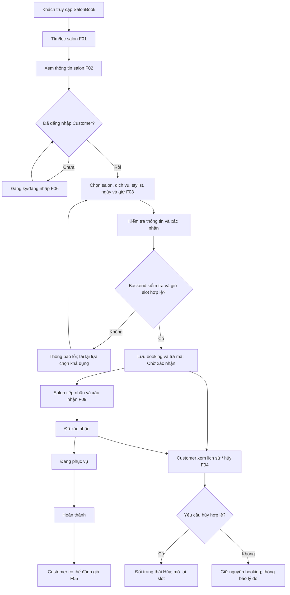

# QUY TRÌNH NGHIỆP VỤ SALONBOOK (BUSINESS WORKFLOW)

## 1. Mục tiêu, phạm vi và căn cứ

### 1.1. Bối cảnh và mục tiêu nghiệp vụ

SalonBook là nền tảng trung gian giúp khách hàng tìm kiếm, tìm hiểu và đặt lịch dịch vụ chăm sóc tóc tại **nhiều salon/barbershop** ở TP.HCM. Khách hàng có thể lọc salon theo khu vực, loại hình và nhóm chuyên môn; xem bảng giá, stylist và đánh giá trước khi đặt lịch. Chủ salon quản lý dịch vụ, lịch làm của thợ và tiến trình lịch hẹn **chỉ trong phạm vi salon được phân quyền**. Admin nền tảng phê duyệt/khóa salon, quản lý tài khoản và kiểm duyệt đánh giá.

Quy trình hướng đến việc giảm thao tác đặt lịch qua điện thoại/tin nhắn, hạn chế trùng lịch stylist và giúp khách chủ động theo dõi lịch sử, hủy lịch đúng quy định.

### 1.2. Phạm vi MVP

| Nhóm nghiệp vụ | F-code | Phạm vi được áp dụng |
|---|---|---|
| Khám phá salon | F01, F02 | Tìm kiếm/lọc đa tiêu chí; xem thông tin salon, dịch vụ, giá, stylist, không gian tiệm và đánh giá. |
| Tài khoản và phân quyền | F06 | Đăng ký/đăng nhập; phân biệt Guest, Customer, Salon Owner và Platform Admin. **Chỉ Customer đã đăng nhập được đặt lịch.** |
| Đặt lịch | F03, liên quan F08 | Chọn salon, dịch vụ, stylist, ngày, giờ còn trống; kiểm tra khả dụng và lưu booking có mã định danh. |
| Lịch cá nhân và hủy/đổi lịch | F04 | Xem lịch sử của chính mình; hủy trước giờ hẹn ít nhất 2 giờ. Đổi lịch bằng cách hủy lịch cũ rồi đặt lịch mới, **không sửa trực tiếp booking**. |
| Đánh giá | F05 | Customer có booking đã **Hoàn thành** được chấm 1–5 sao và nhận xét; Guest được xem nhưng không được gửi đánh giá. |
| Quản lý salon và lịch làm | F07, F08 | Chủ salon cập nhật thông tin/dịch vụ/giá; quản lý stylist, ca trực và ngày nghỉ của salon mình. |
| Điều phối lịch | F09 | Chủ salon lọc lịch theo ngày/trạng thái, xác nhận và cập nhật trạng thái theo luồng đã quy định. |
| Quản trị nền tảng | F10 | Admin phê duyệt/khóa salon, quản lý tài khoản và kiểm duyệt đánh giá vi phạm. |

**Ngoài phạm vi MVP:** Chatbot AI, chương trình tích điểm/voucher và tích hợp thanh toán trực tuyến. Khách sử dụng dịch vụ tại salon, sau đó thanh toán trực tiếp tại quầy bằng tiền mặt hoặc chuyển khoản. Không có nghiệp vụ giao hàng/vận chuyển.

### 1.3. Quy tắc nền tảng áp dụng thống nhất

1. **Marketplace nhiều salon:** Mỗi booking phải gắn đúng `salon_id`; dịch vụ và stylist phải thuộc salon đang chọn. Dữ liệu không được lẫn giữa các salon.
2. **Quyền đặt lịch:** Guest được xem/lọc salon, xem dịch vụ, đánh giá và giờ trống nhưng **không được đặt lịch**. Người dùng phải đăng ký/đăng nhập với vai trò Customer trước khi xác nhận booking.
3. **Chống trùng lịch:** Thời lượng dịch vụ, lịch làm/ca trực, ngày nghỉ và các booking đã chiếm chỗ được kiểm tra tại backend. Không dựa riêng vào danh sách giờ trống hiển thị trên giao diện.
4. **Chính sách hủy:** Customer chỉ hủy booking của mình khi còn **ít nhất 2 giờ** trước giờ hẹn; hủy thành công giải phóng khung giờ bị chiếm. Không chỉnh sửa trực tiếp lịch đã tạo.
5. **Quyền đánh giá:** Chỉ Customer sở hữu lịch đã ở trạng thái **Hoàn thành** mới được gửi đánh giá 1–5 sao và nhận xét; điểm trung bình được cập nhật/hiển thị trên nền tảng.
6. **Quyền salon:** Salon Owner chỉ được đọc/sửa dữ liệu thuộc `salon_id` được cấp; Platform Admin quản trị ở cấp nền tảng, không thay chủ salon tự ý phân ca hằng ngày.
7. **Quy ước trạng thái:** Dùng thống nhất **Chờ xác nhận → Đã xác nhận → Đang phục vụ → Hoàn thành**, cùng trạng thái kết thúc **Hủy**, theo F09.
8. **Quy định đến hẹn:** Theo giả định trong `REQUIREMENTS.md`, khách nên có mặt trước 10 phút; nếu đến muộn quá 15 phút mà không liên hệ, salon có quyền từ chối phục vụ hoặc hủy lịch. Đây **không phải** điều kiện từ chối tạo booking ban đầu.

## 2. Tác nhân và trách nhiệm

| Tác nhân | Trách nhiệm / quyền trong quy trình | Giới hạn |
|---|---|---|
| **Guest (khách vãng lai)** | Dùng F01, F02 để xem/lọc salon, dịch vụ, giá, stylist, slot trống và đánh giá. | Không đặt lịch, không xem lịch sử cá nhân và không gửi đánh giá; cần đăng nhập để sử dụng F03/F04/F05 ở mức Customer. |
| **Customer (khách hàng đã đăng nhập)** | Đặt lịch F03; xem lịch sử/hủy F04; đánh giá booking hoàn thành F05. | Chỉ thao tác trên booking của chính mình; không sửa trực tiếp lịch; không truy cập phần quản trị. |
| **Salon Owner / Manager** | Cập nhật thông tin/dịch vụ/giá F07; quản lý danh sách stylist, ca trực/ngày nghỉ F08; tiếp nhận và cập nhật booking F09; xem phản hồi của salon. | Chỉ dữ liệu thuộc salon được cấp quyền; không sửa/xóa đánh giá tùy tiện hoặc quản lý salon khác. |
| **Platform Admin** | Phê duyệt/kích hoạt/khóa salon; quản lý tài khoản đối tác; kiểm duyệt/gỡ đánh giá vi phạm F10. | Không trực tiếp làm thay việc phân ca chi tiết hằng ngày của chủ salon. |
| **Stylist** | Là nguồn lực phục vụ được gắn với salon, dịch vụ và lịch làm để tính slot khả dụng. | `REQUIREMENTS.md` chưa định nghĩa tài khoản/quyền đăng nhập riêng của stylist; trong MVP, việc quản lý lịch thuộc Salon Owner. |
| **Frontend (website)** | Hiển thị dữ liệu theo quyền, thu nhận lựa chọn, gửi yêu cầu, hiển thị kết quả/thông báo lỗi. | Không tự xác nhận cuối cùng rằng slot còn trống hay người dùng có quyền. |
| **Backend và cơ sở dữ liệu** | Xác thực/phân quyền; đối chiếu salon–dịch vụ–stylist; xác định slot; chống trùng khi lưu; cập nhật trạng thái và lịch sử. | Chỉ ghi dữ liệu khi toàn bộ điều kiện hợp lệ; bảo vệ dữ liệu từng salon và từng khách. |

## 3. 04.1 – Quy trình đặt lịch chính

### 3.1. Điều kiện trước khi khách đặt lịch

- Salon đã được Platform Admin **phê duyệt và kích hoạt** (F10); salon bị khóa không xuất hiện trong kết quả tìm kiếm F01.
- Salon Owner đã thiết lập thông tin salon, dịch vụ/giá, danh sách stylist (F07) và lịch làm/ngày nghỉ của stylist (F08).
- Dịch vụ đang được cho phép đặt; ngày/giờ được chọn phải ở **tương lai** và thuộc lịch làm hợp lệ.
- Khách có thể khám phá dịch vụ khi chưa đăng nhập; để **gửi yêu cầu đặt lịch**, phải đăng nhập tài khoản Customer (F06).

### 3.2. Luồng tổng quát

**Chuẩn bị dữ liệu (Admin/Salon):** Admin duyệt và kích hoạt salon (F10) → Chủ salon cấu hình thông tin, dịch vụ, stylist (F07) và ca trực/ngày nghỉ (F08).

**Luồng khách hàng:** Truy cập website → tìm/lọc salon (F01) → xem chi tiết salon (F02) → đăng nhập/đăng ký nếu cần (F06) → chọn salon, dịch vụ, stylist, ngày/giờ (F03) → xác nhận → backend kiểm tra cuối cùng và lưu booking → nhận mã lịch ở trạng thái **Chờ xác nhận** → theo dõi/hủy trong lịch sử cá nhân (F04) → đánh giá sau khi **Hoàn thành** (F05).

**Luồng salon:** Nhận lịch **Chờ xác nhận** → **Đã xác nhận** → **Đang phục vụ** → **Hoàn thành** (F09), hoặc chuyển **Hủy** nếu có căn cứ nghiệp vụ hợp lệ.

Sơ đồ biểu diễn nhánh hủy của khách ở các trạng thái có thể hủy. Quy tắc hủy chi tiết ở mục 4 và 5; không hàm ý rằng mọi trạng thái đều cho phép hủy.

### 3.3. Bảng quy trình chi tiết

| Bước | Người thực hiện | Dữ liệu đầu vào / hành động | Hệ thống xử lý | Kết quả đầu ra / F-code |
|---|---|---|---|---|
| **1. Công khai salon hợp lệ** | Platform Admin; hệ thống | Admin phê duyệt/kích hoạt salon đối tác. | Lưu trạng thái salon; salon bị khóa không xuất hiện ở bộ lọc. | Salon đủ điều kiện hiển thị – **F10**. |
| **2. Chuẩn bị dữ liệu salon** | Salon Owner | Cập nhật thông tin, tag phân loại, menu, giá, stylist, ca trực/ngày nghỉ. | Lưu trong phạm vi `salon_id`; xác lập dữ liệu dùng để tính slot. | Salon/dịch vụ/lịch làm được cấu hình – **F07, F08**. |
| **3. Tìm kiếm và lọc salon** | Guest hoặc Customer | Chọn quận/khu vực, Nam/Nữ/Unisex, nhóm chuyên môn; có thể kết hợp bộ lọc. | Chỉ trả các salon đủ điều kiện; áp dụng đúng tiêu chí và hiển thị tên, địa chỉ, ảnh đại diện, tag, điểm trung bình. | Danh sách salon phù hợp – **F01**. |
| **4. Xem chi tiết salon** | Guest hoặc Customer | Mở một salon trong danh sách. | Đọc dữ liệu đúng `salon_id`: thông tin tiệm, menu dịch vụ, giá, stylist, hình ảnh và đánh giá hiển thị. | Trang chi tiết salon – **F02**, tham chiếu **F05**. |
| **5. Xác thực khi đặt lịch** | Customer/Guest | Chọn thao tác đặt lịch; nếu chưa đăng nhập thì đăng ký/đăng nhập. | Xác thực tài khoản, xác định vai trò; ngăn Guest gửi booking. | Phiên Customer hợp lệ hoặc yêu cầu đăng nhập – **F06**. |
| **6. Chọn salon, dịch vụ, stylist** | Customer | Chọn `salon_id`, `service_id`, `stylist_id` trên salon đã xem. | Kiểm tra dịch vụ và stylist thuộc salon, dịch vụ đang có hiệu lực; lấy giá/thời lượng từ backend. | Tổ hợp dịch vụ và thợ hợp lệ – **F03**, dữ liệu từ **F02/F07**. |
| **7. Chọn ngày và giờ** | Customer | Chọn ngày trong tương lai và khung giờ mong muốn. | Tính slot dựa trên thời lượng dịch vụ, ca trực/ngày nghỉ (F08), lịch hẹn hiện hữu; ẩn/vô hiệu slot không hợp lệ. | Giờ bắt đầu/kết thúc dự kiến – **F03, F08**. |
| **8. Kiểm tra thông tin và xác nhận** | Customer | Kiểm tra salon, dịch vụ, stylist, giá, ngày/giờ; cung cấp/xác nhận họ tên và SĐT liên hệ. | Kiểm tra dữ liệu bắt buộc; SĐT Việt Nam 10 chữ số và dữ liệu nhập an toàn; gửi yêu cầu tới backend. | Yêu cầu đặt lịch gửi đi hoặc lỗi nhập liệu – **F03**, NFR. |
| **9. Kiểm tra khả dụng cuối cùng** | Backend | Yêu cầu có tài khoản Customer và các ID/ngày giờ đã chọn. | Kiểm tra lại quyền, trạng thái salon/dịch vụ, mối quan hệ `salon_id`–`service_id`–`stylist_id`, lịch làm, ngày nghỉ, thời lượng và xung đột. | Yêu cầu được chấp nhận để lưu hoặc bị từ chối – **F03/F08**, NFR. |
| **10. Lưu booking an toàn** | Backend / database | Yêu cầu đã hợp lệ tại bước 9. | Thực hiện thao tác lưu có kiểm soát đồng thời (transaction/locking); tạo booking gắn Customer và các mã liên quan. | Mã booking, lịch ở trạng thái **Chờ xác nhận**, không double booking – **F03**. |
| **11. Trả kết quả** | Website | Kết quả lưu booking. | Chỉ báo thành công sau khi backend xác nhận đã lưu; hiển thị mã lịch, salon, dịch vụ, stylist, ngày/giờ và trạng thái. | Khách có thông tin lịch đã ghi nhận hoặc thông báo chọn lại – **F03**. |
| **12. Salon tiếp nhận và xử lý** | Salon Owner | Mở danh sách lịch, lọc theo ngày/trạng thái, chọn booking thuộc salon mình. | Kiểm tra phân quyền; chuyển trạng thái theo quy tắc F09 và cập nhật dữ liệu. | **Chờ xác nhận → Đã xác nhận → Đang phục vụ → Hoàn thành** hoặc **Hủy** hợp lệ – **F09**. |
| **13. Theo dõi hoặc hủy lịch** | Customer | Mở lịch sử cá nhân; chọn lịch muốn hủy. | Chỉ hiển thị booking của Customer; cho hủy nếu đúng quyền, trạng thái hợp lệ và còn ≥ 2 giờ trước lịch hẹn; giải phóng slot sau khi hủy. | Lịch sử được cập nhật; lịch hợp lệ chuyển **Hủy** – **F04**. |
| **14. Đánh giá sau dịch vụ** | Customer | Chọn lịch đã **Hoàn thành**, nhập sao 1–5 và nhận xét. | Kiểm tra quyền sở hữu booking, trạng thái, thang điểm; lưu đánh giá và cập nhật điểm trung bình salon. | Đánh giá được ghi nhận/hiển thị theo cơ chế kiểm duyệt – **F05**, liên quan **F10**. |

### 3.4. Dữ liệu đầu vào và đầu ra

| Nhóm dữ liệu | Đầu vào | Đầu ra / yêu cầu lưu và kiểm tra |
|---|---|---|
| **Salon** | `salon_id` khách chọn. | Booking gắn đúng salon đã được phê duyệt/kích hoạt; chủ salon chỉ thấy dữ liệu của salon được phân quyền. |
| **Dịch vụ** | `service_id` thuộc salon. | Tên, giá và thời lượng đọc từ hệ thống; dịch vụ còn cho phép đặt và thuộc đúng `salon_id`. |
| **Stylist** | `stylist_id` khách chọn. | Stylist thuộc salon tương ứng và khả dụng theo ca trực/ngày nghỉ trong toàn bộ khoảng phục vụ. |
| **Thời gian** | Ngày/giờ bắt đầu mong muốn. | Giờ kết thúc tính từ thời lượng dịch vụ trên server; thời gian tương lai, phù hợp ca làm và không giao lịch. |
| **Customer** | Tài khoản đã đăng nhập, họ tên và SĐT liên hệ. | Liên kết booking với chủ tài khoản; SĐT hợp lệ 10 chữ số, bảo vệ dữ liệu cá nhân. |
| **Booking** | Salon + dịch vụ + stylist + thời gian + Customer. | Mã booking duy nhất, thông tin dịch vụ, trạng thái **Chờ xác nhận** và thời điểm tạo; các lần cập nhật trạng thái hợp lệ. |
| **Đánh giá** | Booking đã **Hoàn thành**, điểm sao 1–5, nhận xét. | Đánh giá gắn với Customer/booking/salon và điểm trung bình salon được cập nhật. |
| **Kết quả/lỗi** | Kết quả kiểm tra quyền, dữ liệu, slot hoặc lưu trữ. | Thông báo rõ để khách sửa/chọn giờ khác; không xác nhận thành công nếu lưu thất bại. |

### 3.5. Quy tắc chống trùng lịch và bảo toàn dữ liệu

- Backend lấy **thời lượng dịch vụ chuẩn** từ dữ liệu dịch vụ đã lưu; không tin thời lượng hoặc giá do trình duyệt tự gán.
- Với các lịch đang **chiếm chỗ** của cùng stylist, có xung đột nếu:

  `new_start < existing_end AND new_end > existing_start`

  Trong đó `new_end = new_start + service_duration`.
- Booking ở trạng thái **Hủy** không tiếp tục chiếm slot; booking đang có hiệu lực được kiểm tra theo toàn bộ khoảng thời gian, không chỉ giờ bắt đầu. Các booking **Hoàn thành** là dữ liệu lịch sử và không mở lại để đặt chồng vào thời gian đã qua.
- Slot phải nằm trong ca làm hợp lệ, không thuộc ngày nghỉ F08, và thời điểm đặt phải ở tương lai. Kiểm tra `salon_id`, `service_id`, `stylist_id` ở backend kể cả khi frontend đã lọc.
- Khi hai khách đặt đồng thời, hệ thống phải kiểm tra/lưu trong giao dịch an toàn hoặc cơ chế khóa tương đương, để **chỉ một booking có thể chiếm cùng khoảng thời gian của một stylist**. Khách còn lại nhận thông báo chọn slot khác.
- Sau khi hủy hợp lệ, giải phóng slot để hiển thị theo điều kiện lịch làm hiện tại. Việc hủy và giải phóng slot phải được lưu nhất quán.
- `REQUIREMENTS.md` **không quy định** bước nhảy slot, thời gian đệm giữa dịch vụ hoặc số phút làm tròn; không tự mặc định các thông số này trong tài liệu.

## 4. 04.2 – Ngoại lệ và quy tắc nghiệp vụ

| Tình huống | Điều kiện phát sinh | Cách xử lý của hệ thống | Kết quả / căn cứ |
|---|---|---|---|
| **Không tìm thấy salon** | Không có salon thỏa đồng thời các bộ lọc. | Hiển thị trạng thái rỗng và cho phép đổi tiêu chí. | Không có booking – **F01**. |
| **Salon chưa được duyệt hoặc bị khóa** | Salon không đủ điều kiện công khai. | Không đưa salon vào kết quả tìm kiếm; từ chối thao tác đặt lịch tới salon không hợp lệ. | Không tạo booking – **F10, F01, F03**. |
| **Guest cố đặt lịch** | Người dùng chưa đăng nhập Customer. | Chuyển đến đăng nhập/đăng ký; backend từ chối tạo booking nếu thiếu quyền. | Chưa tạo lịch – **F06, F03**. |
| **Dịch vụ/stylist không thuộc salon** | Các ID không nhất quán với `salon_id`, hoặc dịch vụ bị ẩn. | Từ chối yêu cầu; làm mới dữ liệu hợp lệ theo salon. | Không tạo booking – **F02, F03, F07**. |
| **Thông tin liên hệ không hợp lệ** | Thiếu thông tin bắt buộc, SĐT không đúng 10 chữ số hoặc nội dung đầu vào không an toàn. | Thông báo trường cần sửa; kiểm tra ở frontend và backend. | Không tạo lịch – **NFR, F03**. |
| **Ngày/giờ không hợp lệ** | Thời gian đặt không ở tương lai, nằm ngoài ca trực, trùng ngày nghỉ hoặc không đủ thời lượng thực hiện. | Vô hiệu slot; yêu cầu khách chọn lại. | Không tạo lịch – **F03, F08**. |
| **Trùng lịch stylist** | Khoảng phục vụ giao với booking còn chiếm chỗ của cùng stylist. | Kiểm tra toàn khoảng thời gian và từ chối slot. | Không tạo lịch – **F03**, NFR. |
| **Hai khách đặt cùng slot** | Slot thay đổi sau khi hai giao diện cùng tải dữ liệu. | Khóa/giao dịch lưu; chỉ một yêu cầu thành công, yêu cầu còn lại tải lại giờ trống. | Không double booking – **F03**, NFR. |
| **Customer truy cập lịch của người khác** | ID booking không thuộc tài khoản đã đăng nhập. | Kiểm tra quyền từ backend, từ chối đọc/hủy. | Không lộ hoặc sửa dữ liệu – **F04, F06**. |
| **Hủy đủ điều kiện** | Customer sở hữu lịch, lịch còn có thể hủy và cách giờ bắt đầu **≥ 2 giờ**. | Chuyển trạng thái **Hủy**, cập nhật lịch sử và mở lại slot. | Hủy thành công – **F04**. |
| **Hủy muộn hoặc không đúng trạng thái** | Còn **< 2 giờ**, hoặc lịch đã **Hủy/Hoàn thành/Đang phục vụ**. | Từ chối hủy bởi Customer; giữ nguyên trạng thái, nêu lý do. | Không thay đổi booking – **F04, F09**. |
| **Khách muốn đổi lịch** | Muốn thay ngày/giờ hoặc stylist sau khi booking được tạo. | Không hỗ trợ nút sửa trực tiếp; hướng dẫn **hủy lịch cũ (nếu còn đủ điều kiện) rồi tạo booking mới**. | Hai nghiệp vụ tách biệt – **F04, F03**. |
| **Khách đến muộn quá 15 phút** | Đến muộn quá 15 phút và không liên hệ trước. | Salon có quyền từ chối phục vụ hoặc cập nhật **Hủy** theo giả định nghiệp vụ, có kiểm tra quyền/trạng thái. | Lịch có thể bị hủy – **REQUIREMENTS mục 6, F09**. |
| **Guest hoặc khách chưa hoàn tất muốn đánh giá** | Chưa đăng nhập, booking không thuộc Customer hoặc trạng thái chưa **Hoàn thành**. | Không cho gửi đánh giá, thông báo điều kiện. Guest vẫn được đọc đánh giá. | Không tạo đánh giá – **F05, F06**. |
| **Số sao không hợp lệ** | Điểm nằm ngoài 1–5. | Từ chối và yêu cầu chọn mức hợp lệ. | Không lưu đánh giá – **F05**, NFR. |
| **Đánh giá vi phạm** | Admin xác định nội dung vi phạm tiêu chuẩn kiểm duyệt. | Platform Admin gỡ/ẩn nhận xét; phản ánh thay đổi vào nội dung hiển thị và điểm trung bình nếu áp dụng loại trừ đánh giá bị gỡ. | Nội dung vi phạm không còn hiển thị – **F10, F05**. |
| **Chủ salon truy cập salon khác** | Tài khoản Owner thay ID/URL hoặc gửi yêu cầu cập nhật dữ liệu ngoài phạm vi. | Backend kiểm tra salon được cấp quyền; từ chối thao tác. | Không truy cập chéo – **F07, F08, F09**, NFR chống IDOR. |
| **Chuyển trạng thái sai quy trình** | Vai trò không có quyền hoặc chuyển từ trạng thái kết thúc về trạng thái trước. | Từ chối cập nhật, giữ trạng thái hiện tại. | Không thay đổi booking – **F09**. |
| **Lỗi server/database** | Không thể kiểm tra hoặc lưu dữ liệu an toàn. | Rollback giao dịch khi cần; hiển thị thất bại, không báo đặt thành công. | Không lưu booking một phần – **F03**, NFR. |

**Lưu ý về đổi lịch:** Chính sách hủy trước 2 giờ vẫn có hiệu lực khi khách muốn đổi lịch. Nếu lịch cũ không đủ điều kiện hủy, hệ thống không tự động tạo ngoại lệ hay sửa giờ. Việc đặt lịch mới chỉ xác nhận được khi có slot khả dụng, và không được ngầm coi là thao tác chỉnh sửa lịch cũ.

## 5. Trạng thái và chuyển tiếp booking

### 5.1. Bộ trạng thái thống nhất theo F09

| Trạng thái | Ý nghĩa | Chuyển tiếp hợp lệ trong workflow | Chủ thể / điều kiện |
|---|---|---|---|
| **Chờ xác nhận** | Booking đã được backend lưu, salon chưa xác nhận. | **Đã xác nhận** hoặc **Hủy**. | Owner tiếp nhận F09; Customer có thể hủy theo F04 khi còn ≥ 2 giờ. |
| **Đã xác nhận** | Salon đã nhận và xác nhận lịch phục vụ. | **Đang phục vụ** hoặc **Hủy**. | Owner cập nhật F09; Customer có thể hủy theo F04 khi còn ≥ 2 giờ. |
| **Đang phục vụ** | Dịch vụ đang được thực hiện. | **Hoàn thành**. | Owner cập nhật F09; Customer không thể hủy bằng luồng F04 thông thường. |
| **Hoàn thành** | Dịch vụ đã kết thúc. | Không chuyển tiếp thông thường. | Có thể kích hoạt quyền đánh giá F05. |
| **Hủy** | Lịch đã bị hủy hợp lệ, không còn chiếm chỗ. | Không chuyển tiếp thông thường. | Customer hủy hợp lệ theo F04 hoặc salon hủy theo chính sách áp dụng trong F09. |

**Quy chuẩn tên:** F09 trong `REQUIREMENTS.md` sử dụng **“Chờ xác nhận”, “Đã xác nhận”, “Đang phục vụ”, “Hoàn thành”, “Hủy”**. Tài liệu này dùng đúng năm nhãn đó; cụm “đã hủy” chỉ dùng như cách diễn đạt thông thường, không tạo trạng thái thứ sáu.

### 5.2. Nguyên tắc cập nhật

- Booking mới được ghi nhận ở trạng thái **Chờ xác nhận**; việc cấp mã booking **không đồng nghĩa** salon đã xác nhận phục vụ.
- Chỉ tài khoản có quyền mới được cập nhật trạng thái. Owner phải thuộc đúng salon của booking; Customer chỉ có quyền hủy theo F04.
- Không bỏ qua trạng thái **Đang phục vụ** để đánh dấu hoàn thành trong luồng thông thường; không chuyển ngược từ **Hoàn thành/Hủy**.
- Salon có quyền xử lý khách đến muộn theo giả định của `REQUIREMENTS.md`; cách ghi nhận lý do hủy cần thống nhất khi thiết kế giao diện/dữ liệu.
- **Hủy** giải phóng slot; **Hoàn thành** cho phép đánh giá và lưu trong lịch sử cá nhân.

## 6. Luồng quản lý liên quan ngoài hành trình đặt lịch

### 6.1. Quản lý salon và năng lực phục vụ (F07–F08)

1. Salon Owner đăng nhập qua F06; backend xác định `salon_id` được cấp.
2. Owner chỉnh thông tin tiệm, tag chuyên môn, menu dịch vụ và đơn giá; thêm/sửa/ẩn dịch vụ của salon mình (F07).
3. Owner quản lý stylist, phân ca trực và ngày nghỉ (F08).
4. Sau khi dữ liệu hợp lệ được lưu, thông tin công khai được cập nhật tại F01/F02; lịch làm mới được dùng tính slot của F03.
5. Nếu thay đổi ca trực/ngày nghỉ ảnh hưởng đến **booking đã xác nhận**, hệ thống cần quy tắc xử lý riêng; không âm thầm xóa hoặc di chuyển lịch của khách.

### 6.2. Quản trị nền tảng và đánh giá (F10, F05)

1. Platform Admin tiếp nhận và phê duyệt salon đối tác; kích hoạt hoặc khóa salon (F10).
2. Danh sách tìm kiếm F01 chỉ công khai salon hợp lệ; salon bị vô hiệu hóa không xuất hiện trong bộ lọc.
3. Admin quản lý tài khoản đối tác, giám sát và xử lý nội dung đánh giá vi phạm theo F10.
4. Customer đủ điều kiện gửi đánh giá F05; Guest và Customer được xem đánh giá/điểm trung bình ở phần công khai. Chủ salon xem phản hồi nhưng không tùy tiện chỉnh sửa/xóa nhận xét của khách.

## 7. 04.3 – Đối chiếu workflow với REQUIREMENTS.md và README.md

| F-code | Yêu cầu chính thức trong MVP | Vị trí thể hiện trong workflow | Kết quả kiểm tra |
|---|---|---|---|
| **F01** | Tìm kiếm và lọc salon theo khu vực, loại hình, nhóm chuyên môn; có thông tin và điểm trung bình. | 3.3 bước 3; 4; 6.2 | **Phù hợp.** Chỉ salon hợp lệ được hiển thị. |
| **F02** | Xem chi tiết salon, dịch vụ, bảng giá, stylist và không gian tiệm theo `salon_id`. | 3.3 bước 4; 3.4 | **Phù hợp.** Không trộn dữ liệu các salon. |
| **F03** | Customer đặt salon/dịch vụ/stylist/ngày/slot; chống trùng; lưu các ID và sinh mã booking. | 3.2–3.5; 4 | **Phù hợp.** Có bước xác thực và kiểm tra tại backend. |
| **F04** | Khách xem lịch sử cá nhân, hủy khi còn ≥ 2 giờ và giải phóng slot; không sửa lịch trực tiếp. | 3.3 bước 13; 4; 5 | **Phù hợp.** Đổi lịch bằng hủy + đặt lại. |
| **F05** | Đánh giá sao 1–5 và nhận xét sau khi hoàn thành; cập nhật điểm trung bình. | 3.3 bước 14; 4; 5; 6.2 | **Phù hợp.** Guest chỉ xem đánh giá, không gửi. |
| **F06** | Đăng ký/đăng nhập, phân quyền Guest/Customer/Owner/Admin. | 2; 3.3 bước 5; 4 | **Phù hợp.** Guest không đặt lịch; quyền được xác minh ở backend. |
| **F07** | Owner quản lý thông tin, menu, giá và dịch vụ của salon mình. | 3.1; 3.3 bước 2; 6.1 | **Phù hợp.** Gắn giới hạn theo `salon_id`. |
| **F08** | Owner quản lý ca làm, ngày nghỉ stylist; slot nghỉ không xuất hiện. | 3.1; 3.3 bước 2/7/9; 3.5; 6.1 | **Phù hợp.** Dùng lịch làm để tính khả dụng. |
| **F09** | Owner theo dõi/lọc lịch và xử lý chu trình trạng thái chuẩn. | 3.3 bước 12; 5 | **Phù hợp.** Sử dụng đúng bộ năm trạng thái F09. |
| **F10** | Admin phê duyệt/khóa salon, quản lý tài khoản, kiểm duyệt đánh giá vi phạm. | 3.3 bước 1; 4; 6.2 | **Phù hợp.** Vai trò và phạm vi tách biệt Owner. |
