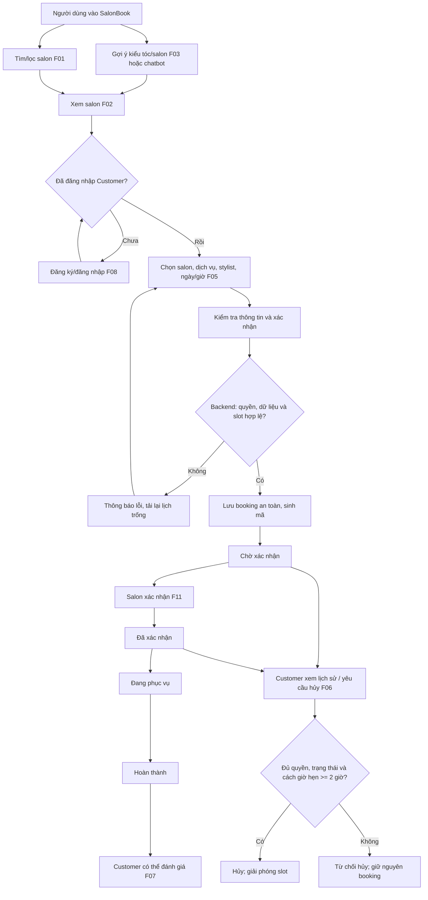

# QUY TRÌNH NGHIỆP VỤ SALONBOOK (BUSINESS WORKFLOW)

> **Dự án:** SalonBook – Website đặt lịch salon tóc trực tuyến  
> **Mô hình:** Marketplace kết nối nhiều salon/barbershop tại Thành phố Hồ Chí Minh  
> **Phạm vi:** Phiên bản MVP theo `REQUIREMENTS.md` cập nhật, gồm **F01–F12** và nghiệp vụ **Chatbot AI** được nêu trong phạm vi MVP  
> **Mục đích:** Mô tả quy trình nghiệp vụ, vai trò, dữ liệu, các luồng chính/phụ, ngoại lệ và đối chiếu với yêu cầu chức năng.  
> **Quy ước:** Nội dung ghi **“cần xác nhận”** là điểm chưa được tài liệu yêu cầu quyết định chi tiết; không được hiểu là chức năng hoặc quy tắc đã chốt.

## 1. Mục tiêu, phạm vi và căn cứ

### 1.1. Bối cảnh nghiệp vụ

SalonBook là nền tảng thương mại điện tử trung gian phục vụ **nhiều salon và barbershop tại TP.HCM**, giúp khách hàng khám phá salon theo khu vực, phân loại và thế mạnh chuyên môn; xem dịch vụ, giá, stylist, đánh giá và đặt lịch trực tuyến. Chủ salon sử dụng hệ thống để quản lý thông tin cửa hàng, danh mục dịch vụ, lịch làm của stylist và lịch hẹn thuộc salon mình. Admin sàn quản lý đối tác, tài khoản và nội dung cần kiểm duyệt.

Bên cạnh hành trình đặt lịch truyền thống, phiên bản MVP còn có ba hướng tiếp cận khách hàng:

- **Gợi ý kiểu tóc từ ảnh khuôn mặt (F03):** người dùng tải ảnh, nhận **3–5 gợi ý kiểu tóc** và lựa chọn salon phù hợp để chuyển sang hành trình đặt lịch.
- **Kết nối tuyển mẫu tóc (F04):** chủ salon đăng tin tuyển mẫu cắt/uốn/nhuộm; Admin duyệt tin; Customer gửi thông tin ứng tuyển để salon liên hệ. **Ứng tuyển không tự động tạo booking.**
- **Chatbot AI tư vấn và hỗ trợ:** người dùng hỏi đáp về dịch vụ, kiểu tóc/màu nhuộm và tham khảo salon; chatbot chỉ hỗ trợ tìm hiểu/điều hướng, không được tự xác nhận lịch hẹn.

### 1.2. Phạm vi MVP

| Nhóm nghiệp vụ | F-code / căn cứ | Nội dung áp dụng |
|---|---|---|
| Tìm kiếm và khám phá salon | **F01, F02** | Lọc theo quận/khu vực, Nam/Nữ/Unisex và nhóm chuyên môn; xem thông tin, ảnh, menu, giá, stylist, điểm đánh giá. |
| Phân tích ảnh và gợi ý kiểu tóc | **F03** | Guest/Customer tải ảnh JPG/PNG/WEBP dưới 5 MB, nhận 3–5 gợi ý kiểu tóc và salon phù hợp. |
| Đăng tin và ứng tuyển mẫu tóc | **F04** | Salon Owner đăng tin; Admin kiểm duyệt trước khi công khai; Customer xem tin và gửi biểu mẫu liên hệ; Owner xem ứng viên. |
| Đặt lịch | **F05** | Customer chọn `salon_id`, dịch vụ, stylist, ngày và giờ trống; hệ thống kiểm tra và lưu mã booking, chống trùng lịch. |
| Lịch sử và hủy/đổi lịch | **F06** | Customer chỉ xem/hủy lịch của mình khi còn ít nhất **2 giờ** trước giờ hẹn. Đổi lịch bằng **hủy rồi đặt mới**, không sửa booking trực tiếp. |
| Đánh giá và nhận xét | **F07** | Customer có booking **Hoàn thành** được gửi đánh giá 1–5 sao và nhận xét; người dùng xem đánh giá và điểm trung bình công khai. |
| Tài khoản và phân quyền | **F08** | Đăng ký/đăng nhập và phân quyền Customer, Salon Owner, Platform Admin; Guest được sử dụng các chức năng công khai theo yêu cầu. |
| Quản lý salon, dịch vụ và lịch làm | **F09, F10** | Owner quản lý thông tin, phân loại, menu, giá, stylist, ca trực và ngày nghỉ trong phạm vi salon mình. |
| Tiếp nhận/điều phối booking | **F11** | Owner lọc lịch theo ngày/trạng thái và cập nhật theo chu trình **Chờ xác nhận → Đã xác nhận → Đang phục vụ → Hoàn thành / Hủy**. |
| Quản trị và kiểm duyệt | **F12** | Admin phê duyệt/kích hoạt/khóa salon, quản lý đối tác, kiểm duyệt tin tuyển mẫu và nhận xét vi phạm. |
| Chatbot AI tư vấn/hỗ trợ | **Phạm vi MVP mục 2; chưa có F-code** | Tương tác hỏi đáp và gợi ý salon; **cần bổ sung mã/tiêu chí nghiệm thu vào REQUIREMENTS** nếu nhóm muốn quản lý như một chức năng độc lập. |

**Ngoài phạm vi:** thanh toán qua website/cổng điện tử; hệ thống không tích hợp hoặc quản lý dòng tiền. Dịch vụ và chi phí tuyển mẫu được khách/salon tự thỏa thuận ngoài nền tảng. Không có giao hàng/vận chuyển; chưa triển khai chương trình tích điểm đổi voucher.

### 1.3. Các nguyên tắc nghiệp vụ xuyên suốt

1. Mọi dịch vụ, stylist, lịch làm và booking phải được liên kết đúng **`salon_id`**; không lấy nhầm dữ liệu giữa các salon.
2. **Guest** được sử dụng F01, F02, F03 và xem thông tin công khai. Để đặt lịch **F05**, xem/hủy lịch **F06**, gửi đánh giá **F07** hoặc ứng tuyển qua F04 theo phân quyền chức năng, người dùng phải là **Customer đã đăng nhập**.
3. **Salon Owner** chỉ xem/sửa dữ liệu của salon được phân quyền; **Platform Admin** quản lý cấp toàn nền tảng. Backend luôn kiểm tra quyền, không dựa vào việc ẩn nút trên giao diện.
4. Giờ trống phải được tính từ dịch vụ, thời lượng, ca làm, ngày nghỉ và các booking đang chiếm lịch; phải kiểm tra lại ở thời điểm **lưu booking** để ngăn đặt trùng.
5. **Hủy online bởi Customer** chỉ thành công khi thời điểm yêu cầu hủy cách giờ bắt đầu **≥ 2 giờ**, booking thuộc Customer và còn ở trạng thái được phép hủy.
6. **Đổi lịch** là hai giao dịch độc lập: hủy booking cũ đủ điều kiện, sau đó đặt booking mới nếu còn slot. Không sửa giờ/thợ/dịch vụ trực tiếp trên booking cũ.
7. Chỉ booking ở trạng thái **Hoàn thành** mới làm phát sinh quyền gửi đánh giá; điểm sao hợp lệ trong khoảng **1–5**.
8. Tin tuyển mẫu chỉ được công khai sau bước kiểm duyệt của Admin; việc ứng tuyển chỉ chuyển thông tin liên lạc cho salon, **không đồng nghĩa được chọn làm mẫu hay được xác nhận lịch**.
9. Ảnh khuôn mặt tải lên phải là **JPG, PNG hoặc WEBP**, dung lượng **dưới 5 MB**; thông tin ứng tuyển phải được kiểm tra định dạng số điện thoại/email trước khi lưu.
10. **Chatbot AI không có quyền tạo, thay đổi hoặc hủy booking chỉ từ câu trả lời hội thoại**; nếu người dùng muốn đặt lịch, phải đi qua bước đặt lịch F05 và kiểm tra backend như thông thường.

## 2. Tác nhân và trách nhiệm

| Tác nhân | Trách nhiệm trong workflow | Phạm vi/giới hạn |
|---|---|---|
| **Guest – khách chưa đăng nhập** | Tìm/lọc salon F01; xem chi tiết F02; tải ảnh và xem gợi ý F03; xem nội dung công khai/đánh giá; hỏi chatbot. | Không tự tạo booking F05, không xem lịch sử cá nhân F06 hoặc gửi đánh giá F07. F04 ghi vai trò ứng tuyển là Customer, nên không mặc định Guest được nộp form. |
| **Customer – khách đã đăng nhập** | Tất cả hành động công khai; đặt lịch F05; tra cứu/hủy F06; đánh giá F07 khi đủ điều kiện; gửi ứng tuyển mẫu F04. | Chỉ thao tác booking và thông tin ứng tuyển thuộc quyền của mình; không sửa lịch trực tiếp; không quản trị salon. |
| **Salon Owner / Manager** | Cập nhật thông tin/dịch vụ/giá F09; quản lý stylist và ca trực/ngày nghỉ F10; tiếp nhận và cập nhật booking F11; đăng tin tuyển mẫu, xem ứng viên F04. | Chỉ dữ liệu thuộc `salon_id` được cấp; không quản lý salon khác; tin đăng phải được Admin kiểm duyệt trước khi công khai. |
| **Platform Admin** | Phê duyệt/kích hoạt/khóa salon, quản lý tài khoản đối tác và kiểm duyệt tin tuyển mẫu/đánh giá F12. | Không mặc định làm thay các thao tác phân ca thường ngày của chủ salon. |
| **Stylist – thợ làm tóc** | Nguồn lực phục vụ được gắn với salon và ca làm; lịch khả dụng phụ thuộc lịch làm và booking của stylist. | `REQUIREMENTS.md` chưa có F-code cấp tài khoản hoặc màn hình riêng cho stylist; trong MVP, Owner quản lý ca/lịch. |
| **Frontend / Website** | Hiển thị salon, bộ lọc, hình ảnh, lựa chọn dịch vụ, form ứng tuyển, thời gian trống, chatbot và trạng thái; tiếp nhận thao tác. | Không được tự quyết định cuối cùng về quyền, trạng thái, tính khả dụng slot hoặc kết quả đặt lịch. |
| **Backend / Database** | Xác thực/phân quyền, kiểm tra dữ liệu/tệp, đối chiếu `salon_id`, xử lý chống trùng, lưu booking/ứng tuyển/đánh giá, điều phối trạng thái và kiểm duyệt. | Chỉ ghi nhận thành công sau khi kiểm tra và lưu an toàn; ngăn truy cập chéo dữ liệu và IDOR. |
| **Thành phần phân tích ảnh/Chatbot AI** | Trả gợi ý kiểu tóc, salon hoặc nội dung tư vấn để frontend trình bày. | Không quyết định giá chính thức, slot còn trống hoặc kết quả ghi nhận booking; phương thức tích hợp AI chưa được REQUIREMENTS chốt. |

## 3. 04.1 – Quy trình đặt lịch chính (F01, F02, F05, F06, F08–F12)

### 3.1. Điều kiện đầu vào

- Admin đã **phê duyệt và kích hoạt** salon đối tác (F12). Salon bị khóa không được hiển thị trong kết quả F01.
- Chủ salon đã lưu thông tin/danh mục dịch vụ/giá và stylist (F09), đồng thời thiết lập ca trực/ngày nghỉ hợp lệ (F10).
- Ngày/giờ được chọn phải ở **tương lai**, trong lịch làm hợp lệ và đủ thời lượng phục vụ; dữ liệu slot được kiểm tra ở backend.
- Khách có thể bắt đầu bằng tìm kiếm F01, gợi ý từ ảnh F03 hoặc chatbot. Tuy nhiên, **bước tạo booking F05 chỉ cho Customer đã đăng nhập** qua F08.

### 3.2. Luồng tổng quát

**Chuẩn bị ở phía salon:** Admin phê duyệt salon (F12) → Owner cập nhật dịch vụ/giá/stylist (F09) và ca trực/ngày nghỉ (F10).

**Hành trình khách hàng:** Truy cập website → tìm/lọc salon (F01) hoặc được điều hướng từ gợi ý F03/chatbot → xem thông tin salon (F02) → đăng nhập nếu chưa có phiên Customer (F08) → chọn salon, dịch vụ, stylist, ngày/giờ (F05) → xác nhận → backend kiểm tra lần cuối và lưu booking → trả mã booking, trạng thái **Chờ xác nhận** → Customer theo dõi/hủy hợp lệ trong lịch sử (F06).

**Hành trình chủ salon:** Nhận booking **Chờ xác nhận** → xác nhận → cập nhật **Đang phục vụ** → **Hoàn thành** hoặc **Hủy** khi đúng quyền/điều kiện (F11).

**Sau dịch vụ:** Customer có booking **Hoàn thành** có thể chấm sao/nhận xét (F07); Admin kiểm duyệt nếu nội dung vi phạm (F12).

*Sơ đồ thể hiện luồng thường gặp; nhánh hủy của salon khi khách đến muộn hoặc có căn cứ khác được mô tả ở mục 6. Các mũi tên không cho phép bỏ qua kiểm tra quyền/trạng thái.*

### 3.3. Các bước xử lý chi tiết

| Bước | Người thực hiện | Dữ liệu đầu vào / hành động | Xử lý của hệ thống | Kết quả / F-code |
|---|---|---|---|---|
| **1. Duyệt đối tác salon** | Platform Admin | Xét salon mới và trạng thái hoạt động. | Phê duyệt/kích hoạt hoặc khóa theo quyền Admin. | Salon đủ điều kiện công khai – **F12**. |
| **2. Chuẩn bị dịch vụ và lịch làm** | Salon Owner | Cập nhật tên/địa chỉ/tag, dịch vụ/giá, stylist, ca trực/ngày nghỉ. | Lưu dữ liệu theo `salon_id` của Owner; cung cấp dữ liệu để tính giờ trống. | Salon có dữ liệu hoạt động – **F09, F10**. |
| **3. Tìm/lọc salon** | Guest / Customer | Chọn quận/khu vực, Nam/Nữ/Unisex, nhóm chuyên môn. | Kết hợp bộ lọc, loại salon bị khóa; hiển thị tên, địa chỉ, ảnh đại diện, tag, điểm trung bình. | Danh sách salon phù hợp – **F01, F12**. |
| **4. Xem thông tin salon** | Guest / Customer | Chọn salon từ kết quả tìm kiếm/gợi ý. | Hiển thị menu, giá, stylist, hình ảnh và đánh giá gắn đúng `salon_id`. | Trang chi tiết salon – **F02, F07**. |
| **5. Xác thực để đặt lịch** | Guest / Customer | Nhấn đặt lịch khi chưa đăng nhập hoặc đang đăng nhập. | Nếu chưa có quyền Customer, chuyển đăng ký/đăng nhập; backend xác minh phiên và vai trò. | Customer hợp lệ – **F08**. |
| **6. Chọn dịch vụ và stylist** | Customer | Chọn salon, `service_id`, `stylist_id`. | Kiểm tra dịch vụ đang hoạt động, stylist thuộc salon; lấy giá/thời lượng từ dữ liệu hệ thống. | Tổ hợp đúng salon – **F05**, nguồn dữ liệu **F02/F09**. |
| **7. Chọn ngày/giờ** | Customer | Chọn ngày ở tương lai, giờ bắt đầu mong muốn. | Đọc ca làm/ngày nghỉ F10; tính giờ kết thúc theo thời lượng, loại slot trùng hoặc không đủ thời gian. | Danh sách slot hợp lệ và lựa chọn tạm thời – **F05, F10**. |
| **8. Xác nhận thông tin liên hệ** | Customer | Kiểm tra salon/dịch vụ/stylist/giá/ngày giờ; xác nhận dữ liệu liên hệ theo form. | Kiểm tra trường bắt buộc, họ tên an toàn và SĐT Việt Nam 10 chữ số (nếu thu thập tại form). | Yêu cầu tạo booking hợp lệ hoặc lỗi để sửa – **F05**, NFR. |
| **9. Kiểm tra cuối tại backend** | Backend | Customer, `salon_id`, `service_id`, `stylist_id`, thời gian dự kiến. | Kiểm tra lại quyền, salon đang hoạt động, quan hệ các mã, ca/ngày nghỉ, thời lượng và các lịch đang chiếm slot. | Chấp nhận hoặc từ chối trước khi ghi – **F05, F10, F12**. |
| **10. Lưu booking an toàn** | Backend / Database | Yêu cầu vượt mọi kiểm tra. | Dùng transaction/locking hoặc cơ chế tương đương để không lưu hai booking trùng khoảng phục vụ cùng stylist; gắn Customer. | Sinh mã booking, ghi trạng thái **Chờ xác nhận** – **F05**. |
| **11. Trả kết quả cho khách** | Website | Kết quả ghi dữ liệu từ backend. | Chỉ hiện thành công khi đã lưu; hiển thị mã, salon, dịch vụ, stylist, ngày giờ và trạng thái. | Thông tin lịch hoặc thông báo thất bại – **F05**. |
| **12. Chủ salon tiếp nhận lịch** | Salon Owner | Xem danh sách đặt lịch, lọc theo ngày/trạng thái. | Giới hạn booking theo salon Owner quản lý; xác nhận lịch theo chuyển trạng thái hợp lệ. | **Chờ xác nhận → Đã xác nhận** – **F11**. |
| **13. Phục vụ và hoàn thành** | Salon Owner / Stylist thực hiện dịch vụ | Salon tiến hành dịch vụ đã xác nhận. | Owner cập nhật trạng thái **Đang phục vụ → Hoàn thành** theo quyền. | Booking hoàn thành, sẵn sàng được đánh giá – **F11**. |
| **14. Xem lịch sử / hủy lịch** | Customer | Xem booking của mình; chọn hủy nếu muốn. | Xác minh sở hữu, trạng thái, khoảng cách tới giờ hẹn **≥ 2 giờ**; hủy và mở slot nếu hợp lệ. | Lịch sử cập nhật, slot được mở – **F06**. |
| **15. Gửi đánh giá** | Customer | Chọn booking **Hoàn thành**, nhập 1–5 sao và nhận xét. | Kiểm tra booking thuộc Customer, trạng thái, giá trị sao; lưu và cập nhật điểm trung bình. | Đánh giá liên kết booking/salon – **F07**, kiểm duyệt **F12**. |

### 3.4. Dữ liệu đầu vào và đầu ra của booking

| Nhóm dữ liệu | Đầu vào | Dữ liệu được kiểm tra/lưu hoặc đầu ra |
|---|---|---|
| **Salon** | `salon_id` được chọn. | Salon hoạt động và gắn đúng với booking; phạm vi phân quyền theo salon. |
| **Dịch vụ** | `service_id`. | Dịch vụ thuộc salon, đang có thể đặt; giá/thời lượng do backend đọc từ nguồn dữ liệu đáng tin cậy. |
| **Stylist** | `stylist_id`. | Stylist thuộc salon, không nghỉ/ngoài ca và không bị xung đột trong toàn khoảng phục vụ. |
| **Ngày/giờ** | Ngày và giờ bắt đầu. | Thời gian tương lai, thuộc lịch làm, giờ kết thúc tính từ thời lượng dịch vụ. |
| **Customer** | Danh tính tài khoản Customer đã đăng nhập; thông tin liên hệ cần thiết. | Liên kết booking với đúng Customer, kiểm tra SĐT/họ tên nếu biểu mẫu có thu thập. |
| **Booking** | Tổ hợp Customer + salon + dịch vụ + stylist + thời gian. | Mã booking, trạng thái khởi tạo **Chờ xác nhận**, thời điểm tạo và các liên kết tương ứng. |
| **Trạng thái** | Thao tác hợp lệ của Owner/Customer. | Trạng thái mới theo F11/F06 và cập nhật khả dụng của slot. |
| **Lỗi** | Tổ hợp không hợp lệ, slot hết, thiếu quyền hoặc lỗi lưu. | Thông báo rõ; **không** trả thành công hoặc tạo booking một phần. |

### 3.5. Quy tắc tính lịch trống và chống đặt trùng

- Backend xác định **thời lượng chuẩn** của dịch vụ từ dữ liệu đã lưu; tính `end_time = start_time + service_duration`, không nhận thời lượng tự khai từ trình duyệt.
- Một yêu cầu bị coi là trùng với booking **đang chiếm chỗ** của cùng stylist khi đồng thời thỏa:

  `new_start < existing_end AND new_end > existing_start`

- Kiểm tra **toàn bộ khoảng thời gian**, ca làm và ngày nghỉ. Một slot có giờ bắt đầu trống vẫn không hợp lệ nếu thời gian kết thúc chồng lên booking khác hoặc vượt thời gian có thể phục vụ.
- Kiểm tra lại `salon_id`, `service_id`, `stylist_id`, lịch làm và trạng thái salon khi gửi/lưu lịch; không dựa vào dữ liệu frontend.
- Nếu hai khách gửi cùng slot gần như đồng thời, cơ chế **transaction/locking** phải bảo đảm **chỉ một booking được lưu**; khách còn lại được thông báo chọn giờ khác.
- Booking trạng thái **Hủy** không tiếp tục giữ chỗ; khi hủy thành công, giờ đó chỉ hiển thị lại nếu vẫn hợp lệ với ca trực, ngày nghỉ và các lịch khác.
- Không tự đặt **bước nhảy slot**, **thời gian đệm** hay số lượt đặt tối đa khi `REQUIREMENTS.md` chưa quy định.

## 4. Các quy trình hỗ trợ và mở rộng trong MVP

### 4.1. Phân tích ảnh khuôn mặt và gợi ý kiểu tóc/salon (F03)

**Mục tiêu:** Giúp Guest/Customer từ ảnh khuôn mặt tìm được kiểu tóc phù hợp và chuyển sang salon có thế mạnh tương ứng.

| Bước | Người thực hiện | Hành động / xử lý | Kết quả |
|---|---|---|---|
| **1. Mở công cụ** | Guest / Customer | Truy cập tính năng gợi ý kiểu tóc. | Giao diện tải ảnh và hướng dẫn đầu vào. |
| **2. Tải ảnh** | Người dùng | Chọn ảnh chân dung/khuôn mặt; có thể cung cấp lựa chọn dáng mặt nếu được triển khai theo phạm vi yêu cầu. | Ảnh đầu vào được gửi để kiểm tra. |
| **3. Kiểm tra ảnh** | Website / Backend | Kiểm tra JPG/PNG/WEBP, dung lượng **< 5 MB** và khả năng nhận tệp; từ chối đầu vào không hợp lệ. | Ảnh hợp lệ hoặc thông báo cần đổi ảnh. |
| **4. Phân tích và gợi ý** | Thành phần xử lý ảnh | Xác định/gợi ý dáng khuôn mặt, chọn bộ sưu tập tóc phù hợp; trả **3–5 gợi ý**. | Danh sách gợi ý kiểu tóc cho người dùng. |
| **5. Gắn salon phù hợp** | Hệ thống | Đối chiếu kiểu tóc/nhóm chuyên môn với dữ liệu salon/stylist đang công khai. | Danh sách salon phù hợp có thể được mở để xem chi tiết. |
| **6. Chuyển sang đặt lịch** | Người dùng | Chọn salon mong muốn rồi xem F02; khi đặt lịch phải xác thực Customer và đi qua F05. | Bắt đầu hành trình booking, **chưa tạo booking ở bước gợi ý**. |

**Ngoại lệ:** ảnh sai định dạng, dung lượng **≥ 5 MB**, lỗi tải lên hoặc phân tích không có kết quả phù hợp → báo lỗi/cho chọn ảnh khác; không khẳng định đã phân tích thành công. `REQUIREMENTS.md` chưa quy định mô hình AI, độ chính xác, thời gian lưu ảnh, cơ chế đồng ý sử dụng ảnh hay phương án dự phòng khi dịch vụ phân tích lỗi; cần chốt trong thiết kế kỹ thuật và chính sách dữ liệu.

### 4.2. Đăng tin tuyển mẫu tóc và ứng tuyển (F04, F08, F12)

**Mục tiêu:** Kết nối salon cần mẫu cắt/uốn/nhuộm với Customer có nhu cầu tham gia; nền tảng **không thu hộ/trả hộ tiền** và **không xác nhận lịch dịch vụ thay salon**.

| Bước | Người thực hiện | Hành động / xử lý | Kết quả |
|---|---|---|---|
| **1. Đăng nhập và tạo tin** | Salon Owner | Đăng nhập F08; chọn salon thuộc quyền quản lý; khai báo loại mẫu (cắt/uốn/nhuộm…), yêu cầu tóc, chi phí hỗ trợ/miễn phí và thông tin cần công khai. | Tin tuyển mẫu được gửi chờ kiểm duyệt. |
| **2. Xác thực phạm vi tin** | Backend | Đối chiếu Owner với `salon_id`, kiểm tra thông tin đầu vào. | Tin hợp lệ thuộc đúng salon; sai quyền thì từ chối. |
| **3. Kiểm duyệt tin** | Platform Admin | Xét nội dung tin theo F12, cho công khai hoặc khóa tin rác/vi phạm. | Chỉ tin được duyệt mới xuất hiện công khai. |
| **4. Xem tin và đăng ký** | Customer | Mở tin, xem điều kiện/chi phí, điền biểu mẫu liên hệ. | Form ứng tuyển được gửi đi. |
| **5. Kiểm tra và lưu ứng tuyển** | Backend | Xác thực vai trò Customer, tin hợp lệ, định dạng số điện thoại/email và các trường biểu mẫu đã quy định. | Hồ sơ ứng tuyển được ghi nhận hoặc báo lỗi. |
| **6. Salon xem ứng viên** | Salon Owner | Xem danh sách ứng tuyển thuộc tin của salon mình. | Owner có thông tin để trực tiếp liên hệ ứng viên. |
| **7. Thỏa thuận ngoài nền tảng** | Salon và ứng viên | Liên hệ và tự thỏa thuận thời gian, yêu cầu tóc, chi phí hỗ trợ. | Kết quả thỏa thuận giữa hai bên; **không tự sinh booking hay giao dịch thanh toán**. |

**Phân biệt nghiệp vụ:** F04 là **ứng tuyển làm mẫu**, còn F05 là **đặt lịch sử dụng dịch vụ**. Hồ sơ ứng tuyển không được xem là slot đã chiếm chỗ của stylist; nếu nhóm muốn biến ứng tuyển thành booking, phải có quy tắc chuyển đổi riêng và chống trùng F05. `REQUIREMENTS.md` chưa quy định trạng thái tin/ứng tuyển ở mức enum, thao tác rút đơn, giới hạn số ứng viên hoặc các trường form chính xác ngoài thông tin liên lạc; không tự đặt thêm trạng thái chính thức.

### 4.3. Chatbot AI tư vấn và hỗ trợ (chưa có F-code)

**Mục tiêu:** Hỗ trợ khách hỏi thông tin dịch vụ, kiểu tóc/màu nhuộm theo xu hướng và gợi ý salon phù hợp ngay trên giao diện.

| Bước | Người thực hiện | Hành động / xử lý | Kết quả |
|---|---|---|---|
| **1. Khởi tạo hội thoại** | Người dùng | Mở chatbot và nhập câu hỏi/nhu cầu. | Yêu cầu được gửi đến chức năng tư vấn. |
| **2. Xử lý yêu cầu** | Thành phần chatbot | Xử lý câu hỏi và dữ liệu hỗ trợ được tích hợp; có thể dựa vào dịch vụ/nhóm chuyên môn/salon đang công khai. | Câu trả lời tư vấn hoặc hướng dẫn rõ khi không xử lý được. |
| **3. Gợi ý salon/điều hướng** | Chatbot / Website | Trình bày gợi ý salon liên quan, cho người dùng mở F01/F02 hoặc công cụ F03. | Người dùng chuyển đến thông tin có thể kiểm chứng. |
| **4. Đặt lịch nếu có nhu cầu** | Customer | Người dùng chủ động chọn salon/dịch vụ và hoàn tất quy trình F05 sau khi đăng nhập. | Booking chỉ được tạo bởi F05; chatbot **không tự đặt/hủy lịch**. |

**Điểm cần đồng bộ:** Chatbot nằm trong **phạm vi MVP ở mục 2 của REQUIREMENTS**, nhưng **không có hàng F-code/tiêu chí nghiệm thu trong F01–F12**. Cần TV phụ trách Requirements bổ sung F-code hoặc xác định nơi quản lý yêu cầu này. Không tự gọi chatbot là F13 trong tài liệu này.

### 4.4. Đăng ký, đăng nhập và phân quyền (F08)

1. Guest có thể xem nội dung công khai, lọc salon F01, xem F02, phân tích ảnh F03 và nhận tư vấn chatbot mà không cần booking.
2. Khi chọn đặt lịch F05, xem/hủy lịch F06, ứng tuyển F04 hoặc đánh giá F07, hệ thống kiểm tra Customer đã xác thực; nếu chưa thì điều hướng tới đăng ký/đăng nhập.
3. Salon Owner và Platform Admin phải đăng nhập với vai trò phù hợp; backend giới hạn truy cập các trang/API quản trị.
4. Mật khẩu được **băm bằng thuật toán an toàn**, không lưu dạng văn bản thô; khóa cấu hình/chuỗi kết nối cần được bảo mật.
5. Không cấp quyền xem booking/ứng tuyển của người khác chỉ vì người dùng nhập được một ID trên URL hoặc API.

### 4.5. Quản lý lịch sử, hủy và đổi lịch (F06)

| Bước | Người thực hiện | Hành động / xử lý | Kết quả |
|---|---|---|---|
| **1. Mở lịch sử** | Customer | Đăng nhập và mở lịch cá nhân. | Chỉ hiện booking thuộc Customer hiện tại. |
| **2. Chọn lịch cần hủy** | Customer | Xem ngày giờ/trạng thái, nhấn yêu cầu hủy. | Hệ thống tiếp nhận mã booking. |
| **3. Kiểm tra điều kiện** | Backend | Kiểm tra sở hữu, trạng thái chưa kết thúc/đang phục vụ và thời điểm hủy **≥ 2 giờ** trước giờ bắt đầu. | Cho phép hoặc trả lý do không thể hủy. |
| **4. Lưu hủy** | Backend | Nếu đủ điều kiện, chuyển sang **Hủy**, lưu nhất quán và giải phóng slot. | Lịch sử cập nhật; slot có thể đặt lại khi đáp ứng điều kiện khác. |
| **5. Đổi lịch nếu cần** | Customer | Sau khi hủy hợp lệ, quay lại F05 và chọn booking mới. | Booking mới có mã và trạng thái riêng; không sửa booking cũ. |

**Lưu ý:** Đúng **2 giờ** trước giờ hẹn vẫn đủ điều kiện hủy (`>= 2 giờ`); còn **dưới 2 giờ** thì không. Nếu việc hủy lịch cũ thành công nhưng slot mới vừa hết, booking cũ vẫn ở trạng thái **Hủy**; hệ thống không được khôi phục ngầm hoặc đảm bảo có lịch mới.

### 4.6. Đánh giá salon và điểm trung bình (F07, F12)

1. Customer truy cập lịch sử của mình, chọn booking ở trạng thái **Hoàn thành**.
2. Hệ thống chỉ cho gửi đánh giá khi xác thực đúng tài khoản sở hữu booking và trạng thái hợp lệ; kiểm tra điểm từ **1 đến 5** và nội dung nhập.
3. Lưu đánh giá gắn với Customer, booking và salon. Tính lại điểm trung bình hiển thị trong danh sách F01 và phần chi tiết F02.
4. Guest và Customer có thể đọc đánh giá công khai; chỉ Customer đủ điều kiện được viết đánh giá.
5. Admin có quyền kiểm duyệt/gỡ nhận xét vi phạm F12; xử lý điểm trung bình sau khi gỡ nhận xét phải nhất quán với quy tắc hiển thị.

**Chưa được quy định cụ thể:** mỗi booking được đánh giá tối đa bao nhiêu lần, người dùng có được sửa/xóa đánh giá hay không và nội dung nào cần duyệt trước khi đăng. Đây là các điểm cần thống nhất, không mặc định trong workflow.

### 4.7. Quản lý salon, dịch vụ và ca làm (F09, F10)

1. Owner đăng nhập qua F08 và được backend xác định phạm vi `salon_id` hợp lệ.
2. Owner cập nhật tên/mô tả/ảnh/tag salon, dịch vụ, giá và trạng thái hiển thị dịch vụ F09.
3. Owner quản lý stylist, ca trực, ngày nghỉ F10. Slot mới được tính dựa trên dữ liệu này và bị ẩn/vô hiệu khi stylist nghỉ.
4. Thay đổi dữ liệu công khai hợp lệ được phản ánh vào F01/F02 và khả dụng giờ đặt F05.
5. **Không tự động xóa hoặc di chuyển các booking đang tồn tại** nếu Owner đổi ca/ngày nghỉ hoặc giá; cần quy trình xử lý ảnh hưởng tới booking cũ do nhóm thống nhất.

### 4.8. Tiếp nhận lịch và quản trị sàn (F11, F12)

1. Owner xem các booking thuộc salon mình, lọc theo ngày/trạng thái, tiếp nhận và cập nhật **Chờ xác nhận → Đã xác nhận → Đang phục vụ → Hoàn thành**.
2. Owner chỉ được hủy theo quyền/điều kiện nghiệp vụ; trường hợp khách đến muộn hơn **15 phút** và không liên hệ trước được nêu trong giả định REQUIREMENTS (xem mục 6).
3. Admin phê duyệt salon mới, kích hoạt/khóa salon và quản lý đối tác; salon bị khóa không hiện ở F01.
4. Admin kiểm duyệt tin tuyển mẫu và đánh giá vi phạm; Owner không được tự ý can thiệp nội dung của salon khác hoặc quyền Admin.
5. Nếu salon bị khóa khi đã có booking/ứng tuyển tồn tại, `REQUIREMENTS.md` chưa quy định cách xử lý các bản ghi đó; phải thống nhất thay vì âm thầm hủy hoặc xóa.

## 5. 04.2 – Ngoại lệ và quy tắc nghiệp vụ

| Tình huống | Điều kiện phát sinh | Cách xử lý của hệ thống | Kết quả / căn cứ |
|---|---|---|---|
| **Bộ lọc không có kết quả** | Không salon nào thỏa đồng thời các tiêu chí. | Hiển thị trạng thái rỗng và cho người dùng đổi bộ lọc. | Không tạo booking – **F01**. |
| **Salon chưa duyệt/bị khóa** | `salon_id` không đủ điều kiện công khai/hoạt động. | Không hiển thị tại F01; không chấp nhận tạo booking vào salon không hợp lệ. | Không tạo lịch mới – **F12, F05**. |
| **Thông tin salon/dịch vụ không nhất quán** | Dịch vụ hoặc stylist không thuộc `salon_id`, hoặc dịch vụ bị ẩn. | Backend từ chối và tải lại lựa chọn đúng salon. | Không tạo booking – **F02, F05, F09**. |
| **Guest cố tạo booking** | Chưa đăng nhập với vai trò Customer. | Điều hướng đăng nhập và từ chối yêu cầu đặt lịch ở backend. | Không tạo booking – **F08, F05**. |
| **Ngày/giờ không hợp lệ** | Ngày ở quá khứ, ngoài ca, trùng ngày nghỉ, không đủ thời lượng. | Vô hiệu slot/yêu cầu chọn lại sau khi tính lịch. | Không tạo booking – **F05, F10**. |
| **Trùng khoảng phục vụ** | Khoảng booking mới giao với lịch đang chiếm slot của cùng stylist. | Từ chối yêu cầu; tải lại giờ trống. | Không double booking – **F05**, NFR. |
| **Hai Customer đặt cùng lúc** | Hai yêu cầu gần đồng thời cùng stylist/khoảng giờ. | Backend kiểm tra và lưu dưới cơ chế transaction/locking phù hợp. | Chỉ một booking thành công – **F05**, NFR. |
| **Thông tin booking không hợp lệ** | Thiếu trường bắt buộc, SĐT không đủ 10 chữ số (nếu biểu mẫu thu thập), dữ liệu nhập nguy hiểm. | Báo rõ dữ liệu cần sửa, kiểm tra ở backend. | Không tạo booking – NFR. |
| **Truy cập lịch của người khác** | Customer yêu cầu booking không thuộc tài khoản mình. | Từ chối xem/hủy; không lộ dữ liệu cá nhân. | Bảo vệ dữ liệu – **F06, F08**. |
| **Hủy đủ điều kiện** | Customer sở hữu booking, đúng trạng thái và còn **≥ 2 giờ**. | Chuyển **Hủy**, giải phóng slot và cập nhật lịch sử. | Hủy thành công – **F06**. |
| **Hủy muộn/không hợp lệ** | Còn **< 2 giờ** hoặc booking đang phục vụ/đã hoàn thành/đã hủy. | Từ chối hủy, giữ nguyên booking. | Không thay đổi – **F06, F11**. |
| **Yêu cầu đổi lịch trực tiếp** | Customer muốn sửa lịch đã tạo. | Không có thao tác sửa trực tiếp; hướng dẫn hủy hợp lệ và tạo booking mới. | Tuân thủ MVP – **F06, F05**. |
| **Ảnh khuôn mặt sai định dạng/kích thước** | Không phải JPG/PNG/WEBP hoặc dung lượng **≥ 5 MB**. | Từ chối tệp và yêu cầu ảnh khác. | Không xử lý ảnh – **F03**, NFR. |
| **Lỗi phân tích khuôn mặt** | Không xử lý được ảnh/không có kết quả phù hợp. | Không hiển thị gợi ý giả như kết quả thành công; báo lỗi và cho người dùng thử lại. | Không tạo booking – **F03**. |
| **Tin tuyển mẫu chưa được duyệt/vi phạm** | Owner vừa gửi tin hoặc Admin quyết định khóa. | Không công khai tin chưa duyệt hoặc đã khóa. | Không hiển thị tin – **F04, F12**. |
| **Owner truy cập tin/ứng viên salon khác** | Không có quyền với `salon_id` của tin. | Backend từ chối đọc/sửa/xem thông tin ứng viên. | Không lộ dữ liệu – **F04, F08**, NFR. |
| **Form ứng tuyển không hợp lệ** | Thiếu dữ liệu yêu cầu hoặc sai định dạng SĐT/email. | Hiển thị lỗi, không ghi nhận gửi thành công. | Không lưu ứng tuyển – **F04**, NFR. |
| **Customer chưa đủ điều kiện đánh giá** | Booking chưa Hoàn thành/không thuộc Customer hoặc điểm ngoài 1–5. | Chặn gửi và thông báo nguyên nhân. | Không tạo đánh giá – **F07**. |
| **Đánh giá/tin tuyển mẫu vi phạm** | Admin phát hiện nội dung vi phạm. | Gỡ/khóa theo quyền kiểm duyệt F12. | Nội dung không hiển thị công khai – **F12**. |
| **Sai quyền quản trị** | Owner thay ID trong URL/API để thao tác salon khác. | Backend kiểm tra quyền theo `salon_id`, từ chối. | Ngăn IDOR – **F04, F09–F11**, NFR. |
| **Chuyển trạng thái sai thứ tự** | Vai trò không có quyền, trạng thái đã kết thúc hoặc chuyển không hợp lệ. | Giữ nguyên trạng thái và thông báo lỗi. | Không ghi thay đổi – **F11**. |
| **Khách đến muộn không liên hệ** | Đến muộn **quá 15 phút**. | Theo giả định, salon có quyền từ chối phục vụ hoặc chuyển lịch sang **Hủy** nếu phù hợp quyền/trạng thái. | Có thể hủy – **mục 6 REQUIREMENTS; F11**. |
| **Chatbot trả lời không đủ dữ liệu** | Không xác định được dịch vụ/salon phù hợp hoặc kết nối AI lỗi. | Hiển thị thông báo không thể tư vấn chính xác; cho người dùng dùng F01/F02. | Không tự xác nhận booking – **Chatbot MVP (chưa có F-code)**. |
| **Lỗi server/cơ sở dữ liệu** | Ghi booking/ứng tuyển/đánh giá hoặc cập nhật trạng thái không an toàn. | Báo lỗi, rollback khi thích hợp; không hiển thị thành công nếu chưa ghi nhận. | Không có bản ghi thành công một phần – NFR. |

## 6. Trạng thái lịch hẹn và quy tắc chuyển trạng thái

### 6.1. Bộ trạng thái chuẩn theo F11

| Trạng thái | Ý nghĩa nghiệp vụ | Chuyển tiếp trong luồng thông thường | Chủ thể / điều kiện |
|---|---|---|---|
| **Chờ xác nhận** | Booking đã lưu, chờ salon tiếp nhận. | **Đã xác nhận** hoặc **Hủy**. | Owner xác nhận/hủy hợp lệ F11; Customer hủy theo F06 khi còn ≥ 2 giờ. |
| **Đã xác nhận** | Salon đồng ý tiếp nhận lịch. | **Đang phục vụ** hoặc **Hủy**. | Owner cập nhật F11; Customer có thể hủy nếu đủ điều kiện F06. |
| **Đang phục vụ** | Dịch vụ đang diễn ra. | **Hoàn thành**. | Owner cập nhật; Customer không hủy online thông thường. |
| **Hoàn thành** | Dịch vụ đã kết thúc. | Không chuyển tiếp thông thường. | Customer được đánh giá F07. |
| **Hủy** | Booking không tiếp tục thực hiện. | Không chuyển tiếp thông thường. | Chỉ hủy hợp lệ mới giải phóng slot. |

**Tên chuẩn:** dùng đúng các nhãn **“Chờ xác nhận”, “Đã xác nhận”, “Đang phục vụ”, “Hoàn thành”, “Hủy”** như F11. Không tạo thêm các trạng thái “Đã thanh toán”, “Ứng tuyển thành công”, “Từ chối” hoặc “Đổi lịch” cho booking khi chưa được định nghĩa.

### 6.2. Quy tắc và giới hạn

- Việc lưu thành công F05 đồng nghĩa booking được **ghi nhận**, chưa đồng nghĩa salon đã **xác nhận**.
- Customer chỉ được yêu cầu **hủy** theo F06, không cập nhật trạng thái phục vụ; Owner chỉ điều phối booking thuộc salon được phân quyền.
- Booking **Hoàn thành/Hủy** là các trạng thái kết thúc trong luồng thông thường; không chuyển ngược.
- Với chính sách đến hẹn ở mục 6 REQUIREMENTS: khách được kỳ vọng có mặt **trước giờ hẹn ít nhất 10 phút**; nếu muộn **quá 15 phút** và không liên hệ, salon có thể từ chối phục vụ hoặc chuyển **Hủy**. Cách ghi lý do hủy/điều kiện xử lý booking đang phục vụ cần xác nhận trước triển khai.
- Thời gian hủy **≥ 2 giờ** áp dụng cho **Customer tự hủy online**; không suy diễn đây là thời hạn cấm salon xử lý tình huống khách đến muộn được ghi ở mục giả định.

## 7. 04.3 – Đối chiếu workflow với REQUIREMENTS.md cập nhật

| F-code | Yêu cầu MVP chính thức | Nơi được thể hiện trong workflow | Đối chiếu |
|---|---|---|---|
| **F01** | Lọc theo khu vực, loại salon, nhóm chuyên môn; hiển thị tên/địa chỉ/ảnh/tag/điểm. | Mục 1–3, 3.3 bước 3, mục 5. | **Đã thể hiện**; chỉ salon phù hợp/đang hoạt động được công khai. |
| **F02** | Xem chi tiết menu, bảng giá, stylist, không gian theo `salon_id`. | Mục 3.3 bước 4, 3.4. | **Đã thể hiện**; không lẫn dữ liệu giữa salon. |
| **F03** | Tải ảnh mặt, nhận **3–5** gợi ý tóc và salon. | Mục 4.1, mục 5. | **Đã bổ sung**; xác thực tệp ảnh **< 5 MB**. |
| **F04** | Owner đăng tin tuyển mẫu; Admin duyệt; Customer ứng tuyển; Owner xem hồ sơ. | Mục 4.2, mục 5. | **Đã bổ sung**; tách biệt ứng tuyển khỏi đặt lịch. |
| **F05** | Customer đặt dịch vụ/stylist/ngày/giờ; lưu `salon_id`,`stylist_id`,`service_id`; chống trùng. | Mục 3.1–3.5, mục 5. | **Đã thể hiện**; đặt lịch chỉ sau xác thực và backend kiểm tra. |
| **F06** | Lịch sử/hủy lịch sở hữu, hủy trước ≥ 2 giờ, giải phóng slot. | Mục 3.3 bước 14, 4.5, 5–6. | **Đã thể hiện**; đổi lịch qua hủy + đặt mới. |
| **F07** | Đánh giá 1–5 sao khi booking hoàn thành, cập nhật điểm trung bình. | Mục 3.3 bước 15, 4.6, 5–6. | **Đã thể hiện**; Admin kiểm duyệt F12. |
| **F08** | Đăng ký, đăng nhập và phân quyền. | Mục 2, 3.3 bước 5, 4.4. | **Đã thể hiện**; Customer/Owner/Admin có phạm vi khác nhau. |
| **F09** | Owner cập nhật thông tin salon, tag, menu, giá và tạm ẩn dịch vụ. | Mục 3.3 bước 2, 4.7, 5. | **Đã thể hiện**; theo đúng `salon_id`. |
| **F10** | Owner phân ca trực/ngày nghỉ stylist, tự ẩn slot không khả dụng. | Mục 3.1, 3.3 bước 2/7/9, 3.5, 4.7. | **Đã thể hiện**; không cho đặt thợ nghỉ. |
| **F11** | Owner lọc lịch/ngày/trạng thái, điều phối theo chu trình chuẩn. | Mục 3.3 bước 12–13, 4.8, 6. | **Đã thể hiện**; 5 trạng thái thống nhất. |
| **F12** | Admin phê duyệt/khóa salon, duyệt tin mẫu, kiểm duyệt đánh giá vi phạm. | Mục 3.3 bước 1, 4.2, 4.6, 4.8, 5. | **Đã thể hiện**; không trộn quyền Owner với Admin. |
| **Chatbot AI** | Hỏi đáp dịch vụ, tư vấn tóc/màu và gợi ý salon; nêu trong phạm vi MVP. | Mục 1.2, 4.3, mục 5. | **Chưa có F-code trong REQUIREMENTS**; cần bổ sung định danh/tiêu chí nghiệm thu, không tự gán mã. |

### 7.1. Những nội dung cần đồng bộ với README.md

`README.md` được cung cấp trước đó chỉ mô tả **F01–F10**; bản REQUIREMENTS cập nhật đã đổi mã và mở rộng nội dung đến **F12**. Vì vậy, khi hoàn thiện repository, nhóm cần cập nhật README theo bảng sau:

| Nội dung | Theo REQUIREMENTS hiện tại | Hành động cần đồng bộ ở README |
|---|---|---|
| Bộ mã chức năng | **F01–F12**, không còn là bộ F01–F10 cũ. | Thay toàn bộ bảng F-code cũ, tránh nhầm **F03 đặt lịch** với **F03 phân tích ảnh**; booking hiện là **F05**. |
| Phân tích ảnh/kiểu tóc | **F03**, bắt buộc trong MVP. | Bổ sung tính năng và mối liên hệ đến danh sách salon/booking. |
| Tuyển mẫu tóc | **F04**, bắt buộc trong MVP. | Bổ sung luồng Owner đăng tin → Admin duyệt → Customer ứng tuyển → Owner liên hệ. |
| Chatbot AI | **Trong phạm vi MVP**, nhưng chưa có mã. | Chuyển chatbot từ mục “tương lai” sang MVP và chốt cách mã hóa chức năng. |
| Booking/lịch sử/đánh giá/auth | **F05/F06/F07/F08**. | Thay mã các mô tả cũ để tài liệu/issue/test case nhất quán. |
| Chủ salon và Admin | **F09–F12**. | Cập nhật phạm vi quản lý dịch vụ, ca làm, booking, kiểm duyệt tin tuyển mẫu. |
| Tiền và tuyển mẫu | **Không có luồng thanh toán trên hệ thống**. | Ghi rõ chi phí dịch vụ/tuyển mẫu tự thỏa thuận ngoài nền tảng, không xử lý tiền. |

**Nguyên tắc nguồn:** Trong tài liệu này, `REQUIREMENTS.md` cập nhật là nguồn xác định **mã F-code và phạm vi MVP**. Những chỗ README cũ khác với REQUIREMENTS mới được đánh dấu để nhóm đồng bộ; không được âm thầm coi hai bản đang khớp hoàn toàn.

### 7.2. Các câu hỏi cần nhóm/TV phụ trách Requirements xác nhận

1. **Chatbot AI:** Có thêm một F-code và tiêu chí nghiệm thu cho tính năng tư vấn nằm trong MVP không? Có quy định nguồn dữ liệu, nội dung ngoài phạm vi tư vấn và cách xử lý khi AI lỗi không?
2. **Dữ liệu ảnh khuôn mặt:** Ảnh được lưu trong bao lâu, có xóa sau khi phân tích không, cần thông báo/đồng ý xử lý ảnh ra sao và có cơ chế xử lý khi nhận diện không thành công không?
3. **Gợi ý salon từ ảnh:** Thế nào là salon/stylist “phù hợp/hàng đầu”; nguồn tag/chuyên môn để xếp gợi ý và cách đánh giá tiêu chí 3–5 kiểu tóc?
4. **Tin tuyển mẫu:** Form bắt buộc gồm những trường nào; có trạng thái tin/ứng tuyển chi tiết không; có cho Guest chỉ xem tin không; có cần giới hạn một Customer gửi nhiều hồ sơ cho một tin không?
5. **Ứng tuyển và booking:** Có cho Owner tạo booking F05 từ hồ sơ ứng viên sau khi liên hệ không? Nếu có, ai xác nhận slot và xử lý xung đột?
6. **Kết quả kiểm duyệt:** Tin tuyển mẫu mới có trạng thái nào trước khi được duyệt; tiêu chí gỡ/ẩn, công khai, gửi lại tin được xử lý thế nào? Có cần bổ sung workflow kiểm duyệt đánh giá chi tiết không?
7. **Cấu hình giờ:** Bước nhảy slot, thời gian đệm, thời lượng dịch vụ và điều kiện cắt ngang ca làm/giờ nghỉ được định nghĩa ở đâu?
8. **Điều chỉnh sau khi đã đặt:** Nếu Owner đổi giờ làm, stylist nghỉ đột xuất, giá thay đổi hoặc salon bị khóa, booking đã tạo sẽ được giữ/xử lý như thế nào?
9. **Đánh giá:** Mỗi booking gửi được bao nhiêu đánh giá; có chỉnh sửa không; sau khi Admin gỡ đánh giá, cách tính lại điểm trung bình được xác định ra sao?
10. **Phạm vi dữ liệu cá nhân:** Thông tin liên hệ booking/ứng tuyển, lịch sử chatbot và tệp ảnh được bảo vệ/lưu/xóa theo chính sách nào?

## 8. Tài liệu tham chiếu và hướng dẫn cập nhật

- [`REQUIREMENTS.md`](../REQUIREMENTS.md): **Nguồn chính** cho phạm vi MVP, yêu cầu F01–F12, các điều kiện nghiệp vụ và phi chức năng.
- [`README.md`](../README.md): Giới thiệu sản phẩm, nhóm, định hướng kỹ thuật; **cần cập nhật bảng chức năng để khớp bộ REQUIREMENTS mới**.
- [`AGENTS.md`](../AGENTS.md): Hướng dẫn triển khai kỹ thuật nếu nhóm có duy trì; chỉ áp dụng các quy tắc không mâu thuẫn với REQUIREMENTS mới.

> **Lưu ý kiểm soát thay đổi:** Khi REQUIREMENTS thay đổi, phải rà soát đồng thời README, `business-workflow.md`, sơ đồ UI/UX, mô hình dữ liệu, test cases và danh sách issue. Trong MVP này, **F05 là Booking**, **F06 là Lịch sử/Hủy**, **F11 là Trạng thái booking**; không sử dụng lại nghĩa F-code cũ.
